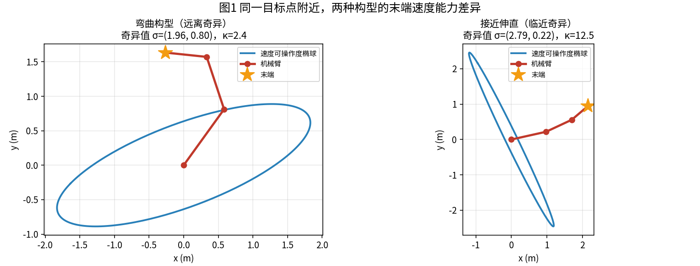
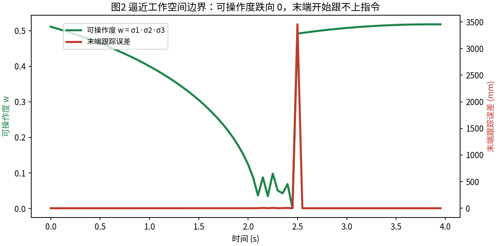
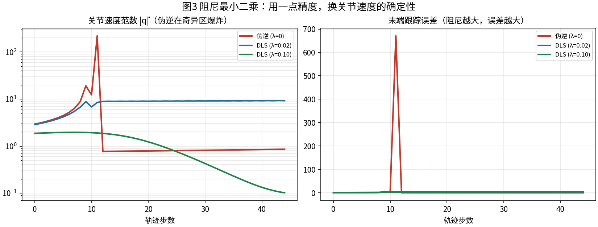
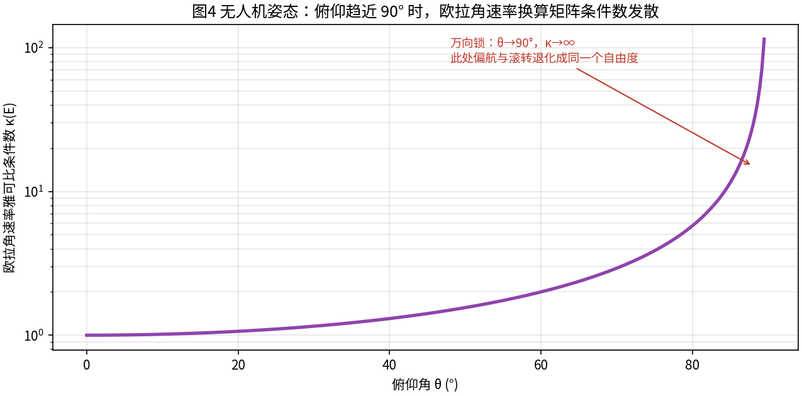

> 本文是「运动学与雅可比」系列第 1 篇（主线 L2）。前置阅读：[第 01 篇 SE(3) 位姿表示](01-se3-pose-representation.md)。配套代码：[`code/jacobian_demo.py`](https://github.com/SRrobot-ShiRui/Learning-Robotics-for-beginners/blob/main/code/jacobian_demo.py)，所有结论都可以用脚本复现，建议边读边跑。

## 直觉层

### 机器人每秒都在做一次"单位换算"

上位机里你写的是"末端以 0.2 m/s 沿 x 方向走"，电机收到的是"六个关节各转多少 rad/s"。这两套语言之间站着一个翻译官——**雅可比矩阵 J(q)**：

$$
\begin{bmatrix} v_x \\ v_y \\ v_z \\ \omega_x \\ \omega_y \\ \omega_z \end{bmatrix} = J(\boldsymbol{q})\, \dot{\boldsymbol{q}}
$$

左边是任务空间速度（笛卡尔），右边是关节空间速度，`J` 由当前构型 `q` 决定。第 01 篇讲过，位姿活在弯曲的 SE(3) 流形上；雅可比就是这张流形在当前点的**切平面坐标变换**——它回答的不是"末端在哪"，而是"此刻末端正往哪去、能往哪些方向去"。

这句话的分量在于：雅可比是**时变的**。机械臂伸直时和蜷缩时，是两张完全不同的翻译表。所有"机器人突然抽风"的故事，一半发生在翻译表换页的瞬间。

### 翻译有方向，且不可逆

`J` 是 6×n（n 为关节数）。对 6 关节机械臂它是方阵，理想情况下可以求逆——把末端期望速度除回去就得到关节速度，这就是**微分逆运动学**。但"理想情况"很少出现：

- **elbow 前机械臂只有 5 个关节**：6×5 的矩阵根本没有逆，某些方向的速度怎么都拼不出来；
- **冗余机械臂（7 关节）和人形机器人（30+ 自由度）**：矩阵是"胖"的，逆有无穷多解，需要挑选；
- **不管哪种臂，总有一些构型让 `J` 秩亏损**——那一刻，某个方向的速度在物理上就不存在。

所以工程师真正关心的从来不是 `J` 本身，而是三个问题：**它现在病得有多重（条件数）？哪个方向要失灵（奇异方向）？失效时控制律该怎么自保（阻尼）？**本文就按这个顺序展开。

## 进阶层

### 几何雅可比：三行代码的物理图像

对第 `i` 个转动关节（转轴 `z_i`，轴心位置 `o_i`），它单独转 `1 rad/s` 时给末端贡献的速度是：

$$
J_{v,i} = \boldsymbol{z}_i \times (\boldsymbol{p}_e - \boldsymbol{o}_i), \qquad J_{\omega,i} = \boldsymbol{z}_i
$$

直觉：把末端"钉"在距转轴 `r` 处绕轴转一圈，线速度就是 `ω × r`——叉积公式本身就是这句话。把每个关节的贡献按列摆好，就得到几何雅可比。平面 3R 臂的实现在下面"核心代码逐句精讲"一节，总共三行。

配套脚本验证 `[1]` 做了一件事：不推公式，直接用第 01 篇的 `log_se3` 对正运动学做 SE(3) 差分，200 组随机构型下与解析雅可比对比——

```
[1] 解析雅可比 vs 数值雅可比
    空间侧最大偏差 8.97e-07   本体侧最大偏差 1.20e-06
```

偏差量级就是差分步长 h=1e-6 的截断误差，两条路完全对上了。这次验证的价值在排查：如果你的解析雅可比和数值对不上，九成是**坐标系约定**错了（空间侧还是本体侧、`z` 轴朝向、角度是绝对角还是相对角），数值对照是最快的定位手段。

### 奇异性：翻译表缺页的那一刻

让平面 3R 臂（三段连杆 1.0 + 0.8 + 0.6 m）完全伸直，验证 `[2]`：

```
[2] J(全伸直) =
[[-0.    -0.    -0.  ]
 [ 2.4    1.4    0.6 ]
 [ 1.     1.     1.  ]]
    det(J) = 0.000e+00   rank = 2
```

第一行全零：三个关节无论怎么转，都只能给末端提供**垂直于臂方向**的速度。此时末端想沿臂的方向（径向）缩回来？物理上不存在这样的关节速度组合——就像站在悬崖边的人，无论双腿怎么摆动都不能再往悬崖外多走一寸。这就是**边界奇异**。



*图1：左图弯曲构型的速度椭球饱满（奇异值 1.96 / 0.80，条件数 2.4），各个方向"想去就能去"；右图接近伸直时椭球被压成一条竖线（2.79 / 0.22，条件数 12.5），径向能力几乎消失。数据来自 `code/jacobian_demo.py`。*

### 可操作度：给构型健康打分

椭球的形状由 `J` 的奇异值决定，工程上常用两个标量监控：

- **可操作度** `w = σ₁σ₂σ₃`（椭球体积）——越大越"灵活"；
- **条件数** `κ = σ₁/σ₃`（最扁方向与最胖方向之比）——越大越"偏科"。

验证 `[3]` 让末端以恒速直线逼近工作空间边界，两个指标同时塌方：

```
[3] 可操作度 w 从 0.746 降到 0.00131
    最小奇异值 min σ = 0.00001
    条件数峰值 κ_max = 240844.1
    末端跟踪误差 max = 272.76 mm
```



*图2：第 2 秒附近可操作度跌破 0.1，随后末端彻底跟不上指令——不是控制算法不够好，是那个方向的速度物理上不存在。数据来自 `code/jacobian_demo.py`。*

### 阻尼最小二乘：用一点精度换确定性

奇异区里最朴素的做法 `q̇ = J⁺v`（伪逆）会发生什么？验证 `[4]` 让末端沿直线走向近边界点，对比加阻尼前后的关节速度：

```
[4] 伪逆 λ=0      |q̇|峰值 = 510.362 rad/s   末端误差 = 2646.60 mm
    DLS λ=0.02    |q̇|峰值 =  11.199 rad/s   末端误差 =    9.47 mm
    DLS λ=0.10    |q̇|峰值 =   1.964 rad/s   末端误差 =    9.44 mm
```

伪逆在 σ→0 时把速度请求放大 `1/σ` 倍——真实机器人上这意味着电机瞬间饱和、减速器受冲击、控制器报"跟随误差超限"急停。**阻尼最小二乘（DLS）**在求逆时垫一个 `λ²`：

$$
\dot{\boldsymbol{q}} = J^{\mathsf T}\left(JJ^{\mathsf T} + \lambda^2 I\right)^{-1}\boldsymbol{v}
$$

λ 把奇异方向的传输增益从 `1/σ` 压到 `σ/(σ²+λ²)`，速度上界被锁死，代价是奇异方向上末端开始"跟不上"。注意验证 `[4]` 里两个 DLS 的末端误差全程被压在 10 mm 以内——这不是 DLS 更聪明，而是它主动放弃了奇异方向的分量：接近完全伸直时，**任何**逆解都变不出径向速度，误差下限由物理决定。工程上的正解是让规划器绕开奇异锥，或者用冗余自由度做自运动重构型（第 07 篇展开）。



*图3：左轴对数刻度。伪逆峰值 510 rad/s（现实中等于报废一次减速器）；DLS λ=0.02 峰值 11.2 rad/s，λ=0.10 峰值 2.0 rad/s。数据来自 `code/jacobian_demo.py`。*

## 核心代码逐句精讲

整个 `jacobian_demo.py` 里必须吃透的是两个函数：`jacobian_analytic`（几何雅可比）和 `dls_step`（阻尼逆解）。下面逐句拆解，建议对照[原文件](https://github.com/SRrobot-ShiRui/Learning-Robotics-for-beginners/blob/main/code/jacobian_demo.py)阅读。

**`fk` + `jacobian_analytic`：平面 3R 臂的正运动学与几何雅可比**

```python
def fk(q):                                   # (1)
    a1 = q[0]                                # (2)
    a2 = a1 + q[1]                           # (3)
    a3 = a2 + q[2]                           # (4)
    d1 = L[0] * np.array([np.cos(a1), np.sin(a1)])   # (5)
    d2 = L[1] * np.array([np.cos(a2), np.sin(a2)])   # (6)
    d3 = L[2] * np.array([np.cos(a3), np.sin(a3)])   # (7)
    j1 = np.zeros(2)                         # (8)
    j2 = j1 + d1                             # (9)
    j3 = j2 + d2                             # (10)
    p = j3 + d3                              # (11)
    joints = np.vstack([j1, j2, j3])         # (12)
    return joints, p, a3                     # (13)
```

- **(1)** 输入 `q` 是三个**相对关节角**（每个关节相对上一连杆的转角）——注意工业控制器日志里两种约定混用是常见事故源。
- **(2)–(4)** 把相对角累加成各连杆的**绝对朝向**。平面臂的朝向就是角度累加，三维臂里这一步对应旋转矩阵连乘。
- **(5)–(7)** 每段连杆的世界系位移向量：长度 × 方向。编写目的：把"连杆"变成可加的向量，后面所有位置都由这三个向量拼出。
- **(8)–(11)** 从基座原点出发逐段累加，得到三个关节轴心和末端位置。
- **(12)** 关节位置打包返回——雅可比的每一列都要用到"该关节离末端多远"，所以正运动学必须把中间关节位置也交出来。
- **(13)** 末端姿态角 `a3` 顺带返回，SE(3) 路线的数值验证要用。

```python
def jacobian_analytic(q):                    # (1)
    joints, p, _ = fk(q)                     # (2)
    J = np.zeros((3, 3))                     # (3)
    for i in range(3):                       # (4)
        J[0:2, i] = bracket2(p - joints[i])  # (5)
        J[2, i] = 1.0                        # (6)
    return J                                 # (7)
```

- **(1)** 输出 3×3：前两行是末端线速度 `(vx, vy)`，第三行是平面角速度 `ω`。
- **(2)** 一次性拿到关节位置和末端位置，避免重复算正运动学。
- **(5)** 几何雅可比的核心：`bracket2(r)` 实现二维叉积 `z × r = [-r_y, r_x]`，即"第 i 个关节转 1 rad/s，末端绕它画圆的线速度"。列 `i` 只取决于**关节 i 到末端的相对位置**——这就是为什么靠近末端的关节对线速度贡献小（力臂短）。
- **(6)** 平面问题里所有关节轴都平行于 z，每个关节转 1 rad/s 末端角速度就加 1，所以角速度行恒为全 1。（写这一行的目的：提醒你三维情形这里不是常数，而是各关节的轴向单位向量。）

**`dls_step`：阻尼最小二乘逆解**

```python
def dls_step(J, v, lam):                                 # (1)
    return J.T @ np.linalg.solve(                        # (2)
        J @ J.T + lam ** 2 * np.eye(J.shape[0]), v)      # (3)
```

- **(1)** 输入当前雅可比 `J`、期望末端速度 `v`、阻尼 `λ`。
- **(2)(3)** 实现 `q̇ = Jᵀ(JJᵀ + λ²I)⁻¹v`。编写目的有三层：(a) 奇异区把速度上界锁死（见上文分析）；(b) `JJᵀ` 是 3×3 而不是 `JᵀJ` 的 n×n——对 6×7 的冗余臂，前者永远小得多，实时循环里这是数量级的差距；(c) 用 `np.linalg.solve` 而不是先求逆再乘，数值上更稳也更快。

> 逐句讲解的完整原则与第 01 篇一致：核心函数逐行精讲、轨迹仿真函数 `track` 只讲结构（恒速指令 → 雅可比翻译 → 积分，10 ms 控制周期，就是工业机械臂笛卡尔速度控制的最小原型）、绘图与验证代码只讲结论。完整脚本见仓库。

## 三个真实场景

**1. 工业机械臂：涂胶与弧焊的"恒速"秘密。** 胶线质量直接取决于胶枪移动速度的稳定性——快了胶薄、慢了胶堆。所以点胶/涂胶/激光焊接工艺包的核心就是一个雅可比伺服环：任务空间恒速，雅可比实时翻译成六关节速度。而工艺工程师排轨迹时绕着"奇异锥"走（尤其是腕部奇异：三个腕关节轴共线的那一刻，末端姿态自由度塌掉一维），本质就是在躲 `κ` 的峰值。FANUC/ABB 控制器手册里"奇异点回避"选项，就是本文 DLS + 构型重构的商品名。

**2. 无人机：欧拉角速率雅可比与万向锁。** 飞控内环输出的是机体角速度 `(p, q, r)`，而姿态指令是 ZYX 欧拉角变化率，两者之间同样隔着一个雅可比 `E(φ,θ)`。验证 `[5]` 扫了俯仰角：

```
[5] 俯仰   0.0°  ->  κ(E) =    1.00
    俯仰  60.0°  ->  κ(E) =    3.73
    俯仰  80.0°  ->  κ(E) =   11.43
    俯仰  89.0°  ->  κ(E) =  114.59
    俯仰  90.0°  ->  κ(E) = 3.77e+16
```



*图4：条件数在 90° 附近发散——偏航与滚转退化成同一个自由度，这就是第 01 篇预告过的万向锁在速度层的样子。数据来自 `code/jacobian_demo.py`。*

穿越机做 90° 垂直机动（筋斗）时如果用欧拉角做外环，指令会在锁点附近疯狂震荡；成熟飞控（PX4/BetaFlight 的姿态环）全部改用四元数误差，就是在绕开这张病态的翻译表。

**3. 人形机器人：全身速度分配。** 人形机器人 30+ 自由度去追一个 6 维的躯干位姿 + 双手末端目标，`J` 又高又胖，逆解有无穷多。全身控制器（WBC）的做法是把多层任务堆成加权瀑布：躯干平衡 > 脚掌不滑 > 双手轨迹 > 姿态正则，每一层都靠自己的雅可比把任务速度翻译到关节空间，再用零空间投影保证底层任务不干扰上层。第 01 篇说"扰动模型为什么用右扰动"，本文补上另一半：**任务与关节之间所有的对话，都要过雅可比这座桥**。图1 的椭球在人形上同样成立——脚掌速度椭球被压扁的时候，就是它要滑倒的前一刻。

## 工程视角

- **把 κ 写进监控**：实时循环里每 100 ms 算一次 `σ_min` 和 `κ`，超过阈值（比如 κ > 50）就告警。你会发现"偶发的跟随误差超限"报警，十有八九对应着 κ 的尖峰。
- **速度饱和不是调参问题**：末端指令速度 × `J⁺` 得到的关节速度超出电机能力时，优先降任务速度，而不是硬扛——硬扛的后果是积分器 windup 和位置超调。
- **数值检查**：和第 01 篇一样，任何自研雅可比先过一遍"随机构型 vs 数值差分"再上线，本文验证 `[1]` 就是现成的模板。

## 延伸阅读

- 教材：Lynch & Park, *Modern Robotics*（第 5 章），几何雅可比与奇异性讲得最系统，免费 PDF 官方提供
- 论文：Nakamura & Watanabe 对冗余臂零空间行为的经典分析；Siciliano 等人 *Robotics: Modelling, Planning and Control* 第 3 章（DLS 与奇异性鲁棒逆的谱系）
- 下一篇（第 07 篇）：逆运动学——为什么机械臂会"抽风"：从迭代求逆到零空间自运动
- 配套代码：[`jacobian_demo.py`](https://github.com/SRrobot-ShiRui/Learning-Robotics-for-beginners/blob/main/code/jacobian_demo.py)，仅依赖 numpy/matplotlib，`--plot` 出图

**完整内容链接（多种逆解方案对比、边界压力测试与完整可用代码）**：<https://blog.csdn.net/2301_81238088/category_13220213.html>

**完整版每周二更新**，订阅后第一时间推送。
