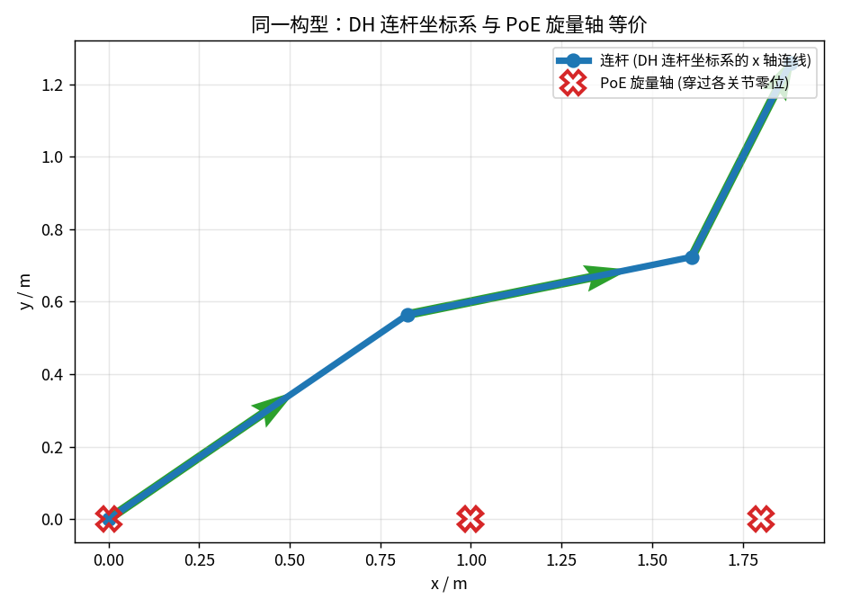
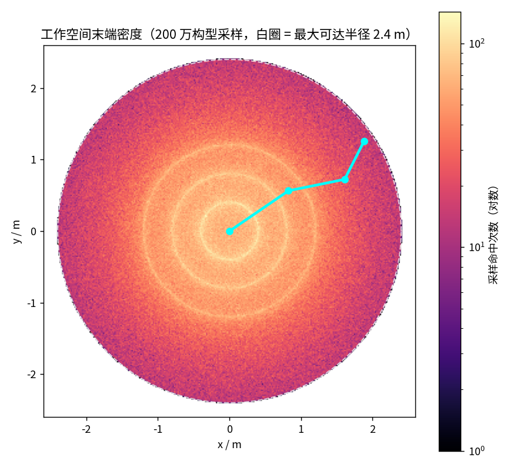

> 本文是「运动学」系列第 2 篇（主线 L2）。前置阅读：[第 01 篇 SE(3) 位姿表示](01-se3-pose-representation.md)、[第 04 篇 雅可比](04-jacobian-velocity-translator.md)。配套代码：[`code/fk_demo.py`](https://github.com/SRrobot-ShiRui/Learning-Robotics-for-beginners/blob/main/code/fk_demo.py)，文中所有验证数字都可用脚本复现。

## 直觉层

### 一个方向有公式，一个方向没有

机器人学里有两类问题长得很像，难度天差地别：

- **正运动学（FK）**：已知所有关节角 `q`，求末端在哪 —— **有闭式公式**，代入就算；
- **逆运动学（IK）**：已知末端想去哪，求关节角 —— 一般**没有**通用闭式解，只能数值迭代（下一篇的主题）。

为什么不对称？因为 FK 本质是**多项式求值**：连杆长度乘上 cos/sin 再累加，代入即得。IK 是**多项式求根**：把 FK 方程反着解，未知数躲在三角函数里，次数一高就没有求根公式。这个不对称决定了工程分工：FK 便宜到每个控制周期都算几千遍，IK 贵到要专门规划。

### 给连杆装坐标系，还是给关节装"旋转轴"

同一个 FK，业界有两套建模哲学：

| | **DH 参数**（Denavit–Hartenberg） | **PoE**（Product of Exponentials） |
|---|---|---|
| 核心动作 | 给每个连杆装一个坐标系，用 4 个参数描述相邻坐标系的关系 | 不装坐标系，把每个关节写成"绕一根固定的螺旋轴转 `q` 弧度" |
| 末端 | 4×4 齐次矩阵连乘 | 旋量矩阵的**指数积** |
| 生态 | 老教材（Craig）与多数机器人学课程 | Pinocchio、Drake 等现代库的底层 |

两套语言描述的是同一条臂，算出来的末端**必须**一模一样——这正是本文验证 `[V]` 要证明的事。理解"为什么等价"，比背任何一套参数表都重要。

## 进阶层

### DH：四个参数与那个经典的平移列陷阱

平面臂是 DH 的最简情形：每个关节只需 2 个参数——关节角 `θᵢ` 和连杆长 `aᵢ`（`d`、`α` 为零）。基本矩阵：

$$
A_i = R_z(\theta_i)\,T_x(a_i)
= \begin{bmatrix} \cos\theta_i & -\sin\theta_i & 0 & a_i\cos\theta_i \\ \sin\theta_i & \cos\theta_i & 0 & a_i\sin\theta_i \\ 0 & 0 & 1 & 0 \\ 0 & 0 & 0 & 1 \end{bmatrix}
$$

注意平移列是 `(aᵢcosθᵢ, aᵢsinθᵢ)`，**不是** `(aᵢ, 0, 0)`。这不是排版细节，是我本周写演示代码时真实踩到的坑：

> **踩坑实录**：第一版我把平移列写成了 `(a, 0, 0)`——直觉上"沿 x 平移 a"嘛。结果 DH 算出的末端和累计角公式差了 0.4 m。原因：矩阵 `Rz(θ)·Tx(a)` 作用在原点上，平移发生在**世界系**里，连杆永远指向世界 x 方向；而正确的 DH 里，连杆必须被当前关节的转角**一起旋转**，指向 `θ` 累计后的方向。一字之差，物理意义完全不同。

修正后，矩阵连乘 `A₁A₂A₃` 与"累计角"公式（每段连杆按 `q₁+…+qᵢ` 方向累加）严格相等——这就是 DH 的本质：**用坐标系语言把"连杆方向 = 转角累加"这件事写成了机械的矩阵乘法**。

### PoE：把每个关节写成一根指数

PoE 不给连杆装坐标系，只问一个问题：**第 i 个关节单独转 1 rad/s 时，整条臂怎么动？** 对绕 `z` 轴、穿过点 `oᵢ` 的转动关节，这根"螺旋轴"由 6 维旋量描述：

$$
\mathcal{S}_i = \begin{bmatrix} \omega \\ v \end{bmatrix}, \quad \omega = \begin{bmatrix} 0 \\ 0 \\ 1 \end{bmatrix}, \quad v = -\omega \times o_i
$$

`ω` 是转轴方向，`v` 编码"轴离原点多远"。关节转 `qᵢ` 弧度的贡献就是矩阵指数 `exp([Sᵢ]qᵢ)`，有闭式解（见下面代码 `(9)`–`(12)`）。整条臂的末端：

$$
T(q) = e^{[\mathcal{S}_1]q_1}\, e^{[\mathcal{S}_2]q_2}\, e^{[\mathcal{S}_3]q_3}\, M
$$

`M` 是零位（所有关节角为 0）时的末端位姿。三个指数从左往右乘，每个关节的旋量轴都写在**固定的基座系**里——这就是 PoE 最大的工程卖点：**换零位、改构型，旋量轴不变；而 DH 参数会跟着坐标系约定整表重算**。



*图1：同一条平面 3R 臂（连杆 1.0 + 0.8 + 0.6 m）、同一构型 `q=(0.60, -0.40, 0.90)`。绿色箭头是 DH 连杆坐标系的方向，红色叉号是 PoE 旋量轴与纸面的交点（即各关节零位位置）。两种语言，一条臂。数据来自 `code/fk_demo.py`。*

### 一致性验证：建模的第一道关

三种写法（累计角、DH 矩阵、PoE）在 500 组随机构型下对比：

```
[V] 500 组随机构型下 三种FK 末端位置最大互差 = 1.01e-15 m
[V] 示例构型 q=(0.60, -0.40, 0.90)
    累计角 末端 = [1.8815 1.2583]
    DH     末端 = [1.8815 1.2583]
    PoE    末端 = [1.8815 1.2583]
```

`1e-15` 就是浮点乘法的本底噪声——三条完全独立的实现路径收敛到同一个数。第 04 篇讲过"解析雅可比 vs 数值雅可比"的对照是排查手段，FK 这关同理：**任何新建模的臂，先跑这个一致性测试再谈别的**。对不上，九成是坐标系约定或平移列（见上文踩坑）。

FK 最直接的应用之一是把工作空间画出来。图2 是 200 万组随机构型的末端落点密度：



*图2：亮区 = 末端更常到达。外圈白虚线是最大可达半径 `L₁+L₂+L₃ = 2.4 m`；圆心附近最亮，因为折叠构型能从更多方向到达同一区域。青色折线是图1 的示例构型。数据来自 `code/fk_demo.py`。*

## 核心代码逐句精讲

从 [`fk_demo.py`](https://github.com/SRrobot-ShiRui/Learning-Robotics-for-beginners/blob/main/code/fk_demo.py) 里抽出最值得吃透的部分：DH 基本矩阵与旋量指数。

**`_dh`：DH 基本矩阵（平面情形）**

```python
def _dh(theta, a):                       # (1)
    c, s = np.cos(theta), np.sin(theta)  # (2)
    return np.array([[c, -s, 0, a * c],  # (3)
                     [s,  c, 0, a * s],  # (4)
                     [0,  0, 1,    0 ],  # (5)
                     [0,  0, 0,    1 ]]) # (6)
```

- **(1)** 输入：关节角 `θ`、连杆长 `a`（平面臂 `d=0, α=0`，四参数退化为二）。
- **(3)(4)** 平移列写的是 `a·cosθ, a·sinθ`——即 `Rz(θ)·Tx(a)` 的乘积结果。编写目的：保证连杆被当前关节转角旋转。写成 `(a, 0, 0)` 就复现本文开头的踩坑。
- **(3)–(6)** 上左 3×3 是旋转，末列是平移——齐次变换的标准布局。

**`_screw_exp` + `fk_poe`：PoE 的指数与连乘**

```python
def _screw_exp(S, th):                                   # (1)
    w, v = S[:3], S[3:]                                  # (2)
    R = _exp_rot(w, th)                                  # (3)
    G = (np.eye(3) * th                                  # (4)
         + (1 - np.cos(th)) * _skew(w)                   # (5)
         + (th - np.sin(th)) * _skew(w) @ _skew(w))      # (6)
    T = np.eye(4)                                        # (7)
    T[:3, :3] = R                                        # (8)
    T[:3, 3] = G @ v                                     # (9)
    return T                                             # (10)

def fk_poe(q):                                           # (11)
    T = np.eye(4)                                        # (12)
    for i in range(3):                                   # (13)
        T = T @ _screw_exp(_S[i], q[i])                  # (14)
    T = T @ _M                                           # (15)
    return T[0:2, 3]                                     # (16)
```

- **(2)** 旋量拆成角速度部分 `w` 与线速度部分 `v`。`v = -ω×oᵢ`（见 `_S` 的构造），编码关节轴的位置。
- **(3)** 转轴方向 `w` 的旋转部分：Rodrigues 公式（第 01 篇的 `exp_so3` 同源）。
- **(4)–(6)** 矩阵指数的平移部分闭式解 `G(θ)`：`θI + (1−cosθ)[ω]× + (θ−sinθ)[ω]ײ`。编写目的：避开数值积分/泰勒截断，一次算准。
- **(9)** 平移 = `G(θ)v`——线速度部分经"指数积分"变成位移。
- **(12)–(14)** 从单位阵出发，逐个左乘每个关节的指数——对应公式 `T = e^{[S₁]q₁}e^{[S₂]q₂}e^{[S₃]q₃}`。注意所有旋量轴 `_S` 都写在固定基座系里，与 `q` 无关。
- **(15)** 乘零位位姿 `M`（末端在零位时的位置），完成整条链。
- **(16)** 平面问题取 `x, y` 两行即末端位置。

> 逐句讲解原则与第 01/04 篇一致：核心函数逐行精讲，`fk_cum`（三行累加）与绘图、采样代码只讲结构。完整脚本见仓库，`--plot` 出图。

## 三个真实场景

**1. 工业机械臂标定：DH 参数表是资产。** 出厂说明书里的 DH 参数和真机总有偏差（装配误差、减速器柔顺、运输磕碰）。高精度工况（激光加工、航空制孔）要做**运动学标定**：用激光跟踪仪测一组末端真实位姿，反解修正 DH 参数。标定精度直接决定绝对定位精度——从 ±1 mm 级修到 ±0.1 mm 级是常规操作。而标定算法的第一步，就是实现一个参数化的 FK（本文的矩阵连乘就是原型），把"误差 = 测量位姿 − FK(q)"往零里压。

**2. 产线布局与选型：工作空间密度图。** 图2 这种 FK 采样图是产线工程师的日常工具：工件放哪个位姿可达？上下料口开在臂展的什么位置？两台臂的公共工作区会不会干涉？密度图比"最大臂展 2.4 m"这个单一数字有用得多——边界附近密度骤降（奇异区，第 04 篇讲过），实际可用的甜区在中等半径。选型时把候选型号各跑一遍采样，甜区大小一目了然。

**3. 人形机器人与多体链：为什么现代库用 PoE。** 人形机器人 30+ 自由度，每个 1 kHz 控制周期要做几十次全身 FK（状态估计、WBC 任务雅可比、碰撞检查各要一遍）。PoE 形式的 FK 对 `q` 求导最方便——速度级雅可比直接从旋量轴导出（第 04 篇的几何雅可比就是它的切片），不用对坐标系约定做符号微分。这就是 Pinocchio、Drake 把 PoE 做成底层的原因：**不是 PoE "更准"（三者都是 1e-15 一致），而是它对下游的求导、优化、自动微分最友好**。

## 工程视角

- **约定自查清单**：拿到任何一份 DH 表，先确认三件事——角度是相对角还是绝对角、`z` 轴朝向、`θ` 与 `d` 哪个是变量。第 04 篇的"雅可比对不上"事故，一大半根源在这三项。
- **平移列写法是 DH 实现的第一坑**：背下"平移列 = `a·(cosθ, sinθ)`"这个形状，看到 `(a, 0, 0)` 直接怀疑。
- **一致性测试是标准动作**：三种独立实现互查（本文 `[V]`），加上第 04 篇的解析/数值互查，构成运动学代码的最低验证组合。

## 延伸阅读

- 教材：Lynch & Park, *Modern Robotics* 第 3–4 章（PoE 的标准讲法，免费 PDF 官方提供）；Craig, *Introduction to Robotics* 第 3 章（经典 DH）
- 工具：Pinocchio（快速 rigid body dynamics 库，PoE 底层）、Drake
- 下一篇（第 08 篇）：逆运动学——数值 IK、阻尼最小二乘与冗余自由度的零空间
- 配套代码：[`fk_demo.py`](https://github.com/SRrobot-ShiRui/Learning-Robotics-for-beginners/blob/main/code/fk_demo.py)，仅依赖 numpy/matplotlib，`--plot` 出图

**完整内容链接（DH 完整四参数推导、PoE 指数闭式解全程推导与完整可用代码）**：<https://blog.csdn.net/2301_81238088/category_13220213.html>

**完整版每周二更新**，订阅后第一时间推送。
