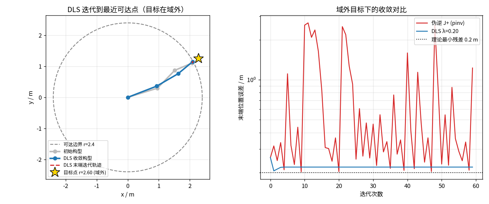
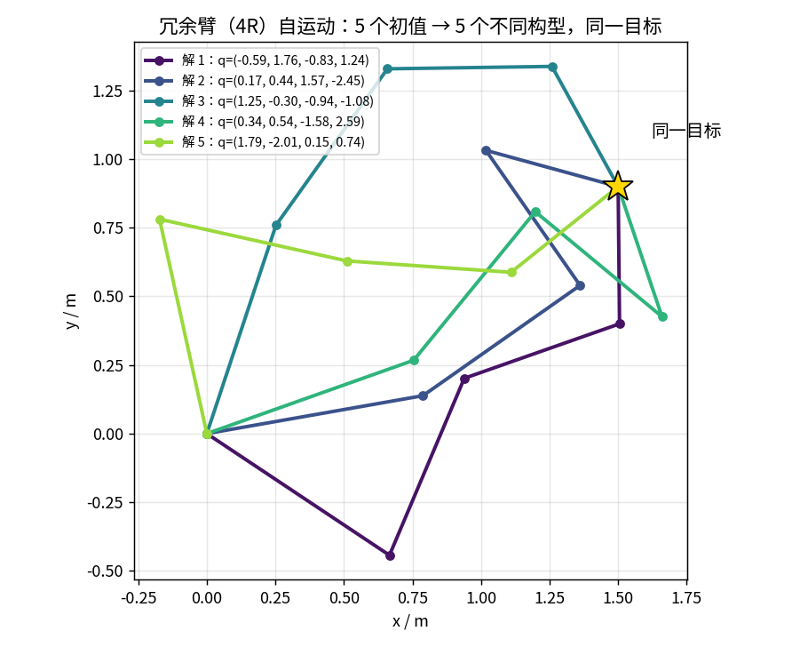

> 本文是「运动学」系列第 3 篇（主线 L2）。前置阅读：[第 04 篇 雅可比](04-jacobian-velocity-translator.md)（本文的数学底座）、[第 07 篇 正运动学](07-forward-kinematics-dh-poe.md)。配套代码：[`code/ik_demo.py`](https://github.com/SRrobot-ShiRui/Learning-Robotics-for-beginners/blob/main/code/ik_demo.py)，所有验证数字可用脚本复现。

## 直觉层

### 没有求根公式的"反查表"

第 07 篇说 FK 是多项式求值——代入就出结果。IK 反过来：给一个末端目标点，问每个关节该转多少。把 FK 方程反着解，未知数藏在 cos/sin 里，次数一高就没有求根公式。少数幸运情况（6 轴球腕机械臂到特定点位）有解析解，但每换一种构型就要重新推一遍公式——工业上叫"专用解"，换型号即作废。

**数值 IK** 是通用底座：不找公式，用迭代把误差磨下去。它的内核出奇地简单，一句话就能说完：

> 当前末端离目标还差 `e`，让雅可比（第 04 篇的"翻译官"）把这个误差翻译成关节修正量 `Δq = J⁺e`，走一步，重算，循环。

### 为什么会"抽风"

第 04 篇埋过钩子：机械臂"抽风"——关节速度瞬间爆炸、末端猛甩——多半发生在奇异区。位置级 IK 是同一堵墙的另一面：目标点接近工作空间边界时，`J` 病态，一步修正量的范数飙升；目标点在边界**外**时，误差永远压不到零，迭代器会在边界附近反复横跳，关节角越荡越远。本文用实验把这两种失效摆上台面，再给出工程上的自保手段（DLS）和富余自由度的正确用法（零空间）。

## 进阶层

### 牛顿法的骨架：雅可比伪逆迭代

把 IK 写成求根问题 `f(q) = FK(q) − p* = 0`。牛顿法每步沿"误差的负梯度方向"修正：

$$
\Delta q = J^{+}(q)\,\big(p^* - FK(q)\big), \qquad q \leftarrow q + \Delta q
$$

`J⁺` 是雅可比的伪逆（Moore–Penrose）。对非奇异方阵它就是普通逆；对病态或长方阵，它给出"最小范数意义下"的最优修正。配套脚本在 200 组随机可达目标上验证：

```
[1] 随机可达目标 200 组（r∈[0.2, 2.2]）
    伪逆迭代收敛 200/200   平均迭代 7.2 次   中位迭代 7 次
```

远离边界时，7 次左右就把毫米级误差磨到 1e-6 m——这就是牛顿法的二次收敛威力。**每次迭代的成本 = 一次 FK + 一次雅可比 + 一次小矩阵求逆**，对 6 关节臂是微秒级，实时规划毫无压力。

### 目标在域外：伪逆会怎么死

把目标放到最大可达半径（2.4 m）之外，`r = 2.6`：

```
[2] 不可达目标 r=2.60（最大可达半径 2.40，理论最小残差 0.20 m）
    伪逆        200 次迭代后误差 1.26 m   峰值误差 3.91 m   |q| 漂移至 616 rad
    DLS λ=0.20  200 次迭代后误差 0.22 m   峰值误差 0.26 m   |q| 漂移至 0.37 rad
```

伪逆的表现值得逐行读：

- **误差永远压不到 0.20 m 以下**——这不是算法不行，是物理不行：臂最长 2.4 m，目标在 2.6 m 处，残差下限就是 0.2 m；
- **误差曲线剧烈振荡**（图1 右）：臂伸直逼近边界 → 病态的 `J` 给出过冲的修正 → 缩回来 → 再伸直，来回打摆；
- **关节角漂到 616 rad**——折合 98 圈。真实机器人上，这意味着电机饱和、减速器冲击、控制器急停。仿真里没有上限的关节变量，真机上就是报废。



*图1：左图——灰色虚线是可达边界 r=2.4，金色星是域外目标 r=2.6，蓝色构型是 DLS 收敛结果：臂伸到边界上离目标最近的点就停住。右图（对数轴）——红色伪逆曲线在 0.2 m 线上方反复振荡，蓝色 DLS 曲线五步内贴住理论最小残差。数据来自 `code/ik_demo.py`。*

### DLS：给修正量上一道保险

阻尼最小二乘把伪逆换成：

$$
\Delta q = J^{\mathsf T}\left(JJ^{\mathsf T} + \lambda^2 I\right)^{-1} e
$$

第 04 篇在速度层讲过它的机理：`λ` 把病态方向的传输增益从 `1/σ` 压到 `σ/(σ²+λ²)`。位置层的故事一模一样——**目标不可达时，"该放弃的分量"就是指向外界的径向方向**，DLS 主动把它砍掉，只保留边界上的切向修正。验证 `[2]` 里 λ=0.20 的 DLS 五步内贴住 0.22 m（理论下限 0.2 m），关节角全程有界（|q| ≤ 0.37 rad，构型几乎没动）。

λ 的取法是工程权衡：λ 越大越稳但收敛越慢，越小越快但接近伪逆。常见做法是**自适应阻尼**——离边界远时用小 λ 保速度，`σ_min` 跌破阈值才加大 λ。

### 冗余自由度：无穷多解与零空间

3R 平面臂追 2 维位置目标，解是孤立的几组（肘上/肘下）。换成 4R 臂（图2），自由度多了 2 个，同一个目标对应**无穷多构型**——迭代器从哪个初值出发，就收敛到哪个解：



*图2：金色星是同一目标点 (1.5, 0.9)，五条彩色臂是五个不同初值收敛出的解，末端误差全部小于 1e-6 m。肘的姿态各不相同——这就是自运动流形。数据来自 `code/ik_demo.py`。*

这些"多余"的自由度不是负担，是资源。零空间投影 `Δq₀ = (I − J⁺J)z` 可以在**不干扰末端**的前提下让肘部自己挪位：人形机器人走路时上身摆动、双臂机械臂焊接时避开夹具、手术机器人保持末端稳定同时给肘让路，全是这一项在起作用。

## 核心代码逐句精讲

[`ik_demo.py`](https://github.com/SRrobot-ShiRui/Learning-Robotics-for-beginners/blob/main/code/ik_demo.py) 的核心是这十几行迭代器：

```python
def ik(q0, target, L, lam=0.0, iters=200, tol=1e-6):     # (1)
    q = np.array(q0, float)                              # (2)
    errs = []                                            # (3)
    for k in range(iters):                               # (4)
        e = np.asarray(target) - fk(q, L)                # (5)
        errs.append(np.linalg.norm(e))                   # (6)
        if errs[-1] < tol:                               # (7)
            break                                        # (8)
        J = jac(q, L)                                    # (9)
        if lam > 0:                                      # (10)
            dq = J.T @ np.linalg.solve(                  # (11)
                J @ J.T + lam ** 2 * np.eye(2), e)       # (12)
        else:                                            # (13)
            dq = np.linalg.pinv(J) @ e                   # (14)
        q = q + dq                                       # (15)
    return q, errs, len(errs)                            # (16)
```

- **(1)** 输入：初值 `q0`（IK 的解取决于它，见冗余一节）、目标点 `target`、连杆长 `L`、阻尼 `λ`、迭代上限与收敛阈值。编写目的：`λ=0` 时退化为纯伪逆，方便同一个函数做两组实验。
- **(5)** 误差向量 `e = 目标 − 当前末端`。注意方向：是"还差多少"，不是"错了多少"——符号反了迭代会发散，这是 IK 实现最常见的低级错误。
- **(6)(7)(8)** 记录误差并按阈值提前退出。编写目的：实时系统里迭代次数就是延迟，够用即停。
- **(9)** 当前构型的雅可比——第 04 篇的 `jac`，几何列 `z × (p_ee − oᵢ)`。
- **(11)(12)** DLS：等价于公式 `Δq = Jᵀ(JJᵀ + λ²I)⁻¹e`。用 `np.linalg.solve` 而不是先求逆再乘——数值更稳，且 `JJᵀ` 是 2×2 小矩阵。
- **(14)** 纯伪逆分支 `J⁺ = (JᵀJ)⁻¹Jᵀ`，由 `np.linalg.pinv` 用 SVD 实现，对病态矩阵给出最小范数解。
- **(15)** 更新。步长就是全部修正量——没有学习率，因为牛顿法自带步长；若目标远离线性区，可以乘一个 `α∈(0,1]` 做阻尼步长（工程上称"line search 的丐版"）。
- **(16)** 返回解、误差轨迹（画图用）、实际迭代次数（性能评估用）。

> 逐句讲解原则与第 01/04/07 篇一致：核心迭代器逐行精讲，`fk/jac/joints` 复用第 04 篇已精讲的实现，`verify` 与绘图代码只讲结论。完整脚本见仓库。

## 三个真实场景

**1. 工业机械臂：轨迹规划里的"逐点 IK + 奇异检查"。** 离线编程（RobotStudio、RoboGuide）把笛卡尔路径离散成一串末端位姿，逐点求 IK。工程要点有二：一是**初值连续性**——上一个点的解作为下一个点的初值，保证解在同一个分支上，末端姿态不跳变；二是**每点算 `σ_min`/`κ`**（第 04 篇的监控指标），逼近阈值就回报"此路径穿奇异区"，让工艺工程师改路径而不是等机器人在线抽风。

**2. 人形机器人：零空间让"顺便的事"不干扰主线。** 人形双臂 12+ 自由度去追双手 6 维目标，富余自由度用来做什么？头部摄像头保持对准目标、肘部避开躯干、整机质心不越界——这些次级任务全部通过零空间投影叠加在主任务上，优先级层层递降。第 04 篇的 WBC 任务瀑布，落到位置层就是这个结构：**主任务保收敛，零空间保体面**。

**3. 图形与数字人：同一套数学，毫秒级预算。** 游戏/影视里的角色手指、Kubernetes 集群里跑的数字人直播，IK 要在 16 ms 帧预算内对几十个角色各解一遍。这个领域的迭代 IK 普遍用 CCD/FABRIK 等启发式（收敛更快但精度低），而机器人界坚持雅可比法——因为我们要的不只是"到位"，还有全程可控的关节速度与力矩。工具链不同，数学底座相同。

## 工程视角

- **初值即分支**：IK 解不唯一，"解跳变"事故几乎都是初值选错分支。流水线上永远用上一点解做初值。
- **先判断可达再迭代**：目标半径超过臂展直接报"不可达"，别让迭代器替你发现——伪逆会用 616 rad 的关节漂移替你发现。
- **监控迭代次数**：平均迭代次数突然翻倍，往往意味着工作区边缘或雅可比病态，是比"最终误差"更早的预警信号。

## 延伸阅读

- 教材：Siciliano 等，*Robotics: Modelling, Planning and Control* 第 3 章（数值 IK 谱系与奇异性鲁棒逆）；Lynch & Park, *Modern Robotics* 第 6 章（IK 与零空间）
- 下一篇（第 09 篇）：强化学习做人形运动控制——从仿真到真机的 gap 清单
- 配套代码：[`ik_demo.py`](https://github.com/SRrobot-ShiRui/Learning-Robotics-for-beginners/blob/main/code/ik_demo.py)，仅依赖 numpy/matplotlib，`--plot` 出图

**完整内容链接（自适应阻尼实现、零空间任务叠加完整代码、多目标 IK 稳定性压测）**：<https://blog.csdn.net/2301_81238088/category_13220213.html>

**完整版每周二更新**，订阅后第一时间推送。
