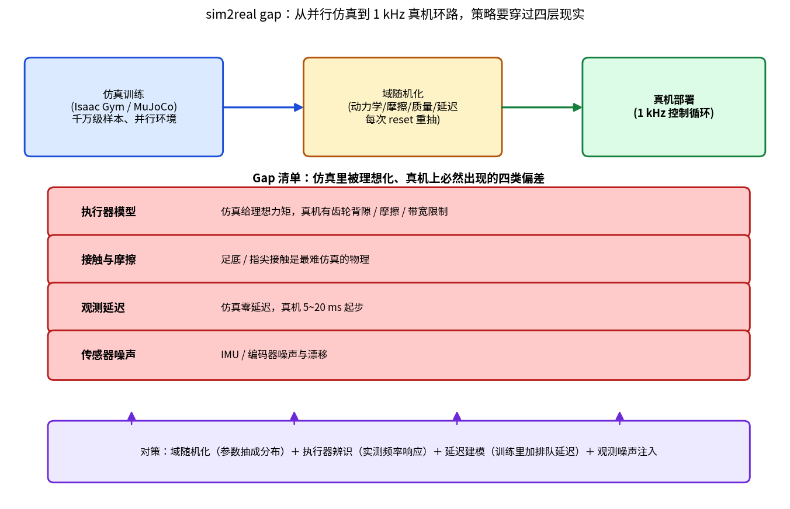

> 本文是「具身智能」前沿篇（主线 M8），与理论线[第 04 篇雅可比](04-jacobian-velocity-translator.md)、[第 08 篇逆运动学](08-inverse-kinematics-dls.md)互补：那两篇讲"用模型算动作"，本文讲"用数据学动作"。文中引用均为公开论文与公开报道。

## 一个所有的团队都经历过的下午

仿真演示视频里，那台人形机器人后空翻落地、稳稳站住，弹幕刷"未来已来"。团队把同一个策略权重加载到真机上，按下使能——机器人抖了两下，向左一歪，保护电路把它按坐在地。全程不到三秒。

这不是某一次事故，这是**过去几年里几乎所有做强化学习运动控制的团队都经历过的下午**。同一个神经网络，在仿真里能连续跑几百万步不摔，上真机活不过三秒——这中间的距离，行业里有个名字：**sim2real gap（仿真到现实的鸿沟）**。

本文不聊玄学，把这条鸿沟拆成四层，一层一层看它为什么存在、怎么量、怎么填。

## 为什么非要在仿真里训练

先回答前置问题：为什么不直接在真机上试错？

强化学习的本质是海量试错。让一个策略学会走路，通常要积累**数亿步**的经验。按真机 1 kHz 控制循环硬跑，一天 8640 万步——听着够用？但真机不能摔：每次摔倒后复位要人工参与，电机和减速器有寿命，一轮实验下来机身先散架。而 GPU 并行仿真（Isaac Gym 一类）能在一张显卡上同时跑上万个环境，**几小时内烧完数亿步**。

所以流程必然是：仿真里练 → 真机上用。中间隔着的那道墙，就是 gap。

*图1：策略从并行仿真到 1 kHz 真机环路要穿过的四层现实偏差，以及对应的工程对策。*

## Gap 清单：四层被理想化的现实

### 第一层：执行器——最大的坑

仿真器默认的关节是"理想执行器"：给多少力矩就出多少力矩，瞬时响应，没有摩擦。真机呢？力矩要经过减速器、轴承、连杆才能到达关节，途中被摩擦吃掉一部分、被齿隙抖一下、被电机带宽限个顶。

这条 gap 有个经典解法值得一提：ETH 苏黎世 Hutter 团队发现，谐波减速器的力矩输出对关节位置、速度和温度的响应**很难写出干净的第一性模型**，干脆训练一个小网络（**执行器网络**）从真机数据里学"给定指令 → 实际输出力矩"的映射，再把这个网络塞进仿真循环（发表于 *Science Robotics* 2020，ANYmal 平台）。用网络学执行器、用 RL 学策略，两层网络叠起来，真机成功率上了一个大台阶。这是"仿真不真实的地方，就用数据把那块补真实"的教科书案例。

### 第二层：接触与摩擦

行走、奔跑、单脚站立，所有腿式技能的核心都是**足底与地面的接触**。而接触恰恰是物理仿真里最病态的部分：接触点的数量和位置随毫秒级变化，摩擦从静摩擦滑到动摩擦是非光滑突变。仿真器只能选一种近似模型，而每种近似在真机上都对不上。

对运动控制来说，这一层的最常见症状是**真机上打滑**：仿真里抓地完美的步态，上真机在光滑地面上原地劈叉。域随机化（见下文）对此的缓解方式是"不追求精确仿真摩擦，而是让策略见过 0.3 到 1.0 的各种摩擦系数"。

### 第三层：观测延迟

仿真的观测是" instantaneous "的：策略在第 k 步看到的传感器读数就是第 k 步的。真机链路上，IMU 采样、总线传输、策略推理、指令下发，每一环都排队——**端到端延迟 5~20 ms 起步**，对 1 kHz 控制环这不是小数。延迟让策略看到的是"过去的世界"，控制的是"未来的身体"，相位一错，本来稳定的步态也会被自己脚下的滞后推倒。

对策是把延迟**建模进训练**：在仿真里人为插入等价的排队延迟和动作延迟，让策略在训练时就学会带着滞后打准。

### 第四层：传感器噪声

仿真里的关节编码器是无限精度的。真机的 IMU 有零偏漂移，编码器有量化噪声，还可能被电机的高频干扰打出毛刺。策略如果在"完美观测"上训练，会把决策边界贴得极窄——真机上一点噪声就翻过界。

对策同样直接：**观测噪声注入**，训练时给每条观测加上 realistic 幅度的噪声。

## 对策的核心：域随机化一句话

四层 gap，主对策是同一个思想——**域随机化（Domain Randomization）**：

> 不再把仿真参数当成确定值，而是每次环境重置时从分布里抽：质量 ±20%、摩擦 0.3~1.0、电机强度 ±10%、延迟 0~20 ms、观测加噪……策略在千万个"略有不同的物理世界"里训练，被迫学出对参数摄动不敏感的动作。

直觉版本：与其教一个学生走一条独木桥，不如把他扔到一百座略有差异的桥上练——真桥只是第一百零一座。这个思想最早在操作领域被 OpenAI 的 Dactyl（灵巧手转魔方，2018 公开报道）验证到极致：靠大规模域随机化，仿真训练的策略零微调直接上真手。对腿式与全尺寸人形，ETH 团队 2019 年在 *Science Robotics* 的工作（ANYmal 域随机化步态）是运动控制侧的标杆：真机上盲走通过碎石与斜坡，步态在室外环境里连续工作数小时。

**域随机化的本质是拿"仿真的便宜"换"分布的鲁棒"**：单次仿真更不精确了，但策略学到的是分布上的期望行为，而不是对某个特定参数向量的过拟合。

## Gap 有大有小：任务决定难度

值得强调的是，gap 不是均匀的：

- **腿式运动**（稀疏、低维接触）是 sim2real 最成功的领域——今天市售四足机器人几乎清一色 RL 步态，人形机器人的行走、奔跑、后空翻同样来自这条管线；
- **灵巧操作**（富接触、多接触点切换）仍然困难——第 03 篇讲过叠衣服的四死结，其中"接触状态爆炸"这一条，域随机化只能缓解、无法根除。手内操作（in-hand manipulation）依然是 gap 最陡的地方。

所以看到"RL 让机器人学会 X"的新闻，先问一句：**X 的接触有多富？** 这一个判据就能过滤大半营销话术。

## 工程视角：上真机前的检查清单

1. **执行器建模**：理想力矩换成实测频率响应模型或执行器网络——这一条通常是收益最大的一项；
2. **随机化范围有依据**：每个参数的随机区间应对应真机实测的参数散布（不同样机、不同温度），拍脑袋的 ±50% 只会教出保守到废的策略；
3. **延迟注入**：训练管线里加与真机链路等价的延迟，别让策略在零延迟世界练成；
4. **观测噪声**：给每条观测加实测幅度的噪声；
5. **上线分级**：先低增益空载跑，再带载、再全速——策略输入里的"模式开关"比真机上的急停便宜得多；
6. **回放与监控**：真机上每秒记录观测-动作对，摔了能回放，gap 大了能定位到哪一层。

## 延伸阅读

- Hwangbo 等，*Science Robotics* 2020：执行器网络 + RL 的 ANYmal 步态（sim2real 运动控制里程碑）
- Lee 等，*Science Robotics* 2020：四足盲走复杂地形（域随机化 + 特征蒸馏）
- Rudin 等，2021："Learning to Walk in Minutes"，GPU 大规模并行训练范式
- OpenAI Dactyl（2018 公开报道）：域随机化在灵巧操作上的极限测试
- 本专栏相关：[第 03 篇 为什么机器人还不会叠衣服](03-why-robots-cannot-fold-clothes.md)（富接触操作为什么难）、[第 04 篇 雅可比](04-jacobian-velocity-translator.md)（模型方法这一侧）
- 配套图：`figs/fig09-01-sim2real-gap.png`

**完整内容链接（四层 gap 的量化实验复现、延迟注入训练的完整代码、执行器网络数据采集方案）**：<https://blog.csdn.net/2301_81238088/category_13220213.html>

**完整版每周二更新**，订阅后第一时间推送。
