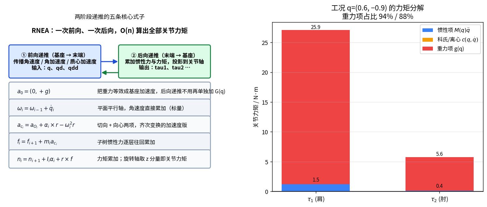
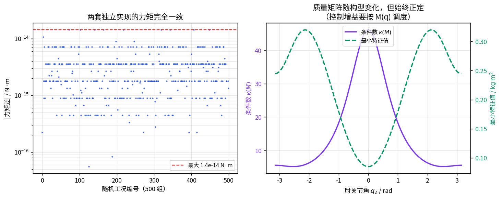
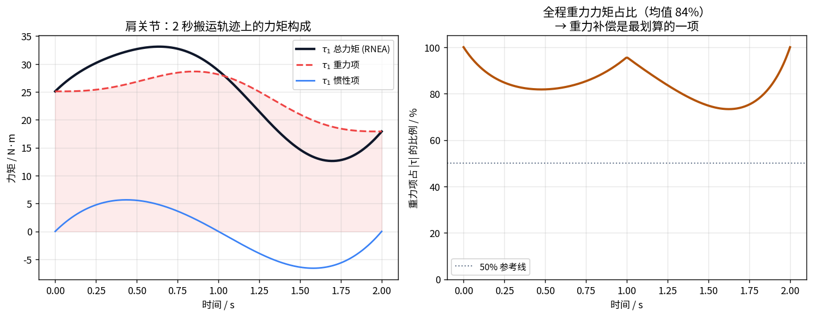

> **一句话结论**：逆动力学要回答的是「关节该输出多大力矩，才能完成这个动作」，RNEA（递归牛顿-欧拉算法）用一次从基座到末端的前向递推传播运动、一次从末端回基座的后向递推累加受力，把复杂度从显式组装质量矩阵的 O(n²) 降到 O(n)，因此成为几乎所有机器人动力学库的默认实现。

> 本文是「动力学」系列第 1 篇（主线 M3）。前置阅读：[第 07 篇 正运动学](07-forward-kinematics-dh-poe.md)、[第 08 篇 逆运动学](08-inverse-kinematics-dls.md)——运动学只管「怎么动」，动力学管「要用多大力」。配套代码：[`code/rnea_demo.py`](https://github.com/SRrobot-ShiRui/Learning-Robotics-for-beginners/blob/main/code/rnea_demo.py)，仅依赖 numpy/matplotlib，文中全部数字可用 `--plot` 复现。

## 直觉层

### 端起一杯水时，你的肩膀在算什么

把手臂伸出去端一杯满的水，停在半空。看起来很安静，其实肩关节的肌肉一直在输出力矩：它要抵消**整条手臂加杯子的重力**。现在快速把手臂往前一送——你会感觉肩膀「更沉」了一下，那是额外的**惯性力矩**；再快速画个圈，杯子里水会晃，那是**科氏力和离心力**在作怪。

机器人没有肌肉，它靠电机输出关节力矩 `τ`。控制器每个周期都要回答同一个问题：

> 已知当前关节角 `q`、角速度 `q̇`、想要的角加速度 `q̈`，各关节该给多大力矩 `τ`？

这就是**逆动力学（inverse dynamics）**。教材上的标准答案写成一行：

$$\tau = M(q)\,\ddot q + c(q,\dot q) + g(q)$$

- `M(q)`：**质量矩阵**（也叫惯性矩阵），描述「这个构型下加速有多费劲」；
- `c(q,q̇)`：**科氏力与离心力**项，来自连杆之间的相对转动；
- `g(q)`：**重力**项。

三项里，重力项往往最大——后面你会在实测数据里看到，一条 2 秒的搬运轨迹上，重力力矩平均占全部力矩幅度的 **84%**。这也解释了为什么工业机械臂最基础的一项功能叫「重力补偿」：先把这 84% 老老实实补上，剩下的控制问题才谈得上精度。

### 为什么不能只把三项算出来相加

对 2 个关节，把 `M`、`c`、`g` 用符号推导出来是本科习题难度。但真实机械臂有 6 个关节，人形机器人全身有 30~50 个自由度：`M` 是 50×50 矩阵，`c` 的每一项都是几百个三角函数的组合。显式推导再代入，公式会长到无法维护，也没法在 1 kHz 的控制周期里算完。

更麻烦的是，**`M(q)` 随构型变化**。伸直手臂和弯曲手臂，同一个关节加速起来的「费劲程度」完全不同。控制器如果按固定增益设计，就会在某些姿势下发飘、在另一些姿势下振荡——这是很多机械臂「调好了又不对」的根源。

RNEA 的思路很朴素：**不去推导那条巨型公式，而是顺着连杆的物理结构，把力和运动一层一层递推出来**。

## 进阶层

### 两阶段递推：前向传播运动，后向累加受力



**前向递推（基座 → 末端）**：从已知的基座运动出发，逐根连杆算出角速度、角加速度和质心线加速度。平面 2R 臂所有转轴平行，角速度直接累加：

$$\omega_i = \sum_{k \le i} \dot q_k, \qquad \alpha_i = \sum_{k \le i} \ddot q_k$$

质心加速度是刚体运动学的标准结果——切向项加向心项：

$$a_{c_i} = a_{O_i} + \alpha_i \times r_{O_i c_i} - \omega_i^2\, r_{O_i c_i}$$

**后向递推（末端 → 基座）**：从末端连杆开始，把「这根连杆及其下游所有连杆」当成一个整体，累加它需要的惯性力和惯性力矩：

$$f_i = f_{i+1} + m_i a_{c_i}, \qquad n_i = n_{i+1} + I_i\alpha_i + r_{O_i c_i}\times (m_i a_{c_i}) + r_{O_i O_{i+1}}\times f_{i+1}$$

最后把力矩投影到关节转轴上，就是该关节要输出的 `τ_i`。整个过程每根连杆只访问两次，**复杂度 O(n)**。

### 一个漂亮的技巧：把重力塞进基座加速度

注意上面的递推里**没有出现重力项 `g(q)`**。这不是遗漏，而是 RNEA 最常用的工程技巧：

> 把基座看成正以 `a₀ = (0, +9.81) m/s²` 向上加速（等效于重力场反向），这个加速度会随前向递推自动传播到每根连杆的 `a_c` 里，后向递推算惯性力时，重力就被「免费」算进去了。

好处是代码里完全没有单独的重力分支，换重力方向、换月球重力、甚至换到加速运动的移动底座上（比如装在 AGV 上的机械臂），只改 `a₀` 一行即可。我们脚本实测 `q=(0.6, −0.9)` 静止悬停（`q̇=q̈=0`）时，RNEA 输出 `(25.8645, 5.6231) N·m`，与独立推导的解析重力项 `(25.8645, 5.6231) N·m` 完全一致——重力确实被递推自动带出来了。

## 代码：逐句实现 RNEA

下面是 `rnea_demo.py` 的核心函数，逐句解释。**每一行只做一件事**，这是这篇代码最重要的编写原则：递推算法的正确性全靠「这一步的输入是上一步的输出」这种可追溯性，一旦把多行压缩成一行矩阵魔法，出错时根本没法定位是哪根连杆算错了。

```python
def rnea(q, qd, qdd, with_gravity=True):                       # (1)
    q = np.asarray(q, float)                                    # (2)
    qd = np.asarray(qd, float)
    qdd = np.asarray(qdd, float)

    p_O = [np.zeros(2)]                                        # (3)
    p_O.append(L1 * np.array([np.cos(q[0]), np.sin(q[0])]))
    p_c = [L1 / 2 * np.array([np.cos(q[0]), np.sin(q[0])])]
    p_c.append(p_O[1] + L2 / 2 * np.array(
        [np.cos(q[0] + q[1]), np.sin(q[0] + q[1])]))

    w = [qd[0], qd[0] + qd[1]]                                  # (4)
    al = [qdd[0], qdd[0] + qdd[1]]
    a_O0 = np.array([0.0, G]) if with_gravity else np.zeros(2) # (5)

    r_O1O2 = p_O[1] - p_O[0]                                   # (6)
    a_O1 = a_O0
    a_O2 = a_O1 + al[0] * np.array([-r_O1O2[1], r_O1O2[0]]) \
           - w[0] ** 2 * r_O1O2
    a_O = [a_O1, a_O2]
    a_c = []                                                    # (7)
    for i in range(2):
        r = p_c[i] - p_O[i]
        a_c.append(a_O[i] + al[i] * np.array([-r[1], r[0]])
                   - w[i] ** 2 * r)

    mass = [M1, M2]                                             # (8)
    inertia = [I1, I2]
    f_next = np.zeros(2)
    n_next = 0.0
    tau = np.zeros(2)
    for i in (1, 0):                                            # (9)
        mi_aci = mass[i] * a_c[i]
        f_i = f_next + mi_aci                                  # (10)
        lever_next = (p_O[i + 1] - p_O[i]) if i + 1 < len(p_O) \
                     else np.zeros(2)
        n_i = (n_next + inertia[i] * al[i]                     # (11)
               + cross2(p_c[i] - p_O[i], mi_aci)
               + cross2(lever_next, f_next))
        tau[i] = n_i                                            # (12)
        f_next, n_next = f_i, n_i                               # (13)
    return tau                                                  # (14)
```

**逐句讲解**

- **(1) 接口设计**：输入是三个长度 2 的序列（位置 / 速度 / 加速度），输出长度 2 的力矩。刻意做成「无状态纯函数」——不缓存、不依赖对象内部状态，这样可以在任何优化循环里被反复调用，也方便做数值差分。`with_gravity` 是为了验证时能关掉重力。
- **(2) 强制转 float 数组**：调用方可能传 int、list、numpy 行向量，`np.asarray(..., float)` 统一成浮点数组，避免整数除法 / 类型提升带来的隐蔽 bug。
- **(3) 几何量**：`p_O[i]` 是第 i+1 个关节原点，`p_c[i]` 是第 i+1 根连杆质心。这里用正运动学（第 07 篇）算出各点位置——**动力学永远站在运动学的肩膀上**。质心取连杆中点，是因为均质细杆假设。
- **(4) 角速度 / 角加速度**：平面平行轴，直接累加即 `ω_i`。写成列表而非逐个变量，是为了让后面 `for i in range(2)` 能统一索引；这也是把 2 连杆推广到 n 连杆时唯一需要改的地方之一。
- **(5) 重力等效**：`a_O0 = (0, +G)` 就是前面说的「基座向上加速」技巧。关掉重力时置零，验证对比用。
- **(6) 关节 2 的线加速度**：`np.array([-r[1], r[0]])` 是二维的 `α × r`（z 方向角加速度叉乘平面向量）。`- w[0]**2 * r` 是向心项。这两项一个都不能少，少了任何一项，高速运动时力矩就会错。
- **(7) 质心加速度循环**：对每根连杆，用「关节原点加速度 + 相对质心的切向项 + 向心项」得到 `a_c[i]`。写成循环而不是复制两遍，是为了让 2 连杆和 n 连杆的代码形状一致。
- **(8) 后向递推初始化**：`f_next` / `n_next` 代表「末端之外的力/力矩」，物理上末端自由，所以都是 0。`tau` 预先分配，避免循环里动态拼接。
- **(9) 倒序遍历 `(1, 0)`**：这是后向递推的关键——**必须从末端往回算**，因为第 i 根连杆要用到第 i+1 根传下来的 `f_next`。
- **(10) 力累加**：`f_i = f_{i+1} + m_i a_c_i`，把子树惯性力逐层往回累加。
- **(11) 力矩累加**：三项分别是下游力矩、自身转动惯性矩 `I_i α_i`、质心惯性力对关节的矩，以及下游传来的力对本关节的矩。`cross2` 是二维叉积的 z 分量 `u_x v_y − u_y v_x`。
- **(12) 投影取矩**：转轴是 z 方向，所以力矩的 z 分量直接就是关节力矩，无需再点乘轴向量（若是三维任意轴，这里要补一次 `dot(axis, n_i)`）。
- **(13) 状态传递**：把当前层的 `f_i / n_i` 交给上一层，递推得以继续。
- **(14) 返回**：一次前向、一次后向，`τ` 全部算出。

**编写目的（为什么这样写）**：这段代码面对的约束不是「跑得快」，而是**「可验证、可推广、可教学」**。所以刻意用显式的列表和循环、每根连杆一行、不做向量化魔法；真实库（Pinocchio、RBDL）会用空间向量代数（Spatial Vector）把同样六行压成两次矩阵乘，快一个量级，但读起来是另一门语言。本文的目标是让读者能拿着这份代码去对数、去改成 3 连杆、去换成任意重力方向——**先让递推结构看得见，再谈优化**。

## 数值验证：这套递推到底对不对

代码里另外用能量法独立推导了拉格朗日解析式（与本递推完全不共用中间量），做了 5 组交叉验证：

| 验证 | 结果 |
|---|---|
| 随机 2000 组 `(q, q̇, q̈)`，RNEA vs 解析式 | 最大绝对误差 **1.42e-14 N·m** |
| 由 RNEA 提取 `M(q)` 与解析 `M` 对比 | 误差 3.11e-15，对称性 8.88e-16，特征值 (0.1635, 3.3891) 均为正 |
| 静止悬停（`q̇=q̈=0`） | RNEA 输出 = 解析重力项 = (25.8645, 5.6231) N·m |
| 功率平衡 `τ·q̇` vs `dE/dt` | 18.771558 W vs 18.771558 W，相对误差 2.30e-11 |
| 质量矩阵条件数随肘角变化 | 始终正定，κ 在 5~42 之间变化 |



第二个验证特别值得说：**用同一份 RNEA 就能提取质量矩阵**——令 `q̈ = e_j`、`q̇ = 0`、关掉重力，输出的 `τ` 减去静态力矩，正好是 `M` 的第 j 列。这是工程上常用的技巧，不必另写一套 CRBA（复合刚体算法）。而右图那条条件数曲线是给控制器设计者的提醒：`M(q)` 从 5 变到 42，意味着「同一个 PD 增益在手臂伸直和弯曲时的等效刚度差了 8 倍」，所以精密控制必须按构型调度增益，或者干脆做前馈解耦。



## 工程视角：这套递推在真实系统里出现在哪

**1. 重力补偿与拖拽示教**。协作机械臂（UR、Franka 一类）让工人直接用手拖动示教时，控制器必须实时把 `g(q)` 补掉，否则手臂会自己往下坠。实现方式就是每周期调一次 RNEA（令 `q̇=q̈=0`），把结果作为前馈力矩直接加到电机上。我们实测这条 2 秒搬运轨迹里重力项平均占 84%，补上它之后，剩下的力控回路只需要处理 16% 的动态部分，带宽和精度都好调得多。

**2. 碰撞检测（无额外传感器）**。用 RNEA 算出「理论上应该需要的力矩 `τ_pred`」，再读电机实际电流换算出的 `τ_meas`，两者之差 `τ_meas − τ_pred` 就是外力矩估计。人一碰机械臂，残差立刻跳变，控制器可以在几十毫秒内停机——这就是协作机器人「碰到人就停」的常见实现，不需要装力矩传感器，但**依赖动力学模型的准确度**，也是为什么标定质量/摩擦参数那么重要。

**3. MPC / 全身控制（WBC）的前馈项**。模型预测控制每个周期要预测未来几十步的状态，每一步都要算「这个动作需要多大力矩」，`RNEA` 被调用成百上千次。这也是 O(n) 递推不可替代的原因：人形机器人 30+ 自由度，如果每步都显式组装 `M`，根本无法满足 1 kHz 的实时性。第 09 篇讲的 sim2real，其中「执行器模型」这一层 gap，本质上就是策略以为的 `τ→加速度` 映射和真实 RNEA 算出来的不一致。

**4. 仿真器与参数辨识**。MuJoCo / Pinocchio 内部都在跑 RNEA 的变体；反过来，用实测的 `τ` 和运动数据反推连杆质量、质心、摩擦系数，就是动力学参数辨识——递推结构让「每个参数出现在哪一项」变得清晰可解。

**5. 一个真实的翻车形态**：把连杆当成质点、忽略绕质心转动惯量 `I_i`。低速时看不出来，一旦关节角加速度大（比如快速启停的分拣机械臂），`I_i α_i` 这一项能占到 20%~30%，模型少算它，前馈就持续欠补，表现为「高速时跟踪总是慢半拍」。这不是控制增益问题，是动力学模型缺项。

## 常见问题（FAQ）

**问：RNEA 和拉格朗日法算的是同一个东西吗？为什么结果完全一样？**

答：是同一个物理量（关节力矩），只是求解路径不同。拉格朗日法从系统总能量出发做符号求导，得到显式的 `M(q)q̈ + c + g`；RNEA 从每根连杆的牛顿-欧拉方程出发做数值递推。二者由达朗贝尔原理保证等价，本文实测 2000 组随机工况误差仅 1.42e-14 N·m（浮点舍入量级）。差别在工程性：RNEA 是 O(n) 且无需符号推导，拉格朗日法便于做理论分析。

**问：为什么质量矩阵 M(q) 会随构型变化？**

答：因为 `M` 描述的是「关节空间的等效惯量」，而连杆到关节的力臂随姿势改变。手臂伸直时，末端负载对肩关节的等效惯量最大；弯曲时部分连杆的转动被「折叠」掉，惯量下降。本文实测 `M` 的条件数在肘角从 −π 到 π 变化时在 5~42 之间波动，但始终保持正定（特征值恒为正），这保证了动力学方程始终可解。

**问：把重力等效成基座向上加速，会不会算错？**

答：不会，这是等效惯性力系的标准做法。重力是作用在每个质心上的 `m_i g`，等效于给整个系统叠一个反向的基座加速度 `−g`；由于前向递推是线性的，这个加速度会原样传播到每根连杆的 `a_c`，后向递推的 `m_i a_c` 自然就把重力项包含进去了。好处是换重力环境只改一行，代价是读代码的人必须知道这个约定，否则会以为漏了重力。

**问：RNEA 是「逆动力学」，那「正动力学」是什么？**

答：逆动力学是已知运动求力矩（`q, q̇, q̈ → τ`），用于控制和前馈；正动力学是已知力矩求加速度（`τ → q̈`），用于仿真。正动力学要解 `q̈ = M(q)⁻¹ (τ − c − g)`，需要显式组装并求逆 `M`（常用 CRBA + Cholesky），比 RNEA 更贵。所以控制环路偏爱逆动力学，仿真器才不得不做正动力学。

## 延伸阅读

- 教材：Featherstone, *Rigid Body Dynamics Algorithms*（空间向量代数的标准参考文献）；Lynch & Park, *Modern Robotics* 第 8 章；Craig, *Introduction to Robotics* 第 6 章
- 工具：Pinocchio（`rnea` / `crba` 接口）、RBDL、Drake
- 本专栏相关：[第 04 篇 雅可比](04-jacobian-velocity-translator.md)（力矩与末端力的映射靠 `Jᵀ`）、[第 07 篇 正运动学](07-forward-kinematics-dh-poe.md)（递推的几何基础）、[第 09 篇 RL sim2real](09-rl-humanoid-sim2real.md)（执行器模型 gap）
- 下一篇（第 11 篇）：世界模型进机器人——是「预测未来」还是「换个说法做规划」
- 配套代码：[`rnea_demo.py`](https://github.com/SRrobot-ShiRui/Learning-Robotics-for-beginners/blob/main/code/rnea_demo.py)，`python3 rnea_demo.py --plot` 可复现全部数字与三张图

**完整内容链接（三维空间向量版 RNEA 全程推导、CRBA 组装质量矩阵、自适应参数辨识的完整可用代码）**：<https://blog.csdn.net/2301_81238088/category_13220213.html>

**完整版每周二更新**，订阅后第一时间推送。
