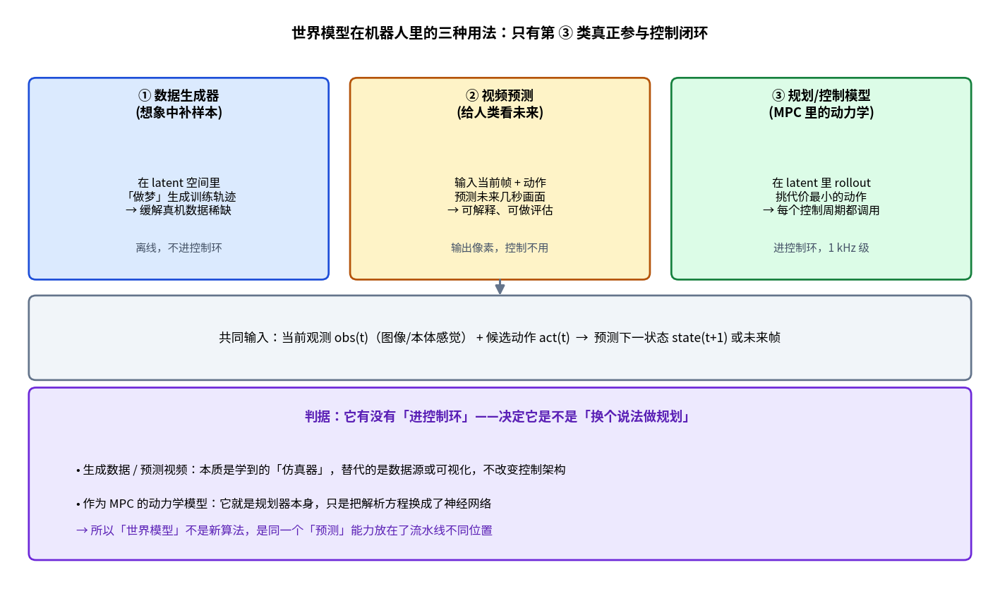

> **一句话结论**：「世界模型」不是一个新算法，而是「学一个能预测下一状态的神经网络」这件事被放在了流水线的不同位置——用来补数据、用来出视频、还是直接当 MPC 的动力学模型，三者对控制架构的影响完全不同；判断某个工作是不是「换个说法做规划」，只有一个判据：**它有没有进控制环**。

> 本文是「具身智能」前沿篇（主线 M8），与理论线[第 10 篇 刚体动力学 RNEA](10-rigid-body-dynamics-rnea.md)正对：那篇讲「用解析方程预测运动」，这篇讲「用学出来的模型预测运动」。文中对方法的归类与局限判断基于公开论文与综述，具体性能数字均标注为文献结论而非本文实测。

## 一个被反复讲错的故事

2025 到 2026 年，几乎每一场机器人发布会都会出现「世界模型」四个字。演示通常是这样的：给机器人一句「把桌上的苹果放进抽屉」，屏幕上先浮出一段「它想象出来的未来画面」——机械臂靠近、夹起、拉开抽屉——然后机器人照着做成了。弹幕和通稿爱写：「机器人学会了在脑内预演未来」。

台下做控制的人看到这里，通常会问一个很扫兴的问题：**那段「预演」，到底有没有参与每一个控制周期的决策？**

答案分三种，而这三种情况对应的技术含量、工程难度、以及「是不是新东西」，差别巨大。这就是本文想拆清楚的事。

## 先给「世界模型」一个不忽悠的定义

剥掉营销话术，世界模型（world model）在机器人语境下就是一个函数：

$$s_{t+1} = f_\theta(s_t,\ a_t)$$

给它当前状态 `s_t`（可能是一帧图像、也可能是压缩后的 latent 向量）和候选动作 `a_t`，输出下一状态。它和[第 10 篇](10-rigid-body-dynamics-rnea.md)里那套 `τ → q̈` 的解析动力学方程，做的是**同一类事**：预测「如果我这么做，系统会变成什么样」。区别只在于 `f_θ` 是神经网络从数据里学出来的，而 RNEA 是从牛顿定律推出来的。

定义清楚了，接下来按「放在流水线哪儿」分成三类。

## 用法 ①：当数据生成器，在「想象」里补样本

真机数据贵。一台人形机器人采一天有效操作数据，成本包含设备折旧、操作员、复位、安全监护，还伴随着摔倒损伤。于是很自然的想法：**让学出来的模型自己生成训练轨迹**，在 latent 空间里「做梦」，把稀缺的真机数据放大几十倍。

这条路线的代表是 MBRL（model-based RL）里的 **Dyna 风格**和 latent imagination（如 Dreamer 系列在机器人上的迁移）。它的价值是实打实的：在样本效率上，模型生成的数据确实能减少对真机交互的依赖。

但要点在于：**生成的数据是离线的，不进控制环**。机器人实际执行时，用的还是原来那套策略网络或控制器，世界模型只是「训练阶段的数据工厂」。所以它改变的是数据成本，不改变控制架构。把它宣传成「机器人会想象了」，属于把训练技巧说成了认知能力。

## 用法 ②：当视频预测器，给人类看「未来」

第二类是输入当前图像和一个候选动作序列，直接生成未来几秒的视频帧。这在两个地方真的有用：一是**可解释性**（让人看清模型打算干什么，便于调试和安全审核），二是**作为评估器**（用预测画面判断某个动作会不会撞、会不会掉）。近两年不少 VLA / 具身大模型的工作会附带这样的可视化模块。

但它有一个硬限制：**输出是像素**。控制环路需要的是力矩、关节目标或末端位姿，不是一帧 RGB 图。你当然可以再从预测帧里反推动作，但那已经绕了一圈，而且像素级预测的计算量决定了它很难在 1 kHz 环路上跑。所以这类世界模型的定位是「给人看的窗口」，不是「给控制器用的模型」。

## 用法 ③：当 MPC 的动力学模型，直接进控制环

第三类才是和本专栏主线真正接上的：**把 `f_θ` 塞进模型预测控制（MPC）当预测模型**。MPC 每个周期做一件事——对未来 H 步的候选动作序列做 rollout，挑代价最小的一段执行第一步，下个周期重来。这个 rollout 用的模型，传统上是解析动力学（就是第 10 篇那套），现在可以换成学出来的 `f_θ`。

这一步换掉，意义才真的大：它意味着**控制器不再依赖你写对的方程**。摩擦、背隙、柔性、接触这些 RNEA 最难建模的部分，理论上都能被数据补上。

代价同样直接。解析模型（第 10 篇那套）需要先标定质量、惯量和摩擦参数，但每一项都有物理含义，外推有牛顿定律兜底，每步是一次确定的 O(n) 递推；学习型模型省去了人工建模，代价是需要覆盖充分的数据，一旦遇到分布外的状态，可能给出物理上根本不可能的预测，而黑箱特性又让安全验证变得困难，每步还要多扛一次或几次网络前向。这些约束合起来，决定了 ③ 的工程门槛远高于 ① 和 ②。

所以判据就是那句话：**看它有没有进控制环**。①②③ 都能叫世界模型，但只有 ③ 在改控制本身，也只有 ③ 要和本文理论线正面竞争。（不同实现路线在精度、速度、依赖与适用边界上的完整对照，收录在 CSDN 完整版，此处不展开。）

## 为什么「想象」得越远越容易崩

这是这类方法最核心、也最容易被演示视频掩盖的问题：**复合误差（compounding error）**。

单步预测哪怕只有 1% 的误差，`f_θ` 是自回归的——第 2 步的输入是第 1 步的预测输出，误差会被当成「真实状态」继续喂进去。滚 50 步，误差不是 50%，而是可能完全发散到训练分布之外：模型从没见过这种「状态」，于是预测越来越离谱，规划器在一个幻觉世界里挑出了「最优」动作，真机一执行就撞。

这不是某个模型的 bug，是自回归预测的结构性缺陷。工程上的应对基本是三种：

1. **缩短 rollout 视野**：只想象 5~10 步，剩下的用价值函数兜底（Dreamer 系的思路）；
2. **每步重新接地**：真机观测一进来就重置状态，不让误差累积（这其实就是 MPC 的滚动优化）；
3. **不确定性惩罚**：模型对预测没把握时，规划器主动避开那些区域（ensemble / 概率模型）。

一个值得记住的失败形态：**在仿真里想象得越远、规划得分越高的策略，上真机往往越脆**——因为长视野给了复合误差充分的放大空间，而仿真里的「完美接地」掩盖了它。这和[第 09 篇 sim2real gap](09-rl-humanoid-sim2real.md)讲的是同一件事的另一面：仿真世界和真实世界之间，永远差一层没被建模的东西。

## 对读者的实用判据：拿到一篇世界模型论文怎么读

以后再看到「XX 世界模型」的工作，按下面四个问题过一遍，基本能定位它的真实贡献：

1. **预测的是什么**：像素 / latent / 物理量（位姿、速度）？物理量最可能进控制环，像素基本不可能。
2. **进没进控制环**：是训练时生成数据、推理时可视化，还是每个控制周期都调用？
3. **rollout 多长、怎么接地**：50 步不接地基本要警惕复合误差；有没有每步用真实观测重置？
4. **和解析模型比了什么**：只比「生成画面像不像」不够；有没有比任务成功率、力矩预测误差、分布外鲁棒性？

如果一篇论文四个问题都答不上来，那它大概率是用法 ①② 的漂亮可视化，而不是控制能力的突破——**这依然是有价值的工作，只是别把它当成「机器人会思考了」**。

## 常见误解（FAQ）

**问：世界模型和「仿真器」有什么区别？**

答：仿真器（MuJoCo / Isaac）的动力学是人写出来的方程，参数靠标定；世界模型的动力学是从数据里学出来的函数 `f_θ`。前者可解释、外推有物理保证，但难覆盖接触/摩擦等复杂现象；后者能拟合这些复杂现象，但分布外可能胡说。用法 ①② 的世界模型，本质上就是一个「学到的仿真器」。

**问：为什么说「世界模型」不是新算法？**

答：因为 `s_{t+1} = f(s_t, a_t)` 这个形式，在系统辨识、MPC、MBRL 里已经存在了几十年，换的只是 `f` 从解析式变成了神经网络。真正的增量是「用大规模数据 + 生成模型把高维观测（图像）也纳入预测」，而不是「提出了预测未来」这个概念。判断贡献要看它替代了流水线里的哪一环。

**问：有了世界模型，还需要第 10 篇讲的 RNEA 吗？**

答：需要，而且在可预见的将来是互补关系。RNEA 提供物理上可靠、可验证、外推有保证的基线，是安全层和标定的锚；世界模型负责补 RNEA 建不准的部分（接触、柔性、摩擦）。工程上常见的做法是「解析模型打底 + 学习型残差」，而不是二选一——纯黑箱模型在安全关键场景里很难通过验证。

**问：视频预测做得越逼真，控制就越好吗？**

答：不一定，两者目标不同。视频预测优化的是像素似然，控制需要的是「动作→状态」的动力学准确性。一个模型可以把画面生成得很像，却在关键的接触瞬间预测错一个几毫米的位姿，而这足以让抓取失败。评估要针对任务指标，不能只看画面质量。

## 延伸阅读与信源

- Ha & Schmidhuber, *World Models*（2018，NeurIPS）：latent imagination 与「在梦里训练」的开创性框架
- Hafner 等，Dreamer / DreamerV2/V3 系列：latent 动力学 + 短视野想象 + 价值函数兜底，复合误差处理的代表
- Sutton, *Dyna* 架构（1991）：用法 ①「模型生成数据」的理论源头，说明这条路并不新
- Moerland 等，*Model-based Reinforcement Learning: A Survey*：MBRL 分类与「模型用于规划 vs 用于数据」的辨析
- 关于机器人领域世界模型的近期综述与 VLA 相关工作，建议以 arXiv cs.RO 当季列表为准（时效性条目，发布时核查）
- 本专栏相关：[第 09 篇 RL sim2real](09-rl-humanoid-sim2real.md)（复合误差与接地问题）、[第 10 篇 刚体动力学](10-rigid-body-dynamics-rnea.md)（解析预测模型这一侧）

> 说明：本文做的是方法归类与判据梳理，不引用具体产品的性能数字；文中表格为定性对比，非实测基准。涉及「某模型达到 X% 成功率」一类断言，请以原论文实验条件为准。

**完整内容链接（三类世界模型代表论文中英对照精读批注、复合误差的量化复现实验、解析模型 + 学习残差混合 MPC 的完整可用代码）**：<https://blog.csdn.net/2301_81238088/category_13220213.html>

**完整版每周二更新**，订阅后第一时间推送。
