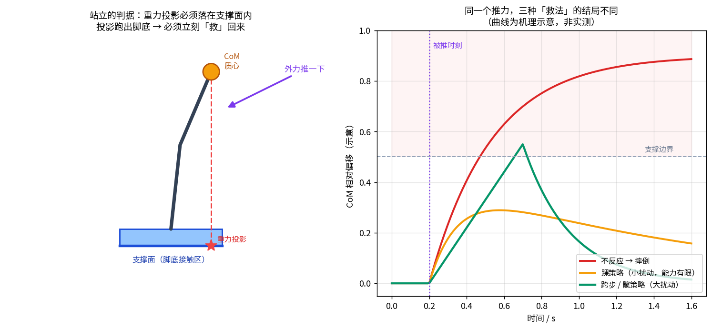

> **一句话结论**：人被推一下不倒，不是因为「站得稳」，而是因为小脑每一秒都在做几百次「摔倒—救回」的微调；机器人缺的从来不是强壮的电机，而是**在几十毫秒内感知到要摔、并立刻把支撑面挪到正确位置**的整套反射——站立是一个动态控制问题，不是一个静态姿势。

> 爆款加更，不占用正片节奏。本文为后续第 6 周「接触力学」、第 9 周「MPC 与全身控制」埋钩子：你会先在这里看到问题，再去那里看到解法。

## 地铁启动时，你根本没「站住」

早高峰的地铁忽然启动，车厢里几十个人同时晃了一下，然后……没有一个人倒。没人思考，没人下指令，甚至没人意识到自己刚刚完成了一次相当复杂的力学救援：脚踝悄悄加了点力、髋部往反方向顶了一下、有人下意识迈出半步。全程不到半秒。

现在把这一幕换成人形机器人。同样一个推力，很多机型的反应是：僵住 → 微微后仰 → 手臂狂摆 → 一屁股坐地上，或者干脆启动保护程序直挺挺往前扑。视频弹幕会刷「这也能叫机器人？」

这个对比里藏着一个特别反直觉的真相，也是本文最想留下的一句话：

> **人不是「站着」，人是「在持续地摔倒，然后持续地把自己接住」。**

所谓「站得稳」，其实是神经系统把「重心投影要跑出脚底」这件事，在它真的跑出去之前就处理掉了。一旦你理解站立是动态过程而不是静态姿势，机器人的笨拙就不再可笑，反而变成了一个非常具体、非常难的工程清单。

## 判据只有一条：投影在不在支撑面里

先建立一个能画出来的物理图像。

人站着时，所有与地面接触的点（两只脚的脚底）围出一个区域，叫**支撑多边形（support polygon）**。把全身质心（CoM）沿重力方向往地面投影，只要这个投影点落在支撑多边形**内部**，重力就能被地面的支持力平衡住，人就不会倒；一旦投影跑出边界，重力就产生一个「继续把你往外翻」的力矩——**这时候摔倒已经开始了，除非你做点什么**。

工程上常用一个等价但更精细的量：**ZMP（零力矩点，Zero Moment Point）**，即地面合力作用点。判据是 ZMP 必须待在支撑面内；ZMP 顶到边界，就意味着「再不救就要翻了」。第 6 周的接触力学会讲它的严格定义和摩擦锥约束，这里只要记住这条直觉：

> **脚底能给的力矩是有上限的，超过上限，就只能靠「换一只脚落地」来重建支撑面。**

这也解释了为什么被推得狠时，所有人都会迈步——不是因为迈步更优雅，而是因为**踝关节那点力矩额度已经用完了**。

## 同一个推力，三种「救法」

人和机器人应对扰动的策略，本质上是按「扰动大小」分层的，右图那三条曲线画的就是三种结局：

| 策略 | 做什么 | 能扛多大扰动 | 代价 |
|---|---|---|---|
| **踝策略** | 脚踝微调力矩，把质心投影压回脚底中部 | 小 | 快、省，但受限于脚底能提供的力矩上限与脚掌长度 |
| **髋策略** | 上半身快速反向摆动，用角动量「换」回平衡 | 中 | 不动脚，但会让上半身姿态大幅变化，抓取任务会受影响 |
| **跨步策略** | 迈一步，把支撑多边形整体挪到质心前方 | 大 | 唯一能扛大扰动的办法，但要求「几十毫秒内决定往哪迈、迈多远」 |

关键在最后一行：**跨步是唯一真正的通用解，也是最难的一个**。它要求机器人在极短时间内连续完成「估计自己正在被推 → 预测质心会跑到哪 → 规划落脚点 → 把一条腿甩过去并稳稳落地」——这里每一步都踩在本专栏讲过的主线上：状态估计（M5）、动力学（[第 10 篇 RNEA](10-rigid-body-dynamics-rnea.md)）、轨迹优化（第 10 周）、接触建模（第 6 周）。

所以「被推一下就倒」不是一个零件坏了，而是**整条链路的时延和精度都不够**。

## 机器人到底卡在哪：三个不体面的工程瓶颈

**瓶颈一：感觉到的那一刻，已经晚了。** 人的前庭系统、肌梭、足底压力感受器是分布式的、毫秒级的；机器人主要靠 IMU + 关节编码器 +（部分机型）足底力传感器，数据要经过滤波、融合、状态估计才能变成「我的质心现在在哪、速度多少」。这一路走完，5~20 ms 就没了，而一个中等推力从施加到必须响应，窗口也就是这个量级。[第 09 篇 sim2real](09-rl-humanoid-sim2real.md)里的「观测延迟」gap，在平衡问题上是最致命的一层——**控制器优化的是 20 ms 前的世界**。

**瓶颈二：接触力不好测，也不好给。** 脚底和地面之间能不能提供足够的力矩，取决于接触有没有打滑、地面有多硬、脚掌有没有完全贴住——这就是摩擦锥和互补条件要处理的事（第 6 周展开）。更麻烦的是执行器：谐波减速器有背隙、有带宽限制，你想让脚踝在 30 ms 内精确输出某个力矩，电机和减速器未必跟得上。第 09 篇讲的「执行器模型」gap，在这里直接表现为「救不回来」。

**瓶颈三：没有小脑。** 人的平衡反射是脊髓和小脑级的，不占用「思考」资源；机器人却常常把姿态控制塞进一个统一的控制栈，从传感器到力矩指令要走完整条软件链路（第 11 周会讲 1 kHz 环路里 Python 代码在哪一层）。层级越深，越难做出「不经过大脑」的反应。这也是为什么现在的人形机器人普遍采用**分层控制**：底层一个极简、极快、只管「别倒」的 WBC / 平衡反射，上层才去做抓取、走路、对话。

一个能记住的翻车形态：**机器人不是「推不动」，而是「推了之后才发现自己在被推」**。很多演示里的摔倒，慢放会发现机器人在失衡初期有一小段几乎静止的「愣神」，那几十毫秒就是状态估计与决策链路的延迟。

## 那为什么波士顿动力的机器人被踹也不倒

因为那类视频恰好把三件事都做到了：足底力/本体感觉的快速融合、以 MPC + 全身控制（WBC）为核心的滚动重规划、以及**允许并擅长跨步**——被踹之后它会小碎步连迈几步，正是右图里绿线那条「先偏出去、再被新支撑面接住」的曲线。它不是没被扰动，它是把扰动变成了一次步态重规划。

这背后没有玄学，就是本专栏后面几周要拆的东西：接触力学给判据、动力学给预测、MPC 给动作、实时系统给速度。**等这些拼齐了，「被推不倒」会从亮点变成本职工作**——就像今天的电梯，没人会因为「它没掉下去」而鼓掌。

## 留给后面几篇的钩子

- 第 6 周《接触力学入门》：脚底到底能给多大力矩、摩擦锥怎么约束、为什么腿式机器人会抖（本文「瓶颈二」的完整答案）
- 第 9 周《从 MPC 到全身控制》：踝/髋/跨步怎么被统一成层级 QP 里的优先级任务（本文「跨步」的算法答案）
- 第 7 周《卡尔曼滤波的几何解释》：怎么把 IMU 延迟压到最低（本文「瓶颈一」的答案）
- 第 11 周《1 kHz 控制环路》：底层平衡反射为什么必须和上层任务分开（本文「瓶颈三」的答案）

## 常见问题（FAQ）

**问：机器人站不稳，是不是因为电机不够力？**

答：大多数情况不是。静态站立需要的力矩并不大（本文第 10 篇实测重力补偿只占额定力矩的一小部分），难点在于「在正确的时间给出正确的力」。执行器带宽、减速器背隙、状态估计延迟比峰值力矩更常成为瓶颈。加更大的电机，往往只让摔倒更有力。

**问：ZMP 和质心投影是一回事吗？**

答：不完全是，静态或低速时两者接近，动态时 ZMP 会领先于质心投影。质心投影是「重力往地面打在哪」，ZMP 是「地面合力实际作用在哪」，它同时包含惯性力的影响。判据都是「必须留在支撑面内」，但做动态步态规划时必须用 ZMP（或更一般的接触力约束），第 6 周会展开。

**问：为什么不能让机器人像不倒翁一样，靠低重心硬扛？**

答：低重心确实能扩大稳定裕度，但代价是放弃了「快速移动」和「迈大步」——不倒翁能复原，是因为它不需要走路。人形机器人被设计成人形，就是为了能上下楼梯、跨越障碍、用双手作业，这些任务要求质心高、支撑面小、姿态灵活，本质上就是一直在接近失衡边缘。稳定与灵活是同一枚硬币的两面。

**问：现在最先进的人形机器人能扛住多大推力？**

答：这取决于测试协议（推哪里、持续多久、是否允许跨步、地面材质），不同厂商口径不统一，横向比数字意义不大。更有意义的判据是三个：允不允许跨步、有没有足底力反馈、失衡后恢复耗时。本文不引用具体产品数字，建议以各团队公开的测试条件为准。

## 延伸阅读

- Vukobratović & Stepanenko, 1972：ZMP 概念的原始文献，步态规划的起点
- Kajita 等，*Introduction to Humanoid Robotics*：支撑多边形、ZMP、预观控制的标准教材讲法
- 本专栏相关：[第 09 篇 RL sim2real](09-rl-humanoid-sim2real.md)（延迟/执行器 gap）、[第 10 篇 刚体动力学](10-rigid-body-dynamics-rnea.md)（力矩从哪来）、[第 08 篇 逆运动学](08-inverse-kinematics-dls.md)（落脚点怎么变成关节角）
- 配图：`figs/fig12-01-balance-strategies.png`（右图曲线为机理示意，非实测数据）

**完整内容链接（踝/髋/跨步三策略的力学推导、ZMP 与摩擦锥的严格关系、一个可跑的平衡反射仿真与完整可用代码）**：<https://blog.csdn.net/2301_81238088/category_13220213.html>

**完整版每周二更新**，订阅后第一时间推送。
