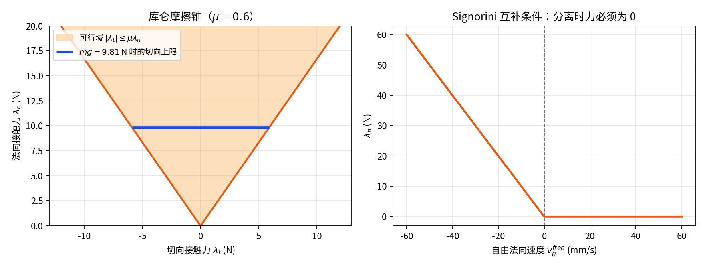
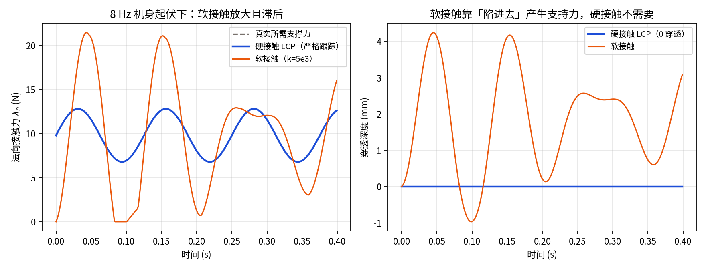
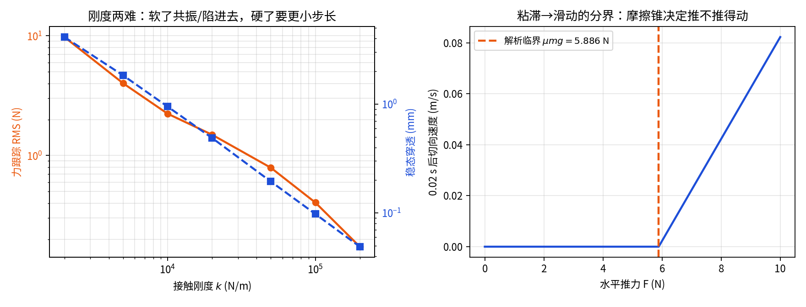

> **一句话结论**：接触不是「给地面加一根弹簧」，而是一组**不允许穿透、不允许拉力、切向力有上限**的互补约束；机器人仿真里足端发抖、夹爪打滑、接触力调不准，大半源于把这条硬约束近似成了软弹簧，于是约束本身开始振荡。

> 本文是「动力学与接触」块第 2 篇（主线 M3），承接 [第 10 篇 RNEA](10-rigid-body-dynamics-rnea.md) 与 [第 12 篇 为什么被推就倒](12-why-robots-fall-when-pushed.md)——上篇讲的「脚底能给多大力矩」在这里有了严格定义。配套代码：[`code/contact_demo.py`](https://github.com/SRrobot-ShiRui/Learning-Robotics-for-beginners/blob/main/code/contact_demo.py)，仅依赖 numpy/matplotlib，`--plot` 可复现文中全部数字与三张图。

## 直觉层：桌面不会把你吸住

把手掌平压在桌面上，往下用力，桌面对你有一个等大的支持力。现在慢慢抬手——支持力会跟着变小，抬到离开桌面的那一刻，支持力**正好变成 0**，绝不会变成负的（桌面不会反过来把你手往下拽）。

这件小事里藏着接触力最反直觉的三条规矩：

1. **不能穿透**：手掌不能跑到桌面里面去；
2. **不能拉**：接触力只能是推力，不能是吸力；
3. **不能凭空产生**：只有真的贴上了，才有力。

第 3 条最容易被忽略，却是所有接触求解的核心：**力和「贴没贴上」是互相决定的两个未知量，必须一起解**。你不知道力多大，因为不知道有没有接触；你不知道有没有接触，因为不知道力会把物体推到哪。这种「二选一、且互相约束」的关系，数学上叫**互补条件（complementarity）**。

再往手上加一点横向推力，手掌开始要滑。你会感觉到桌面能给一个「抗滑」的摩擦力，但它有上限：压得越紧，抗滑能力越强；压力减半，抗滑能力也减半。这个上限画出来是一个锥——**摩擦锥**。夹爪抓杯子时要用多大力、人形机器人脚底能抗多大横推、一条腿落地瞬间会不会打滑，全都被这个锥管着。



## 进阶层：把三条规矩写成方程

设 `λ_n` 是法向接触力（向上为正），`v_n⁺` 是这一时刻算完之后的法向速度（向上为正，向下即趋近地面）。**Signorini 条件**写成一行：

$$v_n^{+} \ge 0,\quad \lambda_n \ge 0,\quad \lambda_n\, v_n^{+} = 0$$

三个式子分别对应「不穿透、不拉、不凭空」，最后那个乘积为 0 就是「互补」二字：两者里必须至少有一个是 0。要么正在分离（`v_n⁺ > 0`，则 `λ_n = 0`），要么保持接触（`λ_n > 0`，则 `v_n⁺ = 0`），**中间状态不存在**。图 13-01 右图那条折线就是它的形状：自由速度为负（要往下穿）时，力线性增长把它顶回去；自由速度为正时，力严格是 0。

切向由**库仑摩擦锥**约束：

$$|\lambda_t| \le \mu\,\lambda_n,\qquad \lambda_t\, v_t^{+} \le 0$$

`μ` 是摩擦系数。锥内是**粘滞**（接触点不相对滑动），锥面上是**滑动**，而且摩擦力的方向必须和滑动方向相反（最大耗散）。注意这个锥是「挂」在 `λ_n` 上的：法向力为零，切向力也必须为零——**悬空的物体不可能受摩擦力**。

时间步进的做法是：先假装没有地面，用外力算出「自由速度」`v_free`，再求一个接触力把它投影回可行域。这个「预测 + 投影」的问题就是**线性互补问题（LCP）**。单个接触点有解析解，多个接触点（人形机器人两只脚、灵巧手五个指尖）就要迭代求解，MuJoCo、Bullet、Drake 的接触求解器都在做这件事。

## 代码：逐句实现单接触点 LCP

下面是 `contact_demo.py` 的核心函数，逐句解释。**每一行只做一件事**，因为互补条件的正确性全靠「先判断分离、再算力、最后裁剪」这个顺序，压成一行矩阵运算就再也没法检查到底是哪一步放进了不该有的力。

```python
def solve_contact_lcp(v_n, v_t, f_n, f_t, m, dt, mu):                # (1)
    v_n_free = v_n + dt * f_n / m                                    # (2)
    v_t_free = v_t + dt * f_t / m                                    # (3)
    if v_n_free >= 0.0:                                              # (4)
        return 0.0, 0.0
    lam_n = -m * v_n_free / dt                                       # (5)
    lam_needed = -m * v_t_free / dt                                   # (6)
    lam_t = np.clip(lam_needed, -mu * lam_n, mu * lam_n)               # (7)
    return lam_n, lam_t                                               # (8)
```

**逐句讲解**

- **(1) 接口设计**：输入是上一时刻的法向/切向速度、本步外力、质量、步长和摩擦系数，输出两个接触力。做成无状态纯函数，是为了能在每个控制周期、每个接触点、每次优化迭代里反复调用。
- **(2) 自由法向速度**：`v_n + dt·f_n/m`，即「假设没有地面，这一步结束时会往哪走」。重力 `f_n = −mg` 让它变负，这是产生接触的根本原因。
- **(3) 自由切向速度**：同理，横向外力（比如机身惯性、被推了一下）都进这一项。
- **(4) 互补条件的开关**：`v_n_free ≥ 0` 说明物体正在远离地面，**直接返回 0 力**。这一行就是 `λ_n·v_n⁺ = 0` 的全部实现，也最容易被写漏：漏了它，悬空的物体会被「地面」凭空拉住。
- **(5) 法向投影**：令 `v_n⁺ = v_n_free + dt·λ_n/m = 0`，解出 `λ_n = −m·v_n_free/dt`。这就是「恰好把穿透速度消掉」所需的力，一步到位、不需要迭代。因为 `v_n_free < 0`，结果必然为正，天然满足「不能拉」。
- **(6) 切向想要的力**：假设接触点粘住不动，需要抵消全部自由切向速度，对应的力是 `−m·v_t_free/dt`。
- **(7) 摩擦锥裁剪**：`np.clip` 把上一步的结果截断到 `[−μλ_n, +μλ_n]`。截断发生了，就说明达到滑动边界，多余的力只能让物体滑起来；没截断，就是粘滞。方向自动与 `v_t_free` 相反，最大耗散也顺便满足了。
- **(8) 返回**：法向与切向耦合完毕——注意 `λ_t` 的上限依赖 `λ_n`，所以顺序不能反过来。

仿真主循环用半隐式欧拉（先更新速度、再更新位置），只有两行关键代码：

```python
    v_n += dt * (f_n + lam_n) / M        # (9) 外力 + 接触力一起积分
    z   += dt * v_n                      # (10) 用刚更新的速度推进位置
```

- **(9)** 把求出的接触力和重力、周期性载荷一起积分；
- **(10)** 半隐式（先速度后位置）对带弹簧的系统比显式欧拉稳定得多，是仿真器里最常见的默认选择。

**它能实现什么功能**：给定任意时刻的运动状态和外力，输出严格满足互补条件与摩擦锥的接触力，是整个接触流水线里「把约束变成力」的那一步。

**为什么这样写（编写目的）**：面对的约束不是「算得快」，而是**「约束必须严格成立、且每一行都能单独验证」**。真实求解器会用 PGS 迭代、用锥补问题的内点法、把摩擦锥线性化成多边形，快得多也复杂得多；本文选单点解析解，是为了让读者能拿着这份代码去验互补残差、去改 `μ`、去把 `mg` 换成任意载荷——**先把约束的形状看清楚，再谈求解器的效率**。

## 数值验证：约束到底严不严

代码里对 2000 组随机工况（速度、外力、摩擦系数全随机）逐条检查三个量：

| 验证项 | 实测值 | 要求 |
|---|---|---|
| `max \|λ_n · v_n⁺\|`（互补残差） | **1.329e-12** | 应为 0（浮点舍入量级） |
| `max (\|λ_t\| − μλ_n)`（摩擦锥违反） | **0.000e+00 N** | 必须 ≤ 0 |
| `min v_n⁺`（法向穿透） | **−4.441e-16 m/s** | 必须 ≥ 0 |

第二组验证是「推得动推不动」：一个 1 kg 的块压在地上（`μ=0.6`），水平推力从 0 扫到 10 N。解析临界值是 `μmg = 5.8860 N`，扫描实测第一个出现滑动的点是 **5.8870 N**（扫描步长 0.001 N，吻合到步长内）。临界之前块纹丝不动，之后开始加速滑走——图 13-03 右图那条折线就是这个分界。

## 为什么会抖：把硬约束换成弹簧之后

现在把地面换成**惩罚法（软接触）**：允许物体陷进去一点，陷得越深，弹簧顶回来的力越大，`λ_n = k·penetration + c·(−v_n)`。这是很多仿真器和足端力控里最常见的近似，因为它连续、可微、实现只要三行。

给它叠加一个 8 Hz 的机身高低起伏载荷（步态频率量级，幅值 3 N），看同一个 1 kg 块在 0.1–0.4 s 里的表现：



实测结果：采用硬约束 LCP 时，法向力跟踪 RMS 为 **9.890e-16 N**（浮点舍入量级），最大穿透 0 mm，力峰值 12.810 N；换成软接触（`k=5e3`）后，同一区间的跟踪 RMS 变成 **4.011 N**，稳态穿透 **1.8349 mm**，力峰值升到 **21.469 N**。

软接触的力被放大、相位滞后，甚至在某些时刻掉到 0——那一刻足端其实**离开了地面**，随后又砸回来。右图里穿透深度出现负值，就是这种「跳起—落下」的痕迹。放到腿式机器人身上，就是足底力周期性振荡、接触判定反复翻转、机体表现为肉眼可见的高频抖动；放到力控打磨上，就是工件表面出现振纹。几条建模路线各自的取向与选型理由，完整版按实测展开。

更麻烦的是刚度怎么选都不对。固定阻尼比 0.1，扫描接触刚度：

| k (N/m) | 力跟踪 RMS (N) | 稳态穿透 (mm) |
|---|---|---|
| 2 000 | 9.766 | 4.1329 |
| 5 000 | 4.011 | 1.8349 |
| 10 000 | 2.235 | 0.9483 |
| 20 000 | 1.492 | 0.4886 |
| 50 000 | 0.791 | 0.1943 |
| 100 000 | 0.405 | 0.0978 |
| 200 000 | 0.173 | 0.0490 |



变软就陷得深、还容易撞上结构固有频率被共振放大；变硬跟踪是好了，却带来**数值刚性**：`k = 2e5` 时把积分步长从 1 ms 放大到 5 ms，法向力峰值从 18.424 N 炸到 **128.9 N**，而同一条件下硬约束 LCP 的峰值始终是 12.81 N 左右（1 ms: 12.810 N，5 ms: 12.804 N），完全不受步长影响。也就是说，软接触把「物理约束」换成了「需要配合步长调参的数值参数」——这正是接触调不准的根源。

## 工程视角：这条约束出现在哪

**1. 夹爪抓取的力下限**。要抓起一个 `m` 的物体，靠摩擦夹住时所需法向夹紧力至少是 `mg/(2μ)`（两指对夹）。`μ` 估计偏大，实际就会打滑；物体表面有油、指尖是软的，`μ` 还会随接触面积变。第 06 篇讲灵巧手时提到的「抓不稳」，底层就是摩擦锥的可行域不够大。

**2. 腿式步态与 ZMP**。第 12 篇说「ZMP 必须留在支撑面内」，其严格版本就是：所有足底接触力必须落在各自的摩擦锥里，且合力矩与惯性力平衡。落地瞬间若足端有横向速度，`λ_t` 被锥面裁剪，多余能量只能靠滑一小段或踝关节力矩吃掉——这就是机器人落地会「蹭一下」的原因。

**3. 无人机降落与着地检测**。多旋翼落地判据常用「垂向速度归零 + 支持力出现」。若用软接触做仿真，落地瞬间弹簧储能会把机体弹起来，控制器误判成「又飞起来了」，于是反复加减油门——这是仿真里降落抖动、真机上没有的经典 gap。

**4. 工业臂的打磨/装配力控**。让机械臂以恒定力压住工件，接触刚度、环境刚度、控制器带宽三者耦合。把环境当成硬约束做混合力位控制，比调一堆弹簧参数稳得多；反过来，若仿真里把环境刚度设得远高于真机，sim2real 时力控增益就会整体偏激进。

**5. 碰撞检测与仿真器接触参数**。MuJoCo 走软接触路线（连续可微，便于优化与 RL），Bullet/Drake 提供硬约束 LCP 路线；两者在可微性、约束严格程度和步长敏感度上取向不同，但**都必须把接触刚度、阻尼、时间步显式写进实验配置并报告**，否则跨仿真器复现时数字对不上。第 09 篇 sim2real 的「接触模型」gap 就在这里，四条路线的实测对比放在完整版。

## 常见问题（FAQ）

**问：为什么接触力不能是负的？地面把我往下拉不就是负的吗？**

答：接触是单侧约束，两个物体只能互相推、不能互相拉，除非有胶水或吸附装置。`λ_n ≥ 0` 就是这条物理事实。若算出来负值，说明模型在「吸」物体，等价于凭空造能量，仿真会立刻发散。摩擦锥的 `|λ_t| ≤ μλ_n` 也依赖它：法向力为零时切向力必须为零，悬空的物体不可能受摩擦力。

**问：互补条件里为什么用乘积等于 0，而不是「接触时力大于 0」？**

答：因为「是否接触」本身是未知量，需要用一个式子把两种情形统一起来：`λ_n ≥ 0`、`v_n⁺ ≥ 0`、`λ_n·v_n⁺ = 0` 三者联立，恰好只允许「分离且无力」和「接触且速度为零」两种状态。写成乘积形式后，多接触点问题就能整体化成 LCP 交给求解器，不需要枚举 2ⁿ 种接触组合。

**问：既然软接触会抖，为什么很多仿真器还在用？**

答：因为软接触连续可微，梯度能一路传回策略网络，做基于优化的轨迹规划和强化学习时非常方便；硬约束的互补条件是分段、不可微的。代价就是本文实测的穿透、力放大和步长敏感。工程上的做法是把接触刚度、阻尼、时间步一起写进实验配置并报告，避免「换个版本结果就变了」。不同建模方式的取舍与实测对比，完整版里展开。

**问：摩擦系数 μ 在真实机器人上怎么取？**

答：它不是材料常数，而是「材料对 + 表面状态 + 接触面积 + 速度」的综合结果，橡胶足底在干湿地面上能差好几倍。工程上通常先取一个保守下限做规划（保证不打滑），再用力/力矩残差在线估计并更新；把 `μ` 当成固定常数直接写死，是抓取和步态翻车的高频原因。

## 延伸阅读

- 教材：Featherstone, *Rigid Body Dynamics Algorithms* 第 11 章（接触与 LCP）；Lynch & Park, *Modern Robotics* 第 12 章（摩擦锥与抓取）
- 文献：Vukobratović & Stepanenko, 1972（ZMP）；Stewart & Trinkle, 1996（时间步进 LCP）
- 工具：MuJoCo 文档「Contact」章节、Pinocchio `contact` 模块、Drake `MathematicalProgram` 的互补约束
- 本专栏相关：[第 10 篇 RNEA](10-rigid-body-dynamics-rnea.md)（接触力最终要由动力学折算成关节力矩）、[第 12 篇 平衡](12-why-robots-fall-when-pushed.md)（摩擦锥决定脚底力矩上限）、[第 09 篇 sim2real](09-rl-humanoid-sim2real.md)（接触模型 gap）
- 下一篇（第 14 篇）：复现一篇机器人论文，真实成本是多少
- 配套代码：[`contact_demo.py`](https://github.com/SRrobot-ShiRui/Learning-Robotics-for-beginners/blob/main/code/contact_demo.py)，`python3 contact_demo.py --plot` 复现全部数字与三张图

**完整内容链接（多点接触 LCP 的迭代求解、三维摩擦锥线性化、四种接触建模方式实测对比与选型理由、足端抖动完整可用代码）**：<https://blog.csdn.net/2301_81238088/category_13220213.html>

**完整版每周二更新**，订阅后第一时间推送。

