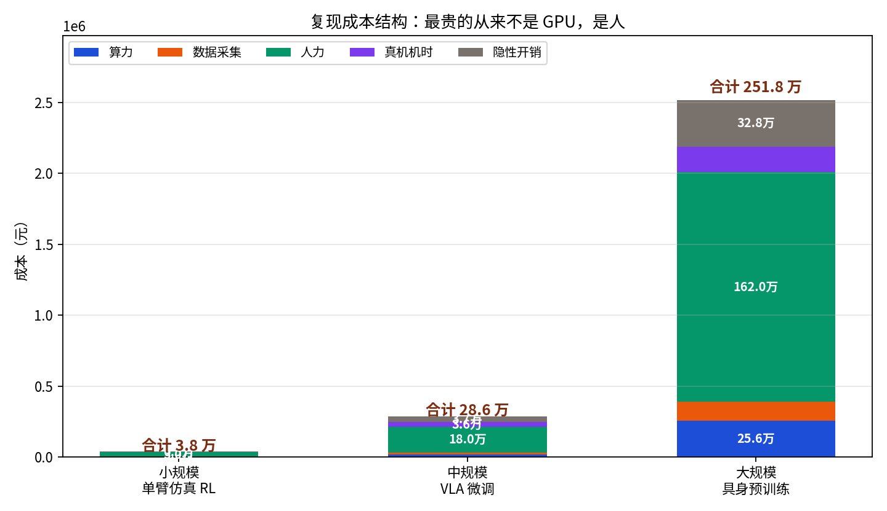
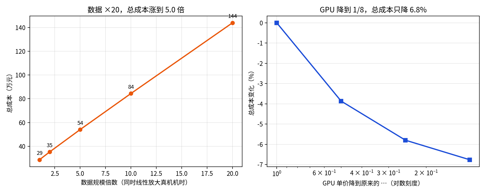

> **一句话结论**：复现一篇机器人论文，最贵的从来不是 GPU，而是人——算力只占总成本的 6.7%~10.2%，而工程师时间、遥操作数据采集和真机机时才是大头；把 GPU 单价降到原来的 1/8，总成本只降 6.76%，把数据规模翻 20 倍，总成本也只涨 5.04 倍。

> 前沿篇，故事化拆解 + 可复现核算模型。承接 [第 09 篇 sim2real](09-rl-humanoid-sim2real.md) 与 [第 11 篇 世界模型](11-world-model-for-robots.md)：这两篇里「再采 10 倍数据」「再训一轮」的代价，在这里第一次被算成钱。配套代码：[`code/repro_cost.py`](https://github.com/SRrobot-ShiRui/Learning-Robotics-for-beginners/blob/main/code/repro_cost.py)。

## 三个月，和一张没人算过的账单

研一新生小林刷到一段 demo：机器人蒙着眼，把散落桌面的积木按颜色分进三个盒子，成功率 92%。论文写得漂亮，代码仓库也有链接。导师说：「复现一下，两周够了吧。」

两周后，环境没装起来——CUDA 版本、仿真器版本、某个已经被删掉的数据集链接。第四周，跑通了训练脚本，但作者用的是 8 张卡训 3 天，实验室只有 2 张。第六周，发现论文里的成功率是在「物体初始位姿固定」的设定下测的，换成随机摆放掉了 30 个点。第九周，为了补真机数据，预约机时排到两周后，采集员一条一条遥操作，五次里有一次要重来。第十二周，小林终于跑出了 89%，写了一份 12 页的复现报告。

**没有人问过这三个月花了多少钱。** 而这恰恰是机器人研究里最不透明、也最影响决策的一笔账。

## 论文里那行「GPU hours」，只是账单的零头

大多数论文在实验章节会写「8×A100，训练 72 h」。读者下意识做的换算是 `8 × 72 × 单价`，得到一个几万块的数字，然后觉得「好像还行」。

但一次完整复现至少包含五项成本，训练算力只是其中一项：

| 成本项 | 从哪来 | 为什么容易被漏算 |
|---|---|---|
| **算力** | 训练 GPU 小时 × 单价 × 失败重跑系数 | 论文只报成功的那一次，不报前面跑废的 3 次 |
| **数据采集** | 遥操作条数 × 单条耗时 × 采集员时薪 ÷ (1−废弃率) | 论文写「5 000 条示范」，不写这 5 000 条是谁、花了多久采的 |
| **人力** | 工程师人数 × 月数 × 全负担成本 | 学生的时间在论文里不计价 |
| **真机机时** | 真机占用小时 × 机时费（含折旧、维修、场地） | 仿真复现不需要，但真机复现绕不开，且要排队 |
| **隐性开销** | 环境搭建、口径对齐、失败样例归档、写报告 | 完全没有出现在任何表格里，却常占一成以上 |

为了把这件事从「感觉」变成「数字」，本文用一个**参数化核算模型**跑了一遍。先说清楚边界：下面的单价与规模参数是公开基准里的常见量级，用来演示核算方法，**不是任何一篇具体论文的真实账单**；换成自己单位的实际报价，结论的形状不变，只是数字缩放。模型假设：GPU 8 元/卡时、遥操作 120 元/小时、工程师 3 万元/人月、真机 300 元/小时，每条示范数据 1 分钟，采集后废弃 25%，训练失败与调参重跑系数 1.6，隐性开销按直接成本的 15% 计。

## 三档规模：钱到底花在哪



| 规模 | 合计 | 算力占比 | 人力占比 | 数据+真机占比 |
|---|---|---|---|---|
| 小规模（单臂仿真 RL，200 GPU·h / 200 条） | **3.81 万元** | 6.7% | **78.8%** | 1.4% |
| 中规模（VLA 微调，1500 GPU·h / 5000 条） | **28.58 万元** | 6.7% | **63.0%** | 17.3% |
| 大规模（具身预训练，20000 GPU·h / 50000 条） | **251.77 万元** | 10.2% | **64.3%** | 12.4% |

三个反直觉点：

**第一，规模涨了 66 倍，人力始终是最大头。** 小规模里人力占 78.8%，大规模里仍占 64.3%。因为复现是「人盯着跑」的活动，自动化程度没有随规模同步提升。

**第二，算力占比一直是个位数到一成。** 哪怕按 20 000 GPU·h 的预训练规模算，算力也只占 10.2%。这也是为什么「等显卡降价再复现」几乎不会改变立项决策。

**第三，数据采集 + 真机机时在中大规模合计 12%~17%，看着不高，但它是唯一随「想要的效果」线性膨胀的部分**，而且真机排期、采集员排班这类约束没法用钱直接压缩。

## 两个敏感性实验：便宜的 GPU、翻倍的数据

模型跑出来的两个实验，比那张堆叠图更能改变直觉。



**实验 A：数据翻 20 倍，总成本只涨 5.04 倍。** 中规模基线 28.58 万元，数据 ×2 → 35.17 万，×5 → 54.00 万，×10 → 84.42 万，×20 → 144.04 万。原因是人力（18 万）和隐性开销是固定成本，被摊薄了；算力按数据量的平方根亚线性增长（模型里 `data_scale ** 0.5`），只有采集与真机是线性涨的。所以「再采 10 倍数据」在纯账单上并不是 10 倍代价，但**在排期和人力注意力上是**——第 16 篇要讲的数据边际收益递减，说的正是这条曲线拐弯之后的部分。

**实验 B：GPU 降到 1/8，总成本只降 6.76%。** 单价 ×0.5 → −3.86%，×0.25 → −5.79%，×0.125 → −6.76%。算力那块本来只有 1.92 万元，砍到底也省不出两万块，而一位工程师一个月就是 3 万。**结论很直接：想降低复现成本，优先砍「人要盯的时间」，不是砍卡。**

这两个数字也解释了一个行业现象：企业愿意为「开箱即用的预训练权重 + 标准评测脚本」付溢价，因为买走的是几个月的人力试错；而单纯比拼算力单价，对总账几乎没影响。

## 代码：把核算写成可复现的脚本

`repro_cost.py` 的核心只有十几行，逐句解释如下。**每一行只做一件事**，因为成本模型最怕的就是把假设藏进一个连乘式里，改一个参数时不知道会牵动哪几项。

```python
def cost_breakdown(p, gpu_price=None, data_scale=1.0, robot_scale=1.0):
    gpu_price = PRICE["gpu_hour"] if gpu_price is None else gpu_price   # (1)
    compute = p["gpu_hours"] * RERUN_FACTOR * (data_scale ** 0.5) * gpu_price  # (2)
    raw_hours = p["episodes"] * data_scale * MIN_PER_EPISODE / 60.0     # (3)
    data = raw_hours / (1 - DISCARD_RATE) * PRICE["teleop_hour"]          # (4)
    human = p["engineers"] * p["months"] * PRICE["engineer_month"]        # (5)
    robot = p["robot_hours"] * robot_scale * PRICE["robot_hour"]            # (6)
    direct = compute + data + human + robot                                # (7)
    overhead = direct * OVERHEAD                                           # (8)
    return np.array([compute, data, human, robot, overhead]), direct + overhead
```

- **(1) 单价可覆盖**：默认读全局单价表，调用时传 `gpu_price` 就能做「显卡降价」实验，不用改函数体。
- **(2) 算力**：GPU 小时 × 重跑系数 × 数据规模的平方根 × 单价。平方根是刻意的——训练量随数据增长通常是亚线性的，写成线性会高估大规模场景。
- **(3) 原始采集工时**：条数 × 单条分钟 ÷ 60 换成小时。
- **(4) 除以 `1−废弃率`**：采 100 条、废 25 条，实际要付出 133 条的工时，这是最常被漏算的一层。
- **(5)(6) 人力与真机**：都是「量 × 单价」的直接项，但人力不随数据规模变（固定团队），真机随规模线性变。
- **(7)(8) 隐性开销**：按直接成本固定比例计提，返回五项明细 + 合计，方便画堆叠图。

**它能实现什么功能**：给定一组规模参数，输出五项成本与合计；换单价、换数据规模、换真机规模，立刻得到新的账单，用来做立项前的「如果…会怎样」。

**为什么这样写（编写目的）**：目标是**让每个假设都是可见、可单改的参数**，而不是算出一个看起来权威的总数。所有单价集中在 `PRICE` 字典、所有比例常数提到模块顶部，读者把自己单位的报价填进去，模型形状不变。这也是本文坚持把它叫「量级估算」而不是「成本核算结果」的原因。

## 隐性成本清单：真正吃掉三个月的东西

**环境复现**：论文依赖的仿真器版本、CUDA 版本、被删除的数据集链接。现象是「代码在，跑不起来」；根因是依赖没有锁定；解法是进组第一天就做一次干净的容器构建并记录耗时，把它计入预算。

**口径对齐**：论文里的 92% 可能是在固定初始位姿、固定光照、固定物体集合下测的。现象是「复现出来差 30 个点」；根因是评测协议不一致；解法是先把评测脚本跑到与论文完全一致，再谈改模型，否则后面所有实验都白做。

**真机排期与损耗**：现象是「数据采到一半，机器人关节过热停机」；根因是真机机时是共享资源且会坏；解法是把机时当成有单价的稀缺资源排期，并在预算里留 15% 缓冲。

**失败样例的价值**：跑废的 3 次训练不是纯损失，它们确定了「哪些超参会炸」。但如果不归档，下一个人会再炸一遍——隐性成本里最贵的一项，是**组织没有沉淀复现记录**。

## 实践应用：这套核算能用在哪

**立项预算**：把「复现论文」从一句口头承诺变成一张五项表，先问人力月数，再问数据条数，最后才问卡时。高校实验室尤其需要把学生工时按全负担成本折算，否则永远觉得「复现是免费的」。

**读论文的核对清单**：看到惊艳结果，先找四样东西——依赖是否锁定、评测协议是否完整、数据是否可获取、失败率与重跑次数是否披露。四样缺得越多，账单越可能翻几倍。

**企业 make-or-buy 决策**：买预训练权重、买数据集、买标注服务，本质都是「用钱换工程师月数」。实验 B 说明砍算力单价没用，实验 A 说明数据规模可以谈量级，这两条直接支持「优先外包数据、保留核心人力」的分工。

**开源复现的公共价值**：一份能一键跑起来的复现仓库，替所有后来者省掉的是 63%~79% 的那部分人力。这也是为什么高质量的复现仓库值得被当成正式成果，而不是「顺手整理的代码」。

## 常见问题（FAQ）

**问：这些数字是某篇真实论文的账单吗？**

答：不是。本文是参数化量级估算，单价与规模取公开基准的常见量级，用于演示核算方法和结论的形状，不对应任何具体论文、机构或项目。换成自己单位的报价与真实工时，脚本会给出对应的账单。把它当成「核算模板」，不要当成「行业均价」。

**问：为什么算力占比这么低？不是说具身智能很烧卡吗？**

答：「很烧卡」说的是绝对量与峰值功率，不是复现一次的总成本结构。本模型里大规模档 20 000 GPU·h 已经折合 25.6 万元算力，但同期 6 人 × 9 个月的人力是 162 万元。两者不矛盾：卡是显眼且可外购的，人是安静且不可外购的。若你的项目是纯仿真、零真机数据、全自动训练，算力占比会显著上升，结论要重算。

**问：数据翻 20 倍只涨 5 倍成本，是不是说明「多采数据」很划算？**

答：账单上是，效果上不一定。这个结论只说明**固定人力成本被摊薄**，完全不涉及收益曲线。数据边际收益递减是另一回事：当失败模式集中在长尾场景，再堆同质数据的收益会快速衰减，第 16 篇会专门拆这条。别用成本曲线的形状去推效果曲线的形状。

**问：怎么把自己项目的数字填进这个模型？**

答：改三处即可：`PRICE` 字典填本单位实际单价；`SCENARIOS` 填真实 GPU 小时、示范条数、人力月数与真机小时；`RERUN_FACTOR`、`DISCARD_RATE`、`OVERHEAD` 按团队历史数据校准。最值得先校准的是后三个系数——它们通常比单价更能改变结论。

## 延伸阅读

- 本专栏相关：[第 09 篇 RL sim2real](09-rl-humanoid-sim2real.md)（域随机化与观测延迟的代价）、[第 11 篇 世界模型](11-world-model-for-robots.md)（复合误差如何吃掉长时程预测）、[第 05 篇 VLA 三条路线](05-robot-brain-race-vla.md)（数据规模与架构的关系）
- 方法参考：把「复现」当作独立实验报告来写的做法，见各会议 Reproducibility Checklist；机器人领域的评测协议差异可参考具身智能基准的公开说明
- 下一篇（第 15 篇）：机器人为什么闭着眼走两步就歪——从 IMU 漂移说起
- 配套代码：[`repro_cost.py`](https://github.com/SRrobot-ShiRui/Learning-Robotics-for-beginners/blob/main/code/repro_cost.py)，`python3 repro_cost.py --plot` 复现全部数字与两张图

**完整内容链接（含算力/数据/人力/真机/隐性的完整核算表、四种预算压缩方案实测对比与选型理由、按会议 Checklist 整理的复现核对清单与完整可用代码）**：<https://blog.csdn.net/2301_81238088/category_13220213.html>

**完整版每周二更新**，订阅后第一时间推送。

