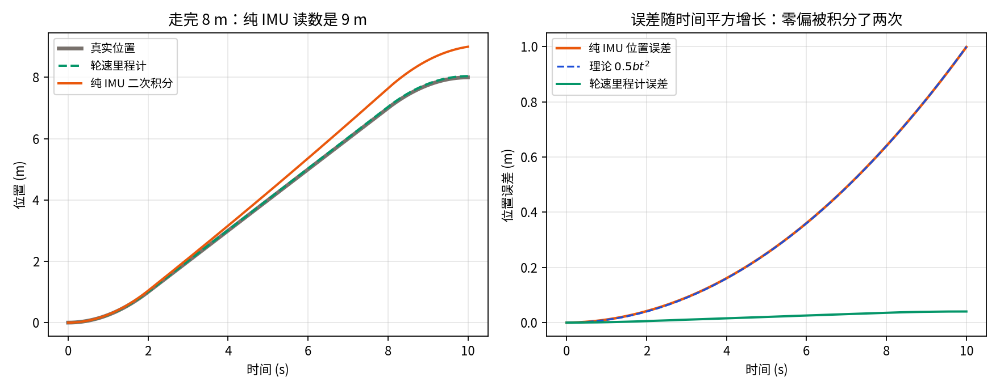
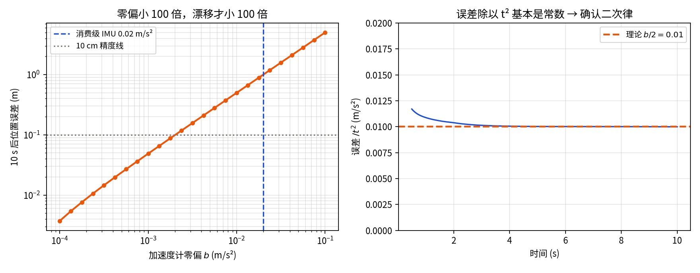

> **一句话结论**：纯惯性导航的误差不是「越走越偏一点」，而是**随时间平方爆炸**——加速度计一个只有 0.02 m/s² 的零偏，被积分两次，10 秒就变成 1 米；换更贵的 IMU 只能线性改善，真正的解法是让 IMU 不再「闭着眼」，也就是把另一类传感器的观测融合进来。

> 爆款加更，不占用正片节奏。本文为后续「卡尔曼滤波」「状态估计」「1 kHz 控制环路」埋钩子：你会先在这里看到问题有多刺眼，再去那里看到解法。配套代码：[`code/imu_drift.py`](https://github.com/SRrobot-ShiRui/Learning-Robotics-for-beginners/blob/main/code/imu_drift.py)。

## 闭着眼走十步，你大概还能走直

现在做个实验：站在走廊里，闭上眼，往前走十步。你大概率不会撞墙。前庭系统、脚底压力、肌肉本体感觉一直在悄悄校准，哪怕什么都不看。

再换一个实验：把一台机器人放在走廊里，蒙上所有摄像头和激光雷达，只留一块 IMU（惯性测量单元），让它靠「感觉自己怎么加速」来推算自己走了多远。10 秒之后，真实位移 **8.0000 米**，它的读数是 **8.9988 米**——多报了将近 1 米。要是让它按这个读数去抓一个杯子，手会伸到杯子后面去。

这不是传感器坏了。这块 IMU 的零偏只有 **0.02 m/s²**，相当于重力加速度的千分之二，属于消费级 MEMS 的正常水平。真正的问题是：**这个几乎察觉不到的小偏差，被积分了两次。**



## 误差为什么会平方增长

IMU 里的加速度计测的是「比力」，控制器把它当成加速度 `a`，做两次积分得到位置：

$$v(t) = \int_0^t a\,\mathrm{d}\tau,\qquad x(t) = \int_0^t v\,\mathrm{d}\tau$$

问题在于测到的不是真值，而是 `a_meas = a_true + b + n`：一个恒定的零偏 `b`，加上随机噪声 `n`。零偏这一项经过两次积分变成

$$e_x(t) = \tfrac{1}{2}\, b\, t^{2}$$

注意是 `t²`，不是 `t`。`b = 0.02 m/s²`、`t = 10 s` 代进去，正好 `0.5 × 0.02 × 100 = 1.0000 m`。本文仿真实跑的误差是 **0.9988 m**（噪声带来的微小偏差），理论值 1.0000 m，两者吻合到千分之一。

更硬的验证是把误差除以 `t²`：在 `t > 0.5 s` 的区间里，这个比值的均值是 **0.010167**，理论值 `b/2 = 0.010000`。一条几乎水平的线，直接确认了「二次律」。图 15-01 右图里那条橙色曲线和蓝色虚线几乎重合，说的就是这件事。

噪声那一项也没闲着：随机误差积分一次变成速度的随机游走，再积分一次变成位置的随机游走，方差随时间立方增长。**零偏决定你漂多远，噪声决定你这次漂得和上次有多不一样**——所以纯惯导不仅不准，还不可重复。

## 代码：逐句实现航迹推算

`imu_drift.py` 的核心函数只有六行，逐句解释：

```python
def dead_reckon(a_meas, dt=DT, x0=0.0, v0=0.0):                # (1)
    n = len(a_meas)                                             # (2)
    x = np.empty(n)                                              # (3)
    v = np.empty(n)
    xx, vv = x0, v0                                              # (4)
    for i in range(n):
        vv = vv + a_meas[i] * dt                                 # (5)
        xx = xx + vv * dt                                        # (6)
        x[i], v[i] = xx, vv                                     # (7)
    return x, v                                                  # (8)
```

- **(1) 接口设计**：输入只有加速度序列、步长和初始状态，输出位置与速度序列。做成纯函数，是为了能拿同一份数据反复验证「改零偏会怎样」。
- **(2)(3) 预分配数组**：循环里不动态拼接列表，避免每次分配内存；10 秒 1 ms 步长就是 10 000 步，这个习惯在 1 kHz 环路里是必须的。
- **(4) 状态初始化**：`xx / vv` 两个标量保存当前状态，不用对象、不引依赖。
- **(5) 加速度 → 速度**：显式欧拉，把本步测得的加速度乘步长累加速度。零偏 `b` 从这里第一次进入系统。
- **(6) 速度 → 位置**：用**刚更新完的**速度推进位置（半隐式欧拉），比用旧速度稳定。零偏在这里被第二次积分，于是变成 `t²`。
- **(7) 记录**：把每步状态存下来，后面画曲线、算误差、拟合 `t²` 全靠它。
- **(8) 返回**：一次调用同时给出位置与速度，误差分析不用再算一遍。

**它能实现什么功能**：把一串加速度读数还原成「我以为自己走了多远」，是惯导流水线里最基础、也最诚实的一环——它没有任何校正，所以把传感器最原始的缺陷原样暴露出来。

**为什么这样写（编写目的）**：这段代码的目的是**演示误差怎么产生**，不是做工程级惯导。真实系统里还要做姿态解算（把加速度从机体坐标系转到世界系）、重力扣除、温度补偿、圆锥/划桨误差补偿，每一项都会引入新的偏差。这里刻意全部省掉，只留两次积分，就是为了让「零偏 → t²」这条因果链一眼可见。**先看清敌人长什么样，再谈装备。**

## 换更贵的 IMU 有用吗：一个让人失望的扫描

最直觉的解法是「买更好的 IMU」。模型里把零偏从 `1e-4` 扫到 `1e-1 m/s²`，跑同一条 10 秒轨迹，结果是一条笔直的 log-log 直线：

| 加速度计零偏 b (m/s²) | 10 s 后位置误差 |
|---|---|
| 2×10⁻⁴ | **0.0087 m** |
| 2×10⁻³ | **0.0987 m** |
| 2×10⁻²（消费级） | **0.9988 m** |
| 1×10⁻¹ | **4.9992 m** |



误差和零偏基本成正比。想要 10 秒漂移压到 10 厘米以内，零偏要小于 **2×10⁻³ m/s²**——比现在好 **10 倍**；想要 1 厘米，得好 100 倍，那是战术级惯导的价格区间，一台机器人的 BOM 表扛不住。**靠换硬件，是拿钱线性地买精度，而误差本身是平方增长的，这笔买卖从一开始就不划算。**

再看另一条路：同一段 8 米运动，用轮速里程计（速度只积分一次，比例误差 0.5%）推算，10 秒误差只有 **0.0403 m**，比纯 IMU 好了 25 倍。听起来问题解决了？并没有——轮速里程计有一个致命前提：**轮子不能打滑**。地面有水、有坡、有减速带，或者机器人是双足的（根本没有轮子），这个 4 厘米立刻变成几十厘米甚至几米。

于是真正的答案浮出水面：IMU 高频但会漂，里程计/视觉低频但会锚住位置，**两者的误差刚好互补**。怎么把它们按各自的可信度加权融合，让误差不再随时间发散，就是下一篇要讲的卡尔曼滤波。本文不展开，先把问题摆在台面上：**不是传感器不够好，是没有人告诉系统「该信谁」。**

## 工程视角：这个 1 米误差出现在哪

**人形机器人被推时的「愣神」**。第 12 篇说「机器人不是推不动，是推了之后才发现自己在被推」。那几十毫秒里，控制器用的质心位置就来自 IMU + 编码器融合的状态估计；融合做得差，估计值本身带着漂移，平衡反射会在错误的位置上发力，越救越歪。

**无人机的姿态与悬停**。多旋翼的 IMU 是唯一能提供 1 kHz 姿态的传感器，GPS 只有 10 Hz 且室内没有。悬停时若加速度零偏没被补偿，飞控会以为自己在缓慢加速，于是持续往反方向倾斜——表现就是「无人机自己慢慢飘走」。室内不靠视觉/光流锚住，飘走只是时间问题。

**AGV、扫地机与仓储机器人**。轮式平台靠里程计 + IMU 做航迹推算，成本低、帧率高，但长时间运行必然累积误差，所以每隔一段距离要用二维码、UWB 或激光定位做一次全局校正。这本质上是「用低频绝对观测打断二次发散」。

**手机、AR 与 VR**。你在隧道里导航，地图上的蓝点会飘到隔壁街；VR 手柄不用基站时几分钟就偏。用户体感里的「漂移」，和机器人脚下那 1 米是同一个式子 `0.5bt²`。

**一个能记住的翻车形态**：仿真里把 IMU 设成零噪声零偏，真机上一切正常；一上真机，静止不动时位置读数仍在缓慢往外跑。**这不是代码 bug，是传感器物理**——所有只靠惯性推算的系统都必然如此。

## 留给后面几篇的钩子

- 下一篇《卡尔曼滤波的几何解释》：怎么把「高频但会漂」和「低频但准确」两类观测按协方差融合，以及为什么 IMU 要用误差状态
- 《因子图与滑窗优化》：VIO/SLAM 为什么最终收敛到一张图，长时间漂移怎么被全局约束拉回来
- 《1 kHz 的控制环路》：状态估计延迟为什么能决定平衡成败（第 12 篇「瓶颈一」的完整答案）
- 《接触力学入门》（[第 13 篇](13-contact-mechanics-friction-cone.md)）：轮速里程计打滑时的接触力判据

## 常见问题（FAQ）

**问：把 IMU 静止时读到的平均加速度减掉，不就消掉零偏了吗？**

答：能消掉一大半，这叫静态零偏标定，是必须做的第一步。但零偏会随温度、时间、振动缓慢变化（温漂与随机游走），开机标一次管不了十分钟；而且还有一部分偏差来自姿态误差——姿态角差 0.1°，重力投影到水平轴就有约 0.017 m/s² 的假加速度，和本文的零偏同量级。所以标定之后仍然需要持续融合外部观测。

**问：误差是 t²，那是不是只要走得够快就行？**

答：恰恰相反。固定零偏下，误差只取决于**经过的时间**，与走多远无关：静止 10 秒也会「漂」出 1 米。走得快只是让 1 米误差在总里程里占比显得小，绝对误差一点没少。这也是为什么惯导规格常用「每小时漂移多少海里」而不是「每米误差多少」来标。

**问：为什么不用 GPS 直接定位？**

答：室外可以，而且是很好的绝对观测；室内、地下、隧道、厂房里 GPS 不可用或误差几米，人形机器人和无人机大多工作在这些场景。即便室外，GPS 也只有 10 Hz 左右，控制环路需要的是 1 kHz 的姿态和加速度——所以 GPS 是「锚」，IMU 是「骨架」，两者是配合关系而不是替代关系。

**问：既然轮速里程计误差只有 4 厘米，为什么机器人不都用它？**

答：因为那个 4 厘米是在「轮子纯滚动、地面水平、比例系数已知」的理想条件下测的。一旦打滑、轮胎磨损、地面不平，比例误差就会跳变，误差从线性累积变成突变，而且系统自己察觉不到。腿式机器人更是完全没有轮子。工程上必须保留一个独立的观测源来发现「里程计在骗人」，这正是融合算法要解决的问题。

## 延伸阅读

- 教材：Lynch & Park, *Modern Robotics* 状态估计相关章节；Bar-Shalom et al., *Estimation with Applications to Tracking and Navigation*
- 工具：ROS `robot_localization`（EKF/UKF 融合）、PX4 ECL EKF2、GTSAM 的 IMU 因子
- 本专栏相关：[第 12 篇 平衡](12-why-robots-fall-when-pushed.md)（状态估计延迟是平衡第一瓶颈）、[第 13 篇 接触力学](13-contact-mechanics-friction-cone.md)（打滑的力学判据）、[第 09 篇 sim2real](09-rl-humanoid-sim2real.md)（观测延迟 gap）
- 配图：`fig15-01-imu-drift.png`、`fig15-02-bias-sweep.png`（全部数据由脚本实跑生成）
- 配套代码：[`imu_drift.py`](https://github.com/SRrobot-ShiRui/Learning-Robotics-for-beginners/blob/main/code/imu_drift.py)，`python3 imu_drift.py --plot` 复现全部数字与两张图

**完整内容链接（误差状态卡尔曼滤波 ESKF 完整推导、四种融合方案实测对比与选型理由、IMU+编码器航迹推算完整可用代码）**：<https://blog.csdn.net/2301_81238088/category_13220213.html>

**完整版每周二更新**，订阅后第一时间推送。

