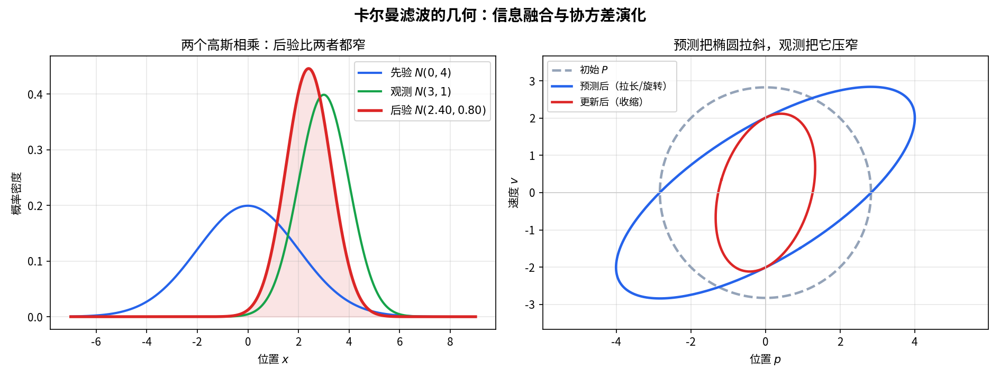
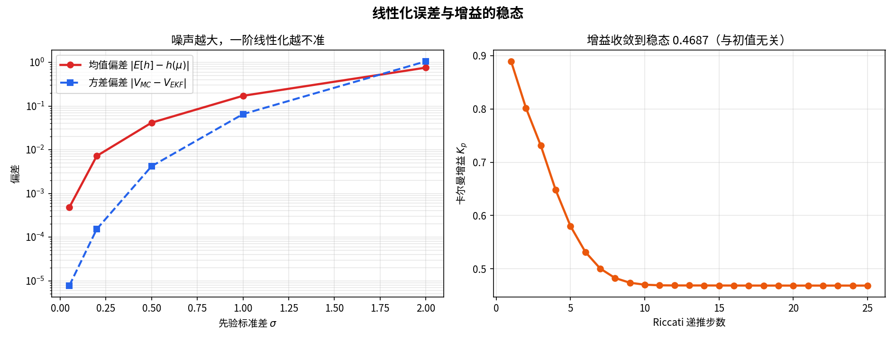
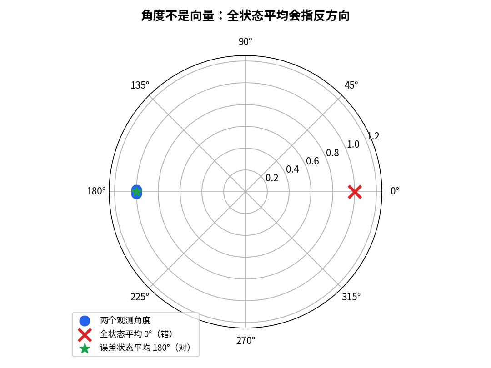

> **一句话结论**：卡尔曼滤波不是五个要背的公式，而是**在反复做同一件几何操作**——把「预测出来的高斯」和「观测到的高斯」相乘，得到一个更窄的高斯；卡尔曼增益只是决定「更相信谁」的那个权重，而权重由两个分布的宽度自动算出来，不需要人工调。

本文用可运行的 Python 把这句话拆成四个能看见的画面：两个高斯相乘、协方差椭圆被拉长又被压窄、增益自动收敛到稳态、以及一阶线性化什么时候开始骗人。所有数字来自配套脚本 `kalman_geometry.py`，`--plot` 可一次复现三张图。读完之后再看 KF 的五个方程，它们会变成同一幅图的五个角落。

## 直觉层：两次不精确的测量，为什么合起来更精确

假设你要知道一个物体在哪。你有两份信息：

- 上一时刻的位置加上运动模型，推算出它现在大概在 `0`，但这个推算**很不确定**，标准差 2（方差 `P₁ = 4`）；
- 传感器直接报了一个读数 `3`，这个读数**比较可靠**，标准差 1（方差 `P₂ = 1`）。

直觉会告诉你「取个折中」。但折中该偏向谁？如果简单平均得到 `1.5`，等于宣称两份信息一样可靠，这显然浪费了传感器。真实的最优答案是 `2.4`——明显偏向更可靠的传感器，但不是完全照抄它。

这个 `2.4` 怎么来的？把两个高斯密度函数**相乘**，再归一化，得到的还是高斯，它的均值恰好是

$$\mu = \mu_1 + \frac{P_1}{P_1+P_2}(\mu_2-\mu_1) = 0 + 0.8\times 3 = 2.4$$

括号里的 `P₁/(P₁+P₂) = 0.8` 就是**卡尔曼增益 K**。它天生是个 0 到 1 之间的数：预测越不确定（`P₁` 越大），K 越接近 1，越听传感器的；观测越不确定（`P₂` 越大），K 越接近 0，越信自己的推算。

更妙的是方差：

$$P = \frac{P_1 P_2}{P_1+P_2} = \frac{4\times 1}{5} = 0.8$$

**0.8 比 4 小，也比 1 小**。融合之后比两个输入都更确定——这不是魔法，因为「两个独立的、都不完美的信息」本来就该比单独一个更可靠。用信息量（方差的倒数）写会更直白：

$$\frac{1}{P} = \frac{1}{P_1} + \frac{1}{P_2} = 0.25 + 1 = 1.25$$

信息是可以相加的。脚本里用 40 万个网格点把两个密度相乘再数值积分，得到均值 `2.400000`、方差 `0.800000`，与解析式误差 `0.00e+00 / 4.44e-16`——图 1 左就是这三条曲线，红色后验又高又窄，稳稳压在两者之间。



## 代码：把「相乘」写成十行

理论讲完，落到代码。下面是脚本 `exp1_gaussian_product()` 的核心，用 `numpy` 就能跑，不依赖任何滤波库。

```python
def gaussian(x, mu, var):                                    # (1)
    return np.exp(-0.5 * (x - mu)**2 / var) / np.sqrt(2*np.pi*var)

mu1, P1 = 0.0, 4.0                                          # (2)
mu2, P2 = 3.0, 1.0                                          # (3)
K = P1 / (P1 + P2)                                          # (4)
P_post = P1 * P2 / (P1 + P2)                                # (5)
mu_post = mu1 + K * (mu2 - mu1)                             # (6)

x = np.linspace(-8, 10, 400001)                             # (7)
prod = gaussian(x, mu1, P1) * gaussian(x, mu2, P2)          # (8)
w = prod / np.trapezoid(prod, x)                            # (9)
mu_grid = np.trapezoid(x * w, x)                            # (10)
var_grid = np.trapezoid((x - mu_grid)**2 * w, x)            # (11)
```

逐句解释：

- **(1)** 一维高斯密度。写成函数而不是直接算，是为了后面能对整个 `x` 数组向量化求密度曲线，画图和积分共用一份代码。
- **(2)(3)** 两组「均值 + 方差」。注意这里刻意不给标准差而给方差，因为 KF 的整套推导都在方差（协方差）空间里做，用标准差会多一层平方，容易写错。
- **(4)** 卡尔曼增益。这一行是整个滤波器的灵魂：**它没有任何可调参数**，完全由两份信息各自的方差决定。工程上常说的「调 KF」其实调的是 `Q` 和 `R`（过程噪声与观测噪声），它们通过改变 `P` 间接改变 `K`，而不是直接旋钮 `K`。
- **(5)** 后验方差，即两个方差的「并联」——和电阻并联、弹簧串联同一形式，物理学里这个式子反复出现，本质是信息量相加。
- **(6)** 后验均值，写成「预测值 + 增益 × 新息」的形式。`mu2 - mu1` 叫**新息（innovation）**，是「观测和预期差了多少」；`K` 决定把这份差额采纳几成。这个写法比直接写加权平均更重要，因为高维版本、EKF、误差状态 KF 全都沿用同一个结构，只是 `K` 从标量变成矩阵、新息从标量变成向量。
- **(7)** 取 40 万个点做数值积分验证。点数取得密，是为了让梯形积分的离散误差远小于我们要验证的 `1e-15` 量级差异。
- **(8)** 两个密度逐点相乘——这就是「贝叶斯更新」在连续分布上的全部内容。未归一化的乘积形状已经是后验了，只是面积不等于 1。
- **(9)** 归一化。`np.trapezoid` 是 numpy 的梯形积分，用它算曲线下面积当归一化常数，避免手工推导归一化系数。
- **(10)(11)** 用加权积分反算均值与方差，作为「独立裁判」验证解析式。这种「解析解 + 数值积分对照」的写法在验证滤波公式时非常值得保留：公式推错一位，数值积分立刻对不上。

这段代码能实现的功能是**验证一维 KF 更新步的正确性**；编写目的是把抽象的「高斯相乘」变成可肉眼核对的两个数字；它刻意不引入矩阵、不引入时间递推，因为一旦堆上多维，读者就看不清「信息量相加」这一件核心事实了。

## 进阶层：预测拉长、观测压窄，反复交替

一维看完了，二维才有真正的「几何」。设状态是「位置 p + 速度 v」，匀速模型 `F = [[1, dt], [0, 1]]`，只能观测到位置 `H = [1, 0]`。协方差 `P` 是个 2×2 矩阵，画出来是个椭圆——椭圆越胖，我们对状态越没底。

一次循环里发生两件事：

**预测步** `P⁻ = F P Fᵀ + Q`。`F` 把位置的不确定性传播到未来，同时 `Q`（过程噪声，代表「模型不完美」）再添一点。椭圆会**变胖、并且倾斜**——倾斜是因为位置和速度的误差开始相关：速度估高了，位置也会跟着越估越偏。脚本里初始 `det(P) = 4.0`，预测后变成 `4.053367`。

**更新步** `P = (I − K H) P⁻`。观测只提供了一个位置的读数，但通过椭圆里那条「位置—速度相关性」，连速度的不确定性也被顺带修正了。脚本算出的增益向量是 `K = [0.889053, 0.446006]`：第二分量不为零，正是「只测位置却改了速度」的证据。更新后 `det(P) = 0.449708`，**不确定面积被压到预测值的 11.09%**。图 1 右把三个椭圆叠在一起：灰色虚线是初始、蓝色是被拉斜的预测、红色是收缩后的更新。

这里有个容易忽略的点：为什么「预测后再观测」能一直收敛，而不是每次都从头开始？因为 `P` 会自己稳定下来。脚本把 Riccati 递推跑 25 步，位置增益从 `0.889053` 一路降到 `0.468710` 后不再变化，稳态 `P` 对角元为 `0.234355 / 0.054304`。图 2 右那条快速趋平的曲线说明：**增益是方程的解，不是工程师拍脑袋定的常数**。稳态之后，滤波器对每个新观测的反应强度固定，这使得实时系统里的行为可预测、可验收。

## 边界：一阶线性化什么时候开始骗你

标准 KF 要求模型和观测都是线性的。真实机器人里几乎没有线性观测——「到信标的距离」`h(x) = √(x²+y²)` 就是非线性的。EKF 的做法是在当前估计处求一阶雅可比，把曲线局部当成直线。

脚本用 20 万次蒙特卡洛采样当「真值」，对比 EKF 的解析结果：

| 先验标准差 σ | 距离真均值 | EKF 给的均值 | 均值偏差 | 真方差 | EKF 方差 |
|---|---|---|---|---|---|
| 0.05 | 3.00048 | 3.00000 | 0.00048 | 0.00251 | 0.00250 |
| 0.20 | 3.00722 | 3.00000 | 0.00722 | 0.03985 | 0.04000 |
| 0.50 | 3.04171 | 3.00000 | 0.04171 | 0.24580 | 0.25000 |
| 1.00 | 3.17181 | 3.00000 | 0.17181 | 0.93459 | 1.00000 |
| 2.00 | 3.75773 | 3.00000 | **0.75773** | 2.94544 | 4.00000 |

EKF 永远报 `3.00000`，因为它在均值处线性化，`h(μ)` 就是 3。但真实均值随 σ 增大一路飘到 `3.75773`——偏差放大了 **1574 倍**。原因是距离函数带凸性，分布越宽，落在「离均值更远」区域的概率越大，期望值被系统性抬高；一阶展开只保留了斜率，把这份曲率全丢了。方差也一样，σ=2 时 EKF 报 `4.00000`，真值只有 `2.94544`，**高估了 36%**。

工程结论很具体：EKF 的可信度取决于「先验分布相对于曲率有多大」，而不是取决于你用了多贵的状态向量。当初始化误差很大、或观测长时间中断导致 `P` 膨胀时，继续用一阶 EKF 会得到一个**看起来收敛、实际有偏**的估计——这比发散更危险，因为它不报警。图 2 左的两条曲线把这个偏差随 σ 的增长画得很清楚，右图则是增益收敛到稳态的那条曲线。



## 为什么 IMU 必须用误差状态

最后一个画面和姿态有关。假设两个角度观测是 `+179°` 和 `-179°`，它们其实几乎指向同一个方向，平均值应该是 `±180°`。但直接把两个数相加除以二：

$$(179 + (-179))/2 = 0°$$

得到 `0°`——**整整反了 180°**。脚本算出的全状态平均误差是 `180.000°`。问题不在于数值精度，而在于角度根本不是向量：`+179°` 和 `-179°` 在数轴上相隔 358°，在圆周上只隔 2°。

误差状态（ESKF）的做法是：固定一个标称姿态，只把「小偏差」放在切空间里表示。脚本把差值 wrap 到 `(-180°, 180°]`，得到 `delta = 2.000°`，再在标称值上加一半增量，得到 `-180°`（与 `+180°` 等价），误差 `0.000°`。图 3 用极坐标把三个点画出来：红叉（全状态平均）落在 0°，绿星（误差状态平均）和两个蓝点一起落在 180°。



这就解释了第 15 篇留下的那个问题：IMU 的姿态在 SO(3) 上，直接对四元数或欧拉角做「加权平均」在数学上不封闭，而误差状态永远在切空间这个线性空间里做加减，KF 的全部线性假设才重新成立。所以几乎所有实用的 IMU 融合（VIO、组合导航、人形机器人状态估计）都用 ESKF 或直接在其上迭代（IEKF），而不是拿全状态硬套 EKF。

## 工程视角：这套几何出现在哪

- **无人机组合导航**：GPS 10 Hz、IMU 200 Hz。预测步用 IMU 高速外推（椭圆不断拉长），GPS 每来一次就压窄一次。GPS 短时丢星时 `P` 会膨胀，这正是判断「还能信多久」的依据，也是 EKF 偏差风险的入口。
- **机械臂视觉伺服**：相机给出末端位置观测、编码器给出关节角，两者方差随工况变化（运动模糊时相机噪声变大），`K` 自动把权重移向编码器——无需手写「模糊时信编码器」的规则。
- **人形机器人本体状态估计**：足端接触相当于一次「位置被约束住」的观测，配合 IMU 预测，构成典型的 ESKF；接触打滑时观测噪声骤增，`R` 需要跟着放大，否则会把滑移当成真实位移吸收进状态。
- **AGV / 扫地机定位**：里程计纯积分必然发散（下下篇会量化），必须周期性引入地图或信标观测把 `P` 压回去，这正是「预测—更新」循环的物理版本。
- **电池 SOC 估计**：状态是荷电状态，模型是电流积分，观测是端电压；`Q` 代表模型误差、`R` 代表电压采样噪声。同一套方程换个名字就能用，说明它确实是「信息融合的几何」，而不是某一类机器人的专有技巧。

## 常见问题（FAQ）

**问：卡尔曼增益 K 需要人工调参吗？**

不需要直接调。K 是 `P`、`H`、`R` 算出来的解析解，脚本里 25 步递推后自动收敛到 `0.468710`，与初始 `P` 取多大无关。工程上「调 KF」实际是调 `Q`（过程噪声）和 `R`（观测噪声）：把 `R` 调大等于告诉滤波器「传感器不可信」，K 会随之变小。直接改 K 会破坏协方差的一致性，让滤波器在有故障时不报错却给出错误置信度。

**问：既然高斯相乘会让方差变小，是不是多跑几步就能无限精确？**

不会，因为预测步的 `Q` 每次都在往里加不确定性。一减一加达到平衡，就是脚本里 `K = 0.468710` 那个稳态。稳态精度由 `Q/R` 的比值决定：想更精确，只能降低过程噪声（更好的模型）或降低观测噪声（更好的传感器），不能靠增加迭代次数。

**问：EKF 和误差状态 KF 有什么区别，该用哪个？**

EKF 在「全状态」上线性化，状态本身若处在流形上（姿态、位姿），线性化和平均都不合法——脚本里 `+179°/-179°` 平均出 `0°` 就是这类错误。误差状态 KF 把小偏差放在切空间，那里是普通欧氏空间，KF 的假设全部成立。只要状态里含姿态，就该用误差状态形式；纯线性系统（如一维位置跟踪）两者等价，用标准 KF 即可。

**问：怎么判断我的 EKF 已经不可信了？**

看 `P` 和新息。若观测长时间中断导致 `P` 膨胀到与非线性曲率同量级，一阶展开就不再成立（脚本里 σ=2 时偏差已达 `0.75773`）；若新息持续同号且远超 `√S`，说明模型或噪声参数错了。这两种情况都不会让滤波器「发散报警」，而是安静地给出有偏估计——所以线上要监控归一化新息平方（NIS），而不只看估计值是否平滑。

## 延伸阅读

- 教材：Thrun, Burgard & Fox, *Probabilistic Robotics* 第 3 章（高斯滤波）；Barfoot, *State Estimation for Robotics*（李群视角的误差状态，讲得最透）
- 经典：Kalman, 1960（原始论文）；Maybeck, *Stochastic Models, Estimation and Control* 第 1 卷
- 本专栏前置：[第 15 篇 IMU 漂移](15-why-robots-drift-without-vision.md)（为什么纯积分必然发散）、[第 04 篇 雅可比](04-jacobian-velocity-translator.md)（雅可比就是 EKF 里那个 `H`）、[第 01 篇 SE(3)](01-se3-pose-representation.md)（姿态为什么要流形）
- 配套代码：[`kalman_geometry.py`](https://github.com/SRrobot-ShiRui/Learning-Robotics-for-beginners/blob/main/code/kalman_geometry.py)，`python3 kalman_geometry.py --plot` 复现全部数字与三张图

**完整内容链接（误差状态 ESKF / IEKF 完整推导、四种滤波实现方式的实测对比与选型理由、可观测性分析与完整可用代码）**：<https://blog.csdn.net/2301_81238088/category_13220213.html>

**完整版每周二更新**，订阅后第一时间推送。

