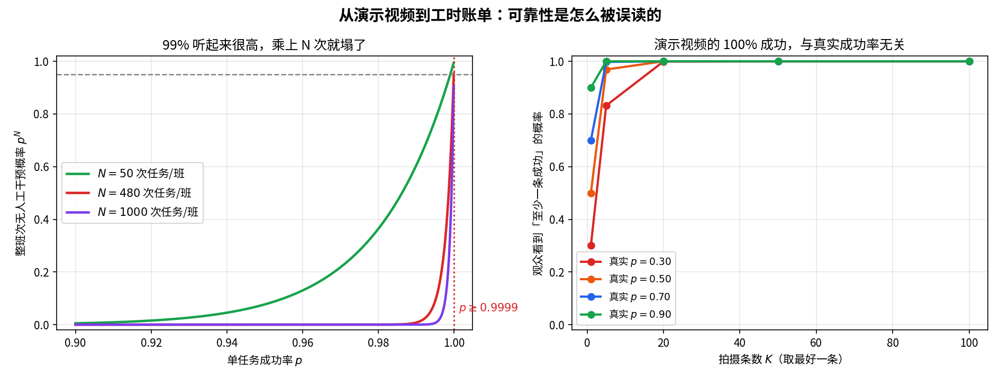
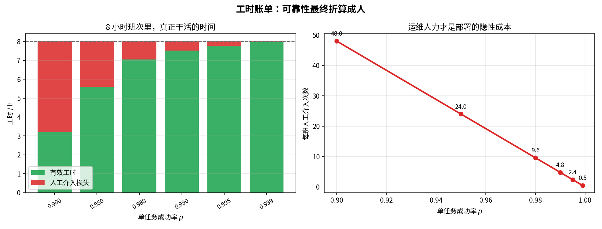

> **一句话结论**：「演示视频里能干活」和「工厂里能上班」之间隔着的不是技术代差，而是一次**连乘**——单任务成功率 `p` 看着有 99%，重复 480 次之后整班不用人管的概率只剩 `0.80%`；真正决定能不能部署的，从来不是最好那一次，而是最差那一千次。

本文把「部署」这个被用滥的词拆成可计算的量：单任务成功率怎么折算成整班可靠性、演示视频的 100% 成功为什么和真实成功率无关、人工介入怎样吃掉工时，以及把 `p` 从 0.90 提到 0.999 到底值多少钱。所有数字来自配套脚本 `deployment_metrics.py`，`--plot` 可复现两张图；文中参数均为量级假设，用于说明口径，不是任何厂商的真实账单。

## 开场：一条视频和一张考勤表

2026 年的发布会里，几乎每台人形机器人都能完成一段流畅的演示：走上几步、拿起零件、放进料箱、转身，一气呵成。弹幕刷「要进厂了」。半年后，同一台机器人在某条产线上试运行，媒体报道的却是「仍需人工看护」「每小时要干预几次」。

两种说法都没撒谎，它们只是**在回答不同的问题**。演示回答的是「存在一次成功吗」，产线问的是「连续 480 次里一次都不失败的概率有多大」。这两者之间差着一个指数。

要把它算清楚，只需要三个数：一个班次多长、单次任务多久、失败了谁来救。本文取一组便于核对的口径：班次 8 小时、单任务 1 分钟、每次人工介入恢复 6 分钟。于是 `N = 8 × 60 / 1 = 480` 次任务/班。这三个数换掉，结论的方向不会变，只是数字搬家。

## 第一层：99% 为什么不够用

若每次任务独立、单任务成功率为 `p`，整班「一次都不用人管」的概率就是 `p^N`。脚本逐个算给你看：

| 单任务成功率 p | 整班无干预概率 p⁴⁸⁰ | 期望失败次数 |
|---|---|---|
| 0.9000 | ≈ 0.0000% | 48.00 |
| 0.9500 | ≈ 0.0000% | 24.00 |
| 0.9800 | 0.0061% | 9.60 |
| 0.9900 | **0.8033%** | 4.80 |
| 0.9950 | 9.0173% | 2.40 |
| 0.9990 | 61.8635% | 0.48 |
| 0.9999 | 95.3131% | 0.05 |

`p = 0.99` 在单次尺度上是「一百次里只失手一次」，听起来相当可靠；但连续跑 480 次，不出事的概率只有 `0.8033%`——**几乎必然要人插手**。反过来算，要让整班无干预概率达到 95%，需要

$$p \geq 0.95^{1/480} = 0.999893$$

也就是**每 9358 次任务最多失败 1 次**。这个数量级才是「无人值守」的门槛。图 1 左把三条不同 `N` 的曲线画在一起：`N=50` 时 `p=0.99` 还有 60% 把握，`N=480` 就已经贴着横轴，`N=1000` 更是要到 `p>0.9999` 才抬得起来。所以「演示 50 个动作全成功」和「上班 8 小时不用管」根本不是同一个指标，中间隔着 `N` 这个放大器。



## 第二层：演示视频的 100% 成功，与 p 几乎无关

那为什么演示总能成功？因为视频是**剪出来的**。

假设真实单任务成功率只有 `p = 0.30`，拍 `K` 条素材、只要有一条成功就能剪出「完美演示」，这个概率是 `1 − (1−p)^K`。脚本实跑：

| 真实 p | K=1 | K=5 | K=20 | K=50 |
|---|---|---|---|---|
| 0.30 | 30.00% | 83.19% | **99.92%** | 100.00% |
| 0.50 | 50.00% | 96.88% | 100.00% | 100.00% |
| 0.70 | 70.00% | 99.76% | 100.00% | 100.00% |
| 0.90 | 90.00% | 100.00% | 100.00% | 100.00% |

`p = 0.30` 拍 20 条，就有 `99.92%` 的概率剪出一条无懈可击的视频。图 1 右那几条迅速贴到 1.0 的曲线说明：**观众看到的「100% 成功」，对真实成功率几乎没有信息量**。只要允许重试、允许挑片、允许剪掉失败，任何 `p>0` 的系统都能产出完美演示。

所以评估一条演示视频，该问的不是「它做成了什么」，而是四条口径问题：连续跑了多少次？失败的定义是什么？允许重试或人为复位吗？有没有报告失败形态和分布？这四个问题能过滤掉大部分「看起来已经能进厂」的印象。这与本专栏前面反复强调的「数据口径核查清单」是同一套方法，只是这次用在可靠性上。

## 代码：把可靠性写成可复算的账单

脚本核心不到二十行，全部是初等运算，用 `numpy` 只是为了画图和扫描。

```python
SHIFT_HOURS = 8.0                                    # (1)
TASK_MIN = 1.0                                       # (2)
RECOVER_MIN = 6.0                                    # (3)

def tasks_per_shift():                               # (4)
    return SHIFT_HOURS * 60 / TASK_MIN

N = int(tasks_per_shift())                           # (5)
p_shift = p ** N                                     # (6)
exp_fail = N * (1 - p)                               # (7)
lost_h = exp_fail * RECOVER_MIN / 60                 # (8)
eff_h = SHIFT_HOURS - lost_h                        # (9)
p_need = 0.95 ** (1.0 / N)                          # (10)
at_least_one = 1 - (1 - p) ** K                     # (11)
```

逐句解释：

- **(1)(2)(3)** 三个口径参数集中放在模块顶部，而不是散落在函数里。目的是让「换一组假设重算」变成改三个数就行——这类模型最怕的就是参数藏在表达式里，别人无法复现你的结论。
- **(4)** 班次任务数。写成函数是为了强调它是**派生量**，由 (1)(2) 决定；若直接写死 `N = 480`，改班次时长时就会漏改。
- **(5)** 转成整数，因为任务次数必须可数。
- **(6)** 整班无干预概率，整篇文章的核心一行。用幂而不是循环，既快也不会有累积浮点误差；`p` 接近 1 时 `p**N` 的数值精度足够，不需要 `log` 变换。
- **(7)** 期望失败次数。由二项分布的期望 `N(1−p)` 直接给出，注意这里是**期望**而非「保证次数」，用来估计平均运维负载。
- **(8)(9)** 把失败次数折算成工时。`RECOVER_MIN` 是每次介入的恢复耗时（含走过去、复位、重启、重新对齐），乘以次数再换算成小时，从 8 小时里扣掉，得到「真正干活的时间」。这一步是「工时账单」这个名字的由来：可靠性最终不是百分比，是小时和人力。
- **(10)** 反解可靠性目标。由 `p^N = 0.95` 两边开 `N` 次方得到，给出「要达到目标，单次成功率得到多少」——比正着算更能说明门槛有多高。
- **(11)** 演示剪辑偏差：拍 `K` 条至少成功一条的概率。用补集 `1 − (1−p)^K` 而不是枚举，是因为 `K` 到 100 时直接算组合数会溢出，补集形式对任意 `K` 都稳定。

这段代码能实现的功能是**把「能不能部署」从形容词变成一张可复算的表**；编写目的是让每个结论都能追到某一行代码，避免行业讨论里常见的「感觉挺稳」；它刻意只用初等运算、不引入仿真或随机数，因为这里要算的是解析关系，随机仿真反而会引入不必要的方差、掩盖 `N` 的放大作用。

## 第三层：工时账单里，最贵的是人

把失败折算成钱，画面会再变一次。脚本按「每次介入损失 6 分钟」计算有效工时：

| p | 每班人工介入 | 损失工时 | 有效工时 | 完成任务数 |
|---|---|---|---|---|
| 0.900 | 48.00 次 | 4.80 h | **3.20 h** | 432.0 |
| 0.950 | 24.00 次 | 2.40 h | 5.60 h | 456.0 |
| 0.980 | 9.60 次 | 0.96 h | 7.04 h | 470.4 |
| 0.990 | 4.80 次 | 0.48 h | 7.52 h | 475.2 |
| 0.995 | 2.40 次 | 0.24 h | 7.76 h | 477.6 |
| 0.999 | 0.48 次 | 0.05 h | **7.95 h** | 479.5 |

`p = 0.90` 时，8 小时班次里有 4.8 小时花在救人上，机器人实际只干了 3.2 小时——**看起来是买了一台机器人，其实是雇了一个人要随时盯着它**。把 `p` 提到 0.999，有效工时变成 7.95 h，相对提升 `148.5%`；而 `p` 的绝对增量只有 `0.099`。图 2 左把有效工时与损失工时堆成柱，右图把介入次数单独画出来：这条下降曲线才是部署经济性的真实形状。



这里藏着一个常被误判的因果关系：机器人本体成本是一次性的，运维人力是**按班次永久发生**的。于是「可靠性差一点点」不会让设备便宜多少，却会让每个班次的成本结构彻底改变。评估方案时把两者放在同一张表上，才不会得出「买便宜的那台更划算」的结论。

## 工程视角：这套判据怎么用

- **产线试运行验收**：不要只报成功率，要求同时报「连续任务数 N」「失败定义」「是否允许复位」「每班人工介入次数」。缺任何一项，成功率都无法外推到班次尺度。
- **方案选型**：把 `p` 与 `RECOVER_MIN` 一起估。有些方案失败率高但能自动恢复（等效 `RECOVER_MIN≈0`），有些方案几乎不失败但一失败就要停机半小时——前者在工时账单上可能更优。
- **演示素材审查**：看到「100% 成功」，先问拍了多少条、剪掉了多少条。用 `1−(1−p)^K` 反推，能大致判断展示的是能力还是运气。
- **数据采集与模型迭代**：`p` 从 0.99 到 0.999 需要长尾失败样本，而演示与短时测试里恰恰采不到这些样本。这解释了为什么「再多采 10 倍数据」有时收益有限——如果采集分布里根本没有失败形态，倍率再高也补不上那一类样本。
- **服务机器人 / AGV**：同样适用，只是 `N` 更大、`RECOVER_MIN` 更小（可远程重启）。口径一换，结论仍由 `p^N` 决定。

## 常见问题（FAQ）

**问：把单任务成功率连乘，是不是假设了各次任务互相独立？**

是，这是本文模型最强的假设，必须明说。真实产线里失败常成簇出现（某个料箱位置偏差、某段地面打滑、某次标定漂移会影响后续一串任务），此时独立性不成立，`p^N` 会**低估**整班无干预的难度。所以文中这张表应理解为「乐观下界」：连独立假设下都只有 0.80%，真实系统只会更难。工程上应改用带状态转移的可靠性模型或直接用实测班次数据。

**问：0.999893 这个门槛是不是太苛刻、根本达不到？**

它对应的是「8 小时完全无人干预且 95% 把握」，这确实是很高的标准。真实部署通常**不要求**这个：允许定时巡检、允许自动重试、允许降级运行，等价于减小有效 `N` 或 `RECOVER_MIN`。把验收目标从「整班零干预」改成「每班介入 ≤1 次且可自动恢复」，门槛会立刻降到可工程实现的区间。关键是把目标写清楚，而不是含糊地说「要稳定」。

**问：为什么不用 MTBF 而要数任务次数？**

MTBF 按时间算，适合连续运行型设备；机器人常按「件/次」计产出，任务之间的复位、上下料会打断时间连续性，用次数更贴合。两者可以换算（本口径下 480 次任务对应 8 小时），但按次数建模能自然带上「失败后恢复耗时」这一项，更适合算工时账单。

**问：这些数字能直接引用为某家公司的水平吗？**

不能。文中 `8 h / 1 min / 6 min` 全是便于核对的量级假设，`p` 是扫描参数而非实测值，脚本里也没有任何厂商数据。它给出的是**换算方法和数量级直觉**，用于建立评估口径；要评价具体系统，必须换成该系统的真实班次参数与实测失败记录。

## 延伸阅读

- 方法：可靠性工程中的二项串联模型与 `MTBF / MTTR / 可用性` 定义；IEC 61508 功能安全里的失效概率口径
- 本专栏相关：[第 14 篇 复现成本](14-cost-of-reproducing-a-paper.md)（成本口径核查清单）、[第 09 篇 sim2real](09-rl-humanoid-sim2real.md)（长尾失败样本为何难采）、[第 02 篇 人形机器人 2026](02-humanoid-2026-state.md)（工时账单视角）
- 配套代码：[`deployment_metrics.py`](https://github.com/SRrobot-ShiRui/Learning-Robotics-for-beginners/blob/main/code/deployment_metrics.py)，`python3 deployment_metrics.py --plot` 复现全部数字与两张图

**完整内容链接（含相关性失效的马尔可夫可靠性模型、五种部署验收口径的实测对比与选型理由、完整可用核算脚本）**：<https://blog.csdn.net/2301_81238088/category_13220213.html>

**完整版每周二更新**，订阅后第一时间推送。

