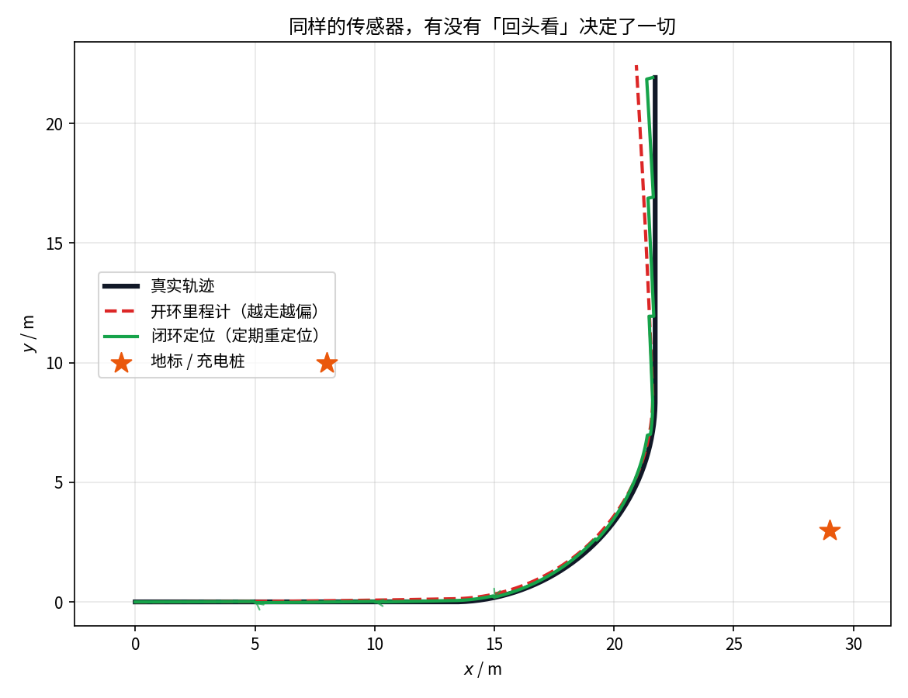
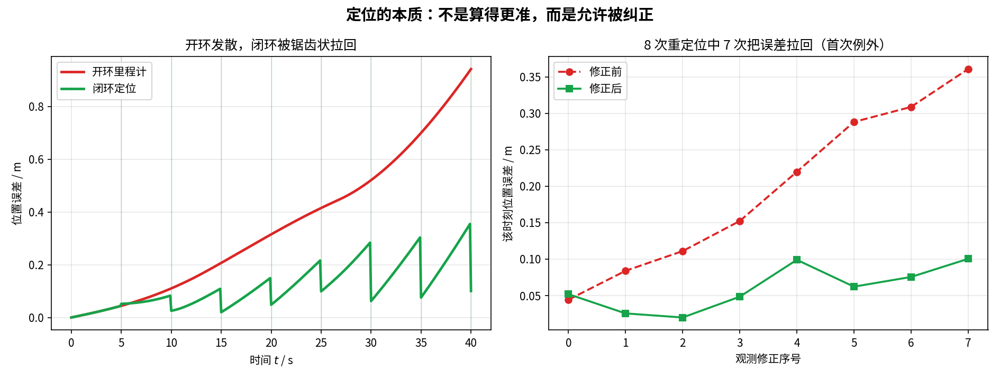

> **一句话结论**：扫地机器人不是算得比人形机器人准，而是它**允许自己被纠正**——它隔一会儿就抬头看一眼「我在哪」，把攒下的误差清零；纯靠轮子转数推算的位置会一路漂，40 米走完偏出 `0.9424 m`，而加了周期性重定位的同一套传感器，末端只剩 `0.1004 m`。

本文用一个 40 米的可运行轨迹把这句话变成两条可对照的误差曲线：一条单调发散，一条被锯齿状反复拉回。所有数字来自配套脚本 `localization_loop.py`，`--plot` 可复现两张图。读完你会明白，定位准不准的关键不在传感器多贵，而在系统里有没有一条「观测回流」的路。

## 开场：几百块的机器，做了几百万的机器做不到的事

家里那台扫地机器人，几百到几千块，转两圈就能把全屋画成一张地图，充电时自己找得到桩，被你抱到另一个房间也能很快认出来。而发布会里能后空翻、能搬箱子的双足机器人，走两步就得靠人扶、换个场景常常「不知道自己在哪」。

这不是传感器差距——人形机器人身上的 IMU、关节编码器、深度相机，加起来比扫地机贵两个数量级。差别在**架构**：扫地机默认自己会算错，所以每隔几秒就用环境信息校准一次；纯靠本体传感器外推的系统，再精密也挡不住误差按路程累积。

第 15 篇讲过 IMU 的加速度零偏被积分两次、误差按 `0.5bt²` 增长。轮子转数（里程计）比它好一点，只积一次，但照样是**积分**：只要比例系数差一点点、陀螺零偏偏一点点，偏差就会一路长大，而且系统自己永远发现不了。

## 第一层：0.8% 的小误差，怎么变成近 1 米

脚本让机器人走一条 40 米的 L 形轨迹：前 13 米直行，中间匀速转 90°，后 13 米再直行（400 步、每步 0.1 秒、速度 1 m/s）。给里程计加两个**很小**的系统误差：

- 轮子转数换算成距离时比例偏大 `0.8%`（`S_SCALE = 1.008`）——轮胎磨损、地面材质、打滑都能造成这个量级；
- 陀螺零偏 `0.0015 rad/s`——静止时也会缓慢报告一个不存在的转动。

两者都小到单次完全看不出来。开环推算（`odometry_open_loop()`）就是把这两个带误差的增量一步步累加，不做任何外部修正。实跑结果：

| 指标 | 数值 |
|---|---|
| 总路程 | 40.00 m |
| 末端位置误差 | **0.9424 m** |
| 误差 / 路程 | 2.36% |
| 中点误差 / 末端误差 | 0.3153 / 0.9424 |
| 误差是否单调增长 | 是 |

图 1 里红色虚线（开环）从起点就和真实轨迹重合，越往后越往外侧偏，转弯之后偏得更明显——因为角度误差在长距离上会放大成横向位移。**误差单调增长 = True** 这一行最值得警惕：系统内部没有任何信号能告诉它「我已经偏了」，它只会越来越自信地停在错误位置上。



## 第二层：加一次「抬头看」，误差就有上界了

闭环版本（`relocalization_ekf()`）的**预测步与开环完全同源**——同样的 1.008 比例误差、同样的 0.0015 rad/s 零偏、同样的转弯指令。唯一差别是：每 50 步（5 秒，约 5 米）给一次带噪声的绝对位置观测，模拟「看到地标 / 认出充电桩 / 匹配上地图」。观测噪声 1σ = `0.02 m`。

```python
X = np.array([0.0, 0.0])                          # (1)
P = np.eye(2) * 1e-4                              # (2)
Q = np.eye(2) * 2e-5                             # (3)
R = np.eye(2) * POS_NOISE ** 2                   # (4)

th = th + (turn_rate(k, n, dt) + GYRO_BIAS) * dt  # (5)
step = v * dt * S_SCALE                          # (6)
X = X + np.array([step*np.cos(th), step*np.sin(th)])  # (7)
P = P + Q                                        # (8)

if (k + 1) % OBS_EVERY == 0:                     # (9)
    z = truth_pos + rng.normal(0, POS_NOISE, 2)  # (10)
    S = P + R                                    # (11)
    K = P @ np.linalg.inv(S)                     # (12)
    before = np.linalg.norm(X - truth_pos)       # (13)
    X = X + K @ (z - X)                          # (14)
    P = (np.eye(2) - K) @ P                     # (15)
    after = np.linalg.norm(X - truth_pos)        # (16)
```

逐句解释：

- **(1)** 状态只放二维位置 `[x, y]`，刻意不含朝向。目的是把「观测回流」这一个变量单独隔离出来；真系统还要估姿态，那正是误差状态 KF 的用武之地。
- **(2)** 初始协方差设得很小（`1e-4`），因为机器人从已知起点出发。这里踩过坑：初版设成 `0.5`，第一次观测权重过大，把本来只有 `0.0206 m` 的误差反而拉到 `0.2784 m`——**滤波器不是加得越多越好，权重必须由不确定性决定**。
- **(3)** 过程噪声 `Q`，代表每一步里程计增量里没被建模的随机误差；`(4)` 观测噪声 `R` 由 `POS_NOISE = 0.02 m` 得到。两者之比决定观测能被采纳多少。
- **(5)(6)(7)** 预测步。**这三行与开环脚本逐字相同**，是全文最关键的对照设计：两组曲线唯一的区别只能是 (9) 之后有没有观测，否则数字对比没有说服力。
- **(8)** 协方差随预测增长——系统「知道自己越来越没底」，这个自我认知是后面愿意接受观测修正的前提。
- **(9)** 每 50 步触发一次重定位，而不是每步都测。真实机器人也不可能每毫秒都做视觉匹配，周期性观测更贴近工程。
- **(10)** 观测 `z` = 真实位置 + 高斯噪声。用真值加噪声来模拟传感器，是为了让「真值」已知、误差可精确计算；真实系统里这一项来自相机/激光与地图的匹配。
- **(11)(12)** 因为观测就是位置本身（`H = I`），`S = P + R`，`K = P(P+R)⁻¹`。这就是第 16 篇那个标量 `K = P₁/(P₁+P₂)` 的矩阵版本——**同一件事换了个维度**。
- **(13)(16)** 记录修正前后各自的真实误差，用来验证「观测确实把估计拉回来了」，而不是只看一条好看的曲线。
- **(14)(15)** 状态更新与协方差收缩。注意 `P` 也一起变小：滤波器采纳观测之后，会同步降低自己的不确定性，下一次预测才不会无脑信任旧估计。

实跑结果：

| 指标 | 开环 | 闭环 |
|---|---|---|
| 末端位置误差 | 0.9424 m | **0.1004 m** |
| 全程误差均值 | 0.3459 m | **0.1170 m** |
| 全程误差最大 | — | 0.3548 m |
| 末端抑制倍数 | — | **9.4 倍** |

8 次重定位里有 **7 次把误差拉回**，平均每次拉回 `0.1358 m`。唯一一次例外是第 50 步：`0.0444 → 0.0519 m`，反而差了 `0.0075 m`——那时开环刚攒起来的误差还小于观测噪声 `0.02 m` 量级，融合一个更吵的观测自然会略微变差。这不是 bug，而是**噪声地板**：任何定位系统的精度都不可能低于它的观测噪声，误差小于地板时「纠正」只会添乱。诚实地把这个例外留在图里，比抹掉它更有价值。



图 2 左是整篇文章的缩影：红色曲线一路平滑上扬（发散），绿色曲线呈锯齿——每次预测让它爬升、每次观测把它拽回，于是误差被**锁在有界区间**里，而不是随路程无限增长。

## 第三层：为什么人形机器人反而更难

扫地机占了一个便宜：它在**二维平面**上跑，轮子与地面接触稳定，地图是已知的静态结构，随时能找到参照。人形机器人要同时处理：

- **状态维度高**：浮动基座 6 自由度 + 几十个关节，姿态在 SO(3) 上，不能简单相加（第 16 篇的 `+179°/-179°` 就是例子）；
- **观测常断**：足端打滑、相机运动模糊、遮挡，视觉/接触观测会突然不可用，只能退回纯积分；
- **接触本身不确定**：脚有没有踩实、地面软不软，决定了「我以为的支撑点」是不是真的支撑点（第 13 篇的互补条件）。

所以它必须把「哪些观测可信」「哪些时刻该忽略」也一起估计出来。工程上的答案不是找一个更准的传感器，而是把很多个不完美的观测和预测**组织成一张图**：每个时刻的状态是节点，里程计、IMU、视觉、接触约束是边，全图一起优化。这就是因子图 / 滑窗 VIO 的出发点——**把「允许被纠正」从一次一次的手工触发，变成整段时间上的联合求解**。

换句话说，扫地机赢了架构，不是赢了硬件。人形机器人要追上，靠的也是这条「观测回流」的路修得更密、更抗断。

## 工程视角：这套道理落在哪

- **AGV / 仓储机器人**：二维码、反光板、UWB 本质上都是在提供周期性绝对位置观测，用来给里程计「清零」。布置密度决定锯齿的幅度。
- **无人机**：GPS 就是那个外部观测；进隧道或室内后观测消失，只剩 IMU 积分，误差立刻按第 15 篇的 `t²` 增长。所以室内方案必须补视觉或 UWB。
- **自动驾驶**：轮速 + IMU 推算（航迹推算）永远只是短时兜底，长期定位靠地图匹配与 GNSS；高精地图的作用之一就是提供可回流的观测。
- **机械臂**：关节编码器精度极高，但连杆柔性、温漂、负载形变仍会让末端慢慢偏，精密装配要加视觉或力觉闭环重新对齐。
- **任何做状态估计的系统**：先问「观测断了会怎样」，再问「传感器多准」。没有回流路径的系统，精度再高也只是在延迟发散的时间。

## 常见问题（FAQ）

**问：既然闭环这么好，为什么不每步都做重定位？**

观测有成本也有噪声。视觉匹配要算力、要光照、要有可识别特征；每步都测不仅算不起，还会把 `0.02 m` 量级的噪声反复注入状态（上文的「噪声地板」）。合理做法是让预测误差攒到明显大于观测噪声时再测一次——本文取 5 秒就是这个权衡下的示意值。间隔多长，由 `Q`、`R` 和算力预算一起决定。

**问：闭环末端 0.1004 m，比观测噪声 0.02 m 大不少，为什么没压到噪声量级？**

因为末端误差是「上一次观测之后又预测了 50 步」的结果，锯齿的峰值本来就落在两次观测之间。看全程均值 `0.1170 m`、最大 `0.3548 m`，都在「观测噪声 + 50 步漂移」的合理范围内。若取「刚修正完」时刻的误差会更接近噪声地板，但那不是连续运行时的真实表现，所以文中一律报末端与全程统计，不挑好看的采样点。

**问：这里用的卡尔曼滤波，和第 16 篇是同一个东西吗？**

是。第 16 篇的标量 `K = P₁/(P₁+P₂)` 在这里变成矩阵 `K = P(P+R)⁻¹`，因为观测矩阵 `H = I`，式子才退化得这么干净。两篇的区别是：第 16 篇讲「一次融合的几何」，这篇讲「反复融合如何把误差锁住」。真系统里 `H` 不会是单位阵（观测往往是距离、方位、像素），那时就要用完整的 `H` 与雅可比，也就是 EKF / ESKF。

**问：扫地机器人真的用卡尔曼滤波吗？**

不必逐字对应。真实产品常用粒子滤波、图优化或栅格地图匹配，形式各不相同，但**结构一致**：预测（会漂）+ 观测回流（会纠正）。本文用 EKF 只是因为它最短、最容易把「同一套传感器、加不加观测」的差别算清楚；结论关于架构，不关于某个具体算法。

## 延伸阅读

- 教材：Thrun, Burgard & Fox, *Probabilistic Robotics* 第 7~10 章（定位与地图构建）；Barfoot, *State Estimation for Robotics*（因子图与滑窗）
- 工具：GTSAM / g2o（因子图优化）、ROS `robot_localization`（EKF/UKF 融合）、Cartographer（回环与子图匹配）
- 本专栏前置：[第 15 篇 IMU 漂移](15-why-robots-drift-without-vision.md)（纯积分为何按 `t²` 发散）、[第 16 篇 卡尔曼滤波几何](16-kalman-filter-geometry.md)（增益与协方差）、[第 13 篇 接触力学](13-contact-mechanics-friction-cone.md)（足端接触为什么不确定）
- 配套代码：[`localization_loop.py`](https://github.com/SRrobot-ShiRui/Learning-Robotics-for-beginners/blob/main/code/localization_loop.py)，`python3 localization_loop.py --plot` 复现全部数字与两张图

**完整内容链接（因子图与滑窗优化的完整推导、四种定位融合方案的实测对比与选型理由、观测中断降级策略与完整可用代码）**：<https://blog.csdn.net/2301_81238088/category_13220213.html>

**完整版每周二更新**，订阅后第一时间推送。

