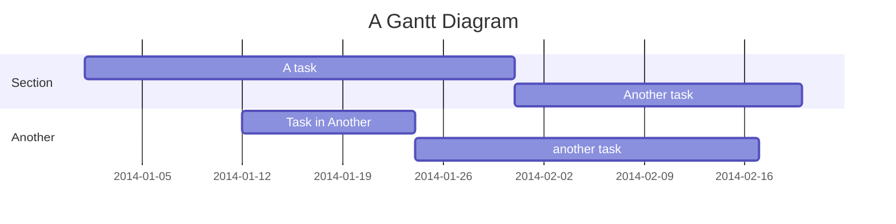
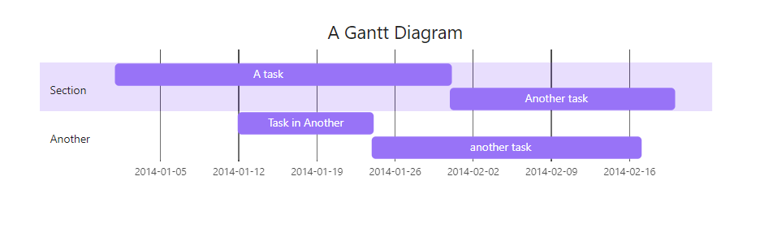

# Obsidian

## Obsidian 使用技巧

### 基本操作
- **插入块引用**：在输入 `![[file#^` 时，Obsidian 会列出所有块，选择需要插入的块后，Obsidian 会补齐 `blockId` 形成 `![[file#^blockId]]]` 的引用，并在 `file` 文档中生成 `blockId` 来标记选定的块。
- **嵌入音视频**：可以使用 `<iframe>` 标签嵌入音视频内容，例如嵌入视频代码：
```
<iframe
  width=auto
  height=480
  src="//player.bilibili.com/player.html?此处是视频地址" 
  scrolling="no" 
  border="0" 
  frameborder="no" 
  framespacing="0" 
  allowfullscreen="true"></iframe>
```
渲染效果：


### 搜索设置
- **搜索选项**：
    - **区分大小写**：将搜索设置为大小写敏感模式
    - **显示搜索含义**：显示当前搜索范围
    - **折叠搜索结果**：只显示文件名，隐藏搜索结果的具体内容
    - **显示上下文**：显示搜索结果的更多内容
    - **排序**：选择按文件名、修改时间、创建时间对搜索结果排序
    - **拷贝搜索结果**：拷贝所有结果的文件名
- **附件存储**：设置新附件默认存储位置，避免附件默认保存在根文件夹下。

### Mermaid 图表
- **绘制流程图**：使用 Mermaid 语法绘制流程图、序列图等 UML 图，例如：


   
### Canvas 功能
- **创建 Canvas**：通过以下几种方式创建 Canvas：
    - 从最左侧功能区点击新建 Canvas 图标
    - 右击文件夹点击新建 Canvas
    - 通过命令面板（快捷键 `⌘` + `p`）输入 `new canvas` 然后回车创建 Canvas
- **功能**：Canvas 支持嵌入文本、文件、网页、图片、视频等，并能随意拖拽，不同元素之间可以进行关联。

### 脚注
- **长脚注**：使用 `[^id]` 格式
- **行内脚注**：使用 `^[text]` 格式


### Obsidian 的反链接功能

#### 1. **创建反向链接**
- **步骤**：
  1. 打开要在其中添加链接的笔记。
  2. 在要插入反向链接的文本中输入两个括号 `[[ ]]`。这将显示其他笔记的列表。
  3. 选择要链接到的笔记。或者，点击链接键两次，然后输入要链接的笔记的名称。
  4. 已创建新的反向链接。默认情况下，Obsidian 链接到新笔记。但是，除非你点击链接，否则不会创建它。在 Mac 上，按 `CMD + Enter`；在 Windows 上，按 `CTRL + Enter`。这将带你进入另一个页面并将你的笔记保存到你的仓库中。

#### 2. **查看反向链接**
- **反向链接面板**：

  - **链接提及**：指向某个笔记的反向链接，该笔记具有指向当前笔记的链接。这是当你使用 `[[反向链接]]` 格式将一个页面链接到另一个页面时。

  - **未链接提及**：显示当前笔记名称的所有未链接的用法。

  - **查看方法**：

1. 打开命令面板（快捷键 `⌘` + `p`）。
2. 选择“反向链接：切换文档中的反向链接”。
3. 或者，在反向链接插件设置中选择“文档中的反向链接”，以便在你打开新笔记时自动切换所有反向链接。

- **右侧面板**：

  - 从右侧选项卡中选择反向链接（链接和箭头图标）以查看活动笔记的反向链接。如果你没有看到“反向链接”选项卡，请打开命令选项板并选择“反向链接：显示反向链接”。

  - 活动笔记的所有反向链接都会显示，直到你折叠“反向链接”选项卡为止，并且当您切换到另一个笔记时它们会自动更新。

#### 3. **使用反向链接的好处**
- **提供额外上下文**：使用反向链接引用另一个笔记将为你提供与该特定笔记相关的所有活动的概述，以及它与其他想法、想法或笔记的关系。

- **知识图谱**：该图显示了链接的页面以及它们链接到的位置。这将帮助你从不同的角度看待你的项目。你可以通过添加过滤器、更改节点功率和编辑显示选项来进一步对此图进行分类。为了获得项目的新视角，知识图具有链接各个注释页面的动画功能。

#### 4. **使用占位符链接**
- **占位符链接**：当你在 Obsidian 中输入笔记时，可以添加占位符链接以便稍后返回。这可以像任何其他笔记一样完成。单击链接以创建笔记。但是，占位符链接消除了先创建笔记然后再创建链接的需要。例如，如果你正在编写有关协调活动的笔记，则可以在开始编写笔记时使用占位符链接为潜在供应商和附属机构创建空间。你还可以将占位符笔记链接到未来的日期。当在每日笔记文件中创建该日期部分时，该链接将变为活动状态。

#### 5. **外部链接的自动链接标题插件**
- **自动链接标题插件**：该插件允许你将浏览器中的 URL 复制并粘贴到 Obsidian 中。这将自动链接到你的网站，提取页面标题，并使用该标题创建 Obsidian 链接。它还使你的笔记看起来更干净。

#### 6. **批量创建双向链接**
- **联动文件面板**：

  - 在文件面板中，通过 `Alt` + `点击`，同时选中多条笔记。
  - 然后把这些笔记拖拽到当前打开的笔记文件中，就会批量建立指向这些笔记的双向链接。

- **联动搜索面板**：

  - 通过在搜索面板中点击查询结果数，就能看到“复制搜索结果”的按钮。
  - 点击该按钮可以批量创建指向筛选过的笔记的双向链接。

#### 7. **反向链接面板的详细使用**
- **反向链接面板由两大部分组成**：
1. **链接引用**：显示链接到当前笔记的其他笔记。
2. **无链接提及**：显示提到当前笔记名称但未链接的笔记。
3. **添加链接**：如果一个引用出现在无链接提及，并且你想要为其加上链接，只需将鼠标悬浮在该文本上即可弹出一个链接按钮。点击该按钮将会自动在高亮文本左右加上中括号，将其转为链接引用。

- **独立反向链接面板**：
4. 可以在右上角的更多按钮中点击打开一个独立的反向链接面板。这个面板将与当前笔记进行连接，成为该笔记的同步面板。
5. 也可以从命令面板中打开这个功能。


## Obsidian 常用插件及使用技巧

### 1. Excalidraw
- **功能**：无限画布草图绘画，支持在笔记中嵌入和编辑绘图内容。
- **使用技巧**：通过命令面板（快捷键 `⌘` + `p`）输入 `Excalidraw` 打开绘图界面，绘制完成后可以保存为嵌入内容。

### 2. Image Caption
- **功能**：给图片添加标题。
- **使用技巧**：在图片下方输入 `![[图片链接]]`，然后在图片下方添加标题文本。

### 3. Image Toolkit
- **功能**：预览模式下「点击查看大图」。
- **使用技巧**：在预览模式下，点击图片即可查看大图。

### 4. Mousewheel Image Zoom
- **功能**：通过 `ALT` 键 + 鼠标滚轮快速调整图片大小。
- **使用技巧**：在编辑模式下，按住 `ALT` 键并滚动鼠标滚轮可以调整图片大小。

### 5. Auto Link Title
- **功能**：自动为网页地址增加链接名。
- **使用技巧**：输入网址后，插件会自动提取网页标题并生成链接。

### 6. Media Extended
- **功能**：在 Obsidian 中播放视频并添加时间戳。
- **使用技巧**：通过命令面板（快捷键 `⌘` + `p`）输入 `Media Extended` 打开视频播放器，支持多种视频格式。

### 7. Media Extended Bilibili Plugin
- **功能**：在 Obsidian 中播放 Bilibili 视频并添加时间戳。
- **使用技巧**：输入 Bilibili 视频链接，插件会自动解析并播放视频。

### 8. Tag Summary
- **功能**：创建具有相同标签的段落或文本块的摘要。
- **使用技巧**：在笔记中使用 `#tag` 标记内容，插件会自动生成标签摘要。

### 9. Tag Wrangler
- **功能**：标签管理，从标签面板中重命名、合并、切换和搜索标签。
- **使用技巧**：在标签面板中右键点击标签，选择相应的操作进行管理。

### 10. MySnippets
- **功能**：在状态栏中添加了一个迷你的 CSS 片段管理菜单，快速关闭和打开代码片段。
- **使用技巧**：通过状态栏的菜单快速切换 CSS 片段。

### 11. Quite Outline
- **功能**：按需自动展开大纲。
- **使用技巧**：在大纲视图中，插件会自动展开当前编辑的节点。

### 12. **Recent Files
- **功能**：显示最近打开的文件列表。
- **使用技巧**：在文件列表中，插件会显示最近打开的文件，可以快速切换。

### 13. Flash Cards**
- **功能**：联动 Anki 并生成 Anki 卡片。
- **使用技巧**：在笔记中使用特定格式标记内容，插件会自动生成 Anki 卡片。

### 14. Local Rest API
- **功能**：联动浏览器插件 Obsidian web。
- **使用技巧**：通过浏览器插件与 Obsidian 进行数据交互。

### 15. Remotely Save
- **功能**：非官方同步插件，在本地设备和云服务（S3，Dropbox，WebDAV，OneDrive）之间同步笔记。
- **使用技巧**：配置插件的同步设置，选择同步目标和同步频率。

### 16. List Callouts
- **功能**：对清单笔记中特定的条目进行标注，让其显示出不同的样式。
- **使用技巧**：在条目前添加特定符号，例如 `> [!info]`，插件会自动应用样式。

### 17. Novel Word Count
- **功能**：在文件列表中显示文件/文件夹基础信息，如笔记数量、字数统计等。
- **使用技巧**：在文件列表中，插件会显示每个文件夹的笔记数量和字数统计，支持自定义显示内容。

### 18. Number Headings
- **功能**：对笔记中的多级标题进行自动编号。
- **使用技巧**：通过命令面板（快捷键 `⌘` + `p`）输入 `Number Headings`，选择该命令后，插件会自动对标题进行编号。


## 视频讲解
**BiliBili：** [视睿网络-哔哩哔哩视频 (bilibili.com)](https://space.bilibili.com/1985904092/lists/1497284)

<iframe
  width=auto
  height=auto
  src="//player.bilibili.com/player.html?isOutside=true&aid=230442258&bvid=BV19h411w7rf&cid=1183170164&p=1" 
  scrolling="no" 
  border="0" 
  frameborder="no" 
  framespacing="0" 
  allowfullscreen="true"></iframe>