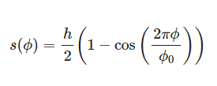
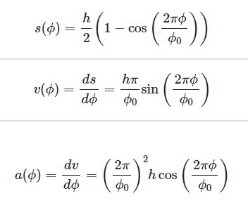
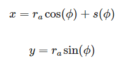

# 凸轮机构（Cam Menchanism）
凸轮机构是一种常见的机械传动机构，由凸轮、从动件和机架三个基本构件组成。凸轮是一个具有曲线轮廓或凹槽的构件，一般为主动件，作等速回转运动或往复直线运动。通过凸轮的轮廓形状来控制从动件的运动规律。

## 一、工作原理
凸轮机构的工作原理主要包括以下几个步骤：

- **凸轮轴旋转**：当凸轮轴被驱动时，凸轮随着轴的旋转而一起旋转。

- **从动件运动**：凸轮的轮廓逐渐接触从动件，使从动件受到推动，从而实现从动件的往复直线运动、摆动或旋转运动。

- **运动规律**：通过改变凸轮轮廓的形状和凸轮的旋转速度，可以实现从动件的不同速度和加速度。凸轮的运动规律直接影响到从动件的运动特性。

## 二、应用领域
凸轮机构广泛应用于多个领域，包括但不限于：

- **汽车发动机**：控制气门的开关时机，调节进、排气量，提高发动机效率。

- **纺织机械**：控制织布机上的梭子的来回往复运动，实现织布机的正常工作。

- **包装机械**：控制每个包装步骤的运动顺序和节奏，实现精确的包装控制。

- **机械手臂**：控制机械手臂的旋转、举升、摆动等运动，使机械手臂的运动更加稳定和精确。

- **医疗设备**：控制手术台、诊断设备等的高度调节、角度调整等运动。

- **自动化生产线**：实现物料的精确定位和传递。

## 三、优缺点
### 优点：
- **运动精确可靠**：能够实现从动件的精确运动规律。

- **结构简单紧凑**：设计方便，占据空间小。

- **传动效率高**：运动平稳，适用于多种机械装置。
### 缺点：
- **易于磨损**：由于凸轮与从动件为点或线接触，是高副机构，易于磨损，仅适用于传递动力不大的场合。

- **加工困难**：凸轮轮廓较复杂，加工较困难。

- **高速运行问题**：高速运行的凸轮设计复杂，对制造工艺有较高要求，噪音问题也是一大挑战。

## 四、分类
凸轮机构的类型很多，通常按凸轮和从动件的端部形状及其运动形式的不同来进行分类：
### 按凸轮的形状分类：
- **盘形凸轮机构**：凸轮是一个具有变化向径的盘形构件，绕固定轴线回转，推动从动件在垂直于凸轮轴的平面内运动。

- **移动凸轮机构**：当盘形凸轮的回转中心趋于无穷远时，凸轮相对机架做直线运动，推动从动件在同一平面内作左右的往复运动。

- **圆柱凸轮机构**：凸轮是一个在圆柱面上开有曲线凹槽或在圆柱端面上做出曲线轮廓的构件，转动时使从动件在与圆柱凸轮轴线平行的平面内运动。
### 按凸轮与从动件维持高副接触（锁合）的方式分类：
- **力锁合方式**：利用重力、弹簧力或其他外力使从动件与凸轮保持接触。

- **几何锁合方式**：依靠凸轮和从动件的特殊几何形状而始终维持接触。
按从动件端部的形式分类：

- **尖底从动件**：从动件端部为尖形，适用于低速轻载。

- **滚子从动件**：从动件端部为滚子，适用于中低速轻载。

- **平底从动件**：从动件端部为平面，适用于高速重载。

## 五、凸轮机构在高速运行时的设计难点主要包括以下几个方面：
### （一）、振动和冲击问题
- **振动问题**：高速凸轮机构在运行过程中容易产生振动，这不仅会影响机构的运动精度，还会导致零部件的疲劳损坏。振动的主要原因是凸轮与从动件之间的接触力变化和惯性力的作用。 

- **冲击问题**：从动件在运动过程中可能会出现刚性冲击或柔性冲击，特别是在运动的起始和终止位置。刚性冲击会导致从动件的瞬时加速度突变，而柔性冲击则会导致加速度的连续变化。这些冲击会增加机构的噪音和磨损。 
### （二）、动力学分析复杂
- **动力学模型建立**：高速凸轮机构的动力学分析需要考虑多种因素，包括凸轮的弹性变形、从动件的惯性力、接触力等。建立准确的动力学模型是设计的关键，但这一过程非常复杂。通常需要使用有限元法和多体动力学方法来建立和求解动力学方程。

- **多自由度系统**：在实际应用中，凸轮机构往往是一个多自由度系统，需要考虑机架的弹性变形、从动件的多自由度运动等。这增加了动力学分析的难度。
### （三）、制造和装配精度要求高
- **凸轮轮廓精度**：高速凸轮机构对凸轮的轮廓精度要求极高。任何微小的制造误差都可能导致从动件的运动不准确，甚至引起振动和冲击。因此，凸轮的加工需要使用高精度的机床和先进的加工技术。

- **装配误差**：装配过程中的误差也会影响凸轮机构的性能。例如，凸轮与从动件的对中误差、轴交角误差等都会导致运动精度下降。因此，装配过程中需要严格控制误差。
### （四）、润滑和磨损问题
- **润滑问题**：高速运行时，凸轮与从动件之间的接触力和表面速度变化剧烈，这使得润滑条件变得复杂。选择合适的润滑油和润滑方法是保证凸轮机构稳定运行的关键。

- **磨损问题**：由于高速运行时的高接触力和频繁的摩擦，凸轮和从动件的磨损速度会加快。这不仅会影响机构的运动精度，还会缩短其使用寿命。因此，需要使用耐磨材料和优化润滑条件来减少磨损。
### （五）、从动件的动态响应
- **惯性力**：高速运行时，从动件的惯性力会显著增加。如果惯性力超过弹簧力和其他外加力，从动件可能会瞬时脱开凸轮廓线，产生跳动和振动。因此，需要设计合理的弹簧系统和外加力来平衡惯性力。

- **动态响应**：从动件的动态响应特性对凸轮机构的性能影响很大。设计时需要考虑从动件的加速度、速度和位移的连续性和平滑性，以减少冲击和振动。
### （六）、多目标优化设计
- **优化目标**：高速凸轮机构的设计需要同时考虑多个目标，如减少振动、提高运动精度、降低噪音、延长使用寿命等。这些目标之间往往存在矛盾，需要进行多目标优化设计。

- **优化方法**：可以使用权重理想法、遗传算法等优化方法来解决多目标优化问题。这些方法可以帮助设计人员在不同的设计参数之间找到最佳的平衡点。

通过以上分析，可以看出高速凸轮机构的设计需要综合考虑多方面的因素，包括动力学分析、制造和装配精度、润滑和磨损、从动件的动态响应等。这些因素相互影响，设计时需要进行系统性的优化和仿真分析，以确保机构的高性能和高可靠性。

## 六、凸轮机构的工作原理
凸轮的连续转动或移动通过高副接触使从动件实现预期的运动规律。从凸轮的形状（盘形凸轮、移动凸轮、圆柱凸轮等）和从动件的运动形式（直线移动、摆动）入手，以汽车发动机的配气机构为例，分析凸轮如何精确控制气门的开启和关闭时刻，保证发动机的正常工作。凸轮机构是一种高副机构，其工作原理主要基于凸轮的轮廓形状和运动规律来控制从动件的运动。
### （一）、基本组成
凸轮机构通常由以下三个基本构件组成：

- **凸轮**：一个具有曲线轮廓或凹槽的构件，一般为主动件，作等速回转运动或往复直线运动。

- **从动件**：与凸轮接触并受其驱动的构件，通常作往复直线运动、摆动或旋转运动。

- **机架**：固定凸轮和从动件的构件，提供支撑和定位。
### （二）、工作过程
凸轮机构的工作过程可以分为以下几个步骤：
#### 凸轮的运动
- **回转运动**：凸轮通常绕一个固定轴线作等速回转运动。凸轮的轮廓形状决定了从动件的运动规律。

- **往复运动**：在某些特殊应用中，凸轮也可以作往复直线运动。
#### 从动件的接触和运动
- **接触方式**：从动件与凸轮的接触方式可以是点接触、线接触或面接触。常见的从动件端部形式包括尖底、滚子和平底。

- **尖底从动件**：从动件端部为尖形，适用于低速轻载。

- **滚子从动件**：从动件端部为滚子，适用于中低速轻载。

- **平底从动件**：从动件端部为平面，适用于高速重载。

- **运动规律**：凸轮的轮廓形状决定了从动件的运动规律。通过设计不同的凸轮轮廓，可以实现从动件的多种运动规律，如等速运动、简谐运动、多项式运动等。
#### 运动传递
- **推程**：当凸轮的轮廓逐渐接触从动件时，从动件被推动，实现上升或摆动运动。这一阶段称为推程。

- **远休止**：凸轮继续旋转，但从动件保持在最高位置不动，这一阶段称为远休止。

- **回程**：凸轮的轮廓逐渐离开从动件，从动件在弹簧力或其他外力的作用下返回初始位置，这一阶段称为回程。

- **近休止**：凸轮继续旋转，但从动件保持在最低位置不动，这一阶段称为近休止。
### （三）、动力学分析
- **接触力**：凸轮与从动件之间的接触力是凸轮机构设计的关键。接触力的大小和方向取决于凸轮的轮廓形状和运动规律。

- **惯性力**：从动件在运动过程中会产生惯性力，特别是在高速运行时，惯性力的影响更加显著。设计时需要考虑惯性力的平衡，以减少振动和冲击。

- **摩擦力**：凸轮与从动件之间的摩擦力会影响机构的效率和寿命。合理的润滑和材料选择可以减少摩擦力。
### （四）、设计要点
- **轮廓设计**：凸轮的轮廓设计是实现从动件特定运动规律的关键。常见的设计方法包括解析法和图解法。

- **运动规律选择**：根据应用需求选择合适的从动件运动规律，如等速运动、简谐运动、多项式运动等。不同的运动规律会影响从动件的加速度和冲击。

- **锁合方式**：选择合适的锁合方式（力锁合或几何锁合）以确保从动件与凸轮始终保持接触。
制造和装配精度：高精度的制造和装配是保证凸轮机构性能的关键。凸轮的轮廓精度和从动件的对中精度需要严格控制。
### （五）、应用实例
- **汽车发动机**：控制气门的开关时机，调节进、排气量，提高发动机效率。

- **纺织机械**：控制织布机上的梭子的来回往复运动，实现织布机的正常工作。

- **包装机械**：控制每个包装步骤的运动顺序和节奏，实现精确的包装控制。

- **机械手臂**：控制机械手臂的旋转、举升、摆动等运动，使机械手臂的运动更加稳定和精确。

- **医疗设备**：控制手术台、诊断设备等的高度调节、角度调整等运动。

通过以上分析，可以看出凸轮机构的工作原理是通过凸轮的轮廓形状和运动规律来控制从动件的运动，实现特定的机械动作。设计时需要综合考虑多方面的因素，以确保机构的高性能和高可靠性。

## 七、凸轮机构的设计方法
凸轮机构的设计方法主要包括以下几个步骤：
### （一）、确定凸轮的运动要求
根据机械系统的功能要求，确定凸轮需要实现的运动特性，如线性运动、往复运动或任意轨迹运动等。
### （二）、选择凸轮类型
根据应用需求选择合适的凸轮类型，常见的凸轮类型包括：

- **盘形凸轮**：从动件为平面盘形，凸轮与从动件之间为点接触或线接触，常用于实现往复运动。

- **圆柱凸轮**：从动件为圆柱形，凸轮与从动件之间为面接触，常用于实现连续回转运动。

- **圆锥凸轮**：从动件为圆锥形，凸轮与从动件之间为点接触或线接触，常用于实现复杂的空间运动轨迹。
### （三）、选择从动件的运动规律
根据实际需求选择合适的运动规律，如等速运动、等加速等减速运动、余弦加速度运动等。合理的运动规律可以确保从动件实现精确的运动轨迹。常见的运动规律包括：

1. **等速运动规律**：有刚性冲击。
2. **等加速等减速运动规律**：有柔性冲击。
3. **五次多项式运动规律**：无刚性冲击、无柔性冲击。
4. **余弦加速度运动规律**：有柔性冲击、无刚性冲击。
5. **正弦加速度运动规律**：无刚性冲击、无柔性冲击，但加速度最大值最大。
### （四）、设计凸轮轮廓曲线
设计凸轮轮廓曲线是凸轮机构设计的关键，常用的方法包括：

- **作图法**：通过反转法将凸轮机构视作一体，赋予其一个围绕凸轮轴心的共同角速度，此时凸轮保持静止，而从动件则反向旋转一定角度，从而推导出凸轮的理论轮廓曲线。

- **解析法**：借助数学公式来详细描述从动件的运动轨迹，进而求解出凸轮的轮廓曲线方程。
### （五）、确定基本尺寸
确定凸轮机构的基本尺寸，包括基圆半径、滚子半径、平底尺寸和压力角等。压力角决定了机构的传动效率和受力情况。
### （六）、强度与刚度校核
在凸轮机构设计过程中，需要校核凸轮、从动件和机架的强度与刚度，以确保机构的可靠性。
### （七）、润滑与密封
对于实际应用中的凸轮机构，润滑与密封是必不可少的考虑因素。合理选用润滑剂和密封元件可以有效降低摩擦和磨损，提高机构的使用寿命。
### （八）、安装与调试
在安装和调试过程中，应严格按照设计要求进行操作，确保各部件的位置和运动轨迹符合预期。
### （九）、维护与保养
定期对凸轮机构进行维护和保养，检查各部件的磨损情况，及时更换损坏的零件，以保证机构的正常运行。
### （十）、优化与改进
在实际应用中，根据需要对凸轮机构进行优化和改进，以提高机构的性能和使用寿命。
### （十一）、试验验证
完成设计后，需要对设计出的凸轮机构进行试验验证。通过模拟实际运行条件，对机构的运动性能、传动性能和稳定性等方面进行测试和评估。如果发现存在问题或不足之处，需要进行相应的调整和改进，以确保凸轮机构在实际应用中能够发挥出最佳的性能。

## 八、解析法
解析法设计凸轮机构是一种通过数学公式和计算来确定凸轮轮廓曲线的方法。这种方法精确度高，适用于复杂运动规律的设计。以下是一个具体的实例，通过计算和绘图来说明解析法设计凸轮机构的过程。
### （一）、确定设计要求
假设我们需要设计一个偏置直动滚子从动件盘形凸轮机构，从动件的运动规律为等加速等减速运动。凸轮的基圆半径 ra=30mm，偏距 e = 10mm，滚子半径 rt=10mm，从动件的行程 h=20mm，凸轮的转角范围为 0°到360°。
### （二）、选择运动规律
等加速，等减速运动规律下，从动件的位移是凸轮转角的二次函数，因此其位移曲线是由两段曲率方向相反的抛物线连成。这种运动规律免了从动件在运动起始和终止速度的突变，从而避免了刚性冲击，但推程的在特定位置有加速度突变，产生柔性冲击。
### （三）、计算理论轮廓曲线
使用反转法，将凸轮固定不动，从动件沿-ω 方向转过角度 φ。滚子中心（B）的坐标为：

x = ra \ cos(φ) + e - s(φ)

y = ra \ sin(φ)
### （四）、计算实际轮廓曲线
滚子从动件盘形凸轮的实际廓线是圆心在理论廓线上的一族滚子圆的包络线。实际轮廓曲线的坐标为：

xt = x - rt \ sin(θ)

yt = y + rt \ cos(θ)

其中，θ为滚子圆的切线与 x 轴的夹角，可以通过求导得到。
### （五）、具体计算
假设 φ 从0° 到 180°以  10° 为步长进行计算：

| \( φ \) | \( s(φ) \) | \( x \) | \( y \) | \( θ \) | \( x_t \) | \( y_t \) |
| ------- | ---------- | ------- | ------- | ------- | --------- | --------- |
| 0°      | 0          | 40      | 0       | 0°      | 30        | 0         |
| 10°     | 0.556      | 39.444  | 5.209   | 7.59°   | 29.444    | 5.209     |
| 20°     | 2.222      | 37.778  | 10.418  | 15.18°  | 27.778    | 10.418    |
| ...     | ...        | ...     | ...     | ...     | ...       | ...       |
| 180°    | 20         | 20      | 0       | 0°      | 10        | 0         |

### （六）、绘图
使用计算得到的 (xt, yt) 坐标点，绘制实际轮廓曲线。可以使用 MATLAB 或其他绘图软件进行绘制。

```matlab
% 参数设置
r_a = 30; % 基圆半径
e = 10;   % 偏距
r_t = 10; % 滚子半径
h = 20;   % 从动件行程
phi_0 = 180; % 推程阶段转角

% 计算理论轮廓曲线
phi = 0:10:phi_0;
s = h/2 * (phi/phi_0).^2;
x = r_a * cosd(phi) + e - s;
y = r_a * sind(phi);

% 计算实际轮廓曲线
theta = atand(y ./ x);
x_t = x - r_t * sind(theta);
y_t = y + r_t * cosd(theta);

% 绘制轮廓曲线
plot(x_t, y_t, 'b-');
xlabel('x (mm)');
ylabel('y (mm)');
title('凸轮实际轮廓曲线');
grid on;
```
### （七）、解析法设计凸轮机构的优点和局限性
#### 优点
- **高精度**：解析法通过数学公式和计算来确定凸轮轮廓曲线，能够实现高精度的设计，适合凸轮在数控机床上加工。

- **设计灵活**：只需要设计适当的轮廓曲线，从动件便可获得任意的运动规律，且结构简单、紧凑、设计方便。

- **适用范围广**：适用于各种复杂运动规律的设计，能够实现从动件的任意预期运动规律。

- **高速运转性能稳定**：在高速运转时，凸轮机构的性能稳定，适用于各种工作条件，如高温、低温、腐蚀等环境。

- **减少误差**：避免了手工求解和作图法带来的误差，提高了设计的精确度和可靠性。
#### 局限性
- **设计难度大**：对于复杂的运动规律，设计难度较大，需要较高的数学和计算能力。

- **制造成本高**：凸轮的加工需要高精度的机床和先进的加工技术，制造成本较高。

- **磨损和疲劳损坏**：凸轮与从动件之间为点或线接触，压强较大，容易磨损和疲劳损坏。

- **设计灵活性有限**：一旦设计完成，凸轮机构的运动规律难以更改，不像电器控制那样可以随时调整。

- **加工难度大**：一般的加工机床难以满足凸轮的加工要求，需要特殊的加工设备和工艺。

- **设计过程耗时**：设计过程耗时、耗力，需要在设计前确定好控制先后次序，一旦设计完成，改动则牵一发而动全身。

通过以上分析，可以看出解析法设计凸轮机构在高精度、复杂运动规律设计和高速运转性能方面具有显著优势，但在设计难度、制造成本和加工难度等方面存在一定的局限性。这些局限性在实际应用中需要通过优化设计方法和采用先进的制造技术来克服。

## 九、图解法
### （一）、图解法设计凸轮机构

图解法是一种通过图形方法来设计凸轮轮廓曲线的方法。这种方法直观、简便，适用于简单的运动规律设计。以下是一个具体的实例，通过简谐运动规律来设计凸轮的轮廓曲线。
#### 确定设计要求
假设我们需要设计一个直动尖底从动件盘形凸轮机构，从动件的运动规律为简谐运动规律。凸轮的基圆半径 r_a = 30 mm，从动件的行程h=20 mm，凸轮的转角范围为0°到360°。
#### 选择运动规律
选择简谐运动规律，其位移s与凸轮转角φ的关系为：

 
 
其中，φ0为推程阶段的转角，假设φ0=180°。

#### 计算从动件的位移、速度和加速度

根据简谐运动规律，计算从动件在不同转角下的位移、速度和加速度：




#### 绘制位移图

根据计算结果，绘制从动件的位移图。假设φ从0°到180°以10°为步长进行计算：

| φ    | s(φ）  |
| ---- | ----- |
| 0°   | 0     |
| 10°  | 1.81  |
| 20°  | 3.62  |
| 30°  | 5.41  |
| 40°  | 7.21  |
| 50°  | 8.99  |
| 60°  | 10.76 |
| 70°  | 12.52 |
| 80°  | 14.26 |
| 90°  | 15.99 |
| 100° | 17.71 |
| 110° | 19.42 |
| 120° | 21.12 |
| 130° | 22.80 |
| 140° | 24.47 |
| 150° | 26.12 |
| 160° | 27.75 |
| 170° | 29.36 |
| 180° | 30.99 |

#### 绘制凸轮轮廓曲线

使用反转法，将凸轮固定不动，从动件沿-ω方向转过角度φ。从动件尖底的坐标为：



根据上述计算结果，绘制凸轮的理论轮廓曲线。可以使用绘图软件（如 AutoCAD 或 MATLAB）进行绘制。


```matlab
% 参数设置
r_a = 30; % 基圆半径
h = 20;   % 从动件行程
phi_0 = 180; % 推程阶段转角

% 计算从动件的位移
phi = 0:10:phi_0;
s = (h/2) * (1 - cosd(2 * pi * phi / phi_0));
x = r_a * cosd(phi) + s;
y = r_a * sind(phi);

% 绘制凸轮轮廓曲线
plot(x, y, 'b-');
xlabel('x (mm)');
ylabel('y (mm)');
title('凸轮理论轮廓曲线');
grid on;
```

### （二）、图解法的优点和局限性

#### 优点
1. **直观简便**：通过图形方法直观地表示从动件的运动规律和凸轮的轮廓曲线，易于理解和操作。
2. **适用范围广**：适用于多种简单的运动规律，如简谐运动、多项式运动等。
3. **设计快速**：不需要复杂的数学计算，设计过程快速，适合初步设计和概念验证。
#### 局限性
1. **精度较低**：由于是图形方法，存在绘图误差，精度相对较低。
2. **复杂运动规律设计困难**：对于复杂的运动规律，图解法难以精确设计，需要借助解析法。
3. **难以优化**：图形方法难以进行优化设计，难以调整和改进设计参数。
4. **制造误差**：图形方法设计的凸轮轮廓在制造过程中容易产生误差，影响机构的性能。

通过以上步骤，可以系统地使用图解法设计凸轮机构。图解法在初步设计和概念验证阶段非常有用，但对于高精度和复杂运动规律的设计，建议结合解析法进行详细设计。
根据从动件的运动规律（如简谐运动规律、多项式运动规律、S 形加速度运动规律等）来设计凸轮的轮廓曲线。


## 视频讲解
**BiliBili：** [视睿网络-哔哩哔哩视频 (bilibili.com)](https://space.bilibili.com/1985904092/lists/1497284)

<iframe
  width=auto
  height=auto
  src="//player.bilibili.com/player.html?isOutside=true&aid=230442258&bvid=BV19h411w7rf&cid=1183170164&p=1" 
  scrolling="no" 
  border="0" 
  frameborder="no" 
  framespacing="0" 
  allowfullscreen="true"></iframe>