# 刚体运动学基础（Kinematic of a Rigid Body）
刚体运动学是研究刚体在空间中运动的科学，不考虑引起运动的力和力矩。它主要关注刚体的位置、速度和加速度等运动参数。以下是一些刚体运动学的基础概念和公式。

## 一、刚体的基本概念
### 刚体
在运动过程中，刚体内部任意两点之间的距离保持不变的物体。
### 自由度
描述刚体在空间中运动所需的独立参数数量。在三维空间中，刚体有6个自由度，包括3个平移自由度和3个旋转自由度。
### 质心
刚体的质心是其质量分布的中心点，通常用位置向量r表示。
### 姿态
刚体在空间中的姿态可以用旋转矩阵R、欧拉角 (φ, θ, ψ)) 或四元数q来表示。

## 二、刚体的位置和姿态
### 位置
刚体在空间中的位置通常用一个点的位置向量来表示，例如质心的位置。
### 姿态
刚体在空间中的姿态可以用旋转矩阵、欧拉角或四元数来表示。

## 三、刚体的运动
刚体的运动可以分为平移运动和旋转运动。这两种运动形式可以单独存在，也可以同时存在。
### 平移运动
刚体在空间中的直线运动，所有点的运动轨迹平行。
#### 1. 位置向量
刚体上任意一点的位置向量 r(t) 可以表示为：fr(t)=r+vt，其中r是初始位置向量，v是恒定的线速度向量，t是时间。
#### 2. 速度
刚体上任意一点的线速度v 是恒定的，且所有点的线速度相同。
#### 3. 加速度
在平移运动中，刚体的加速度a 为零（如果速度是恒定的）。
### 旋转运动
刚体绕某一点或某轴的转动，所有点的运动轨迹为圆或圆弧。
#### 1. 旋转轴
旋转轴是刚体旋转的中心轴线，通常用单位向量 k表示。
#### 2. 角速度
刚体的角速度Ω描述了刚体绕旋转轴的旋转速度，通常用一个向量表示，其方向沿旋转轴，大小为旋转角速度：Ω=ωk。  其中，ω是旋转角速度的大小，k是旋转轴的单位向量。
#### 3. 角加速度
刚体的角加速度 α描述了刚体角速度的变化率，通常用一个向量表示：α=dΩ/dt
#### 4. 线速度
刚体上任意一点的线速度 v可以通过该点的位置向量 r和角速度 Ω计算：fv = Ω x r
#### 5. 线加速度
刚体上任意一点的线加速度a可以通过该点的线速度 v和角加速度 α 计算：fa = α x r + Ω x (Ω x r)
### 刚体的综合运动
刚体的综合运动可以同时包含平移运动和旋转运动。在这种情况下，刚体上任意一点的位置、速度和加速度可以表示为平移和旋转运动的组合。
#### 1. 位置
刚体上任意一点的位置向量r(t)可以表示为：

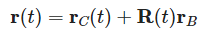
  
  其中，r_C(t)是质心的位置向量，R(t)是旋转矩阵，r_B 是刚体在初始时刻的相对位置向量。
#### 2. 速度
刚体上任意一点的线速度v(t)可以表示为：

  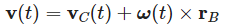
  
  其中，v_C(t)是质心的线速度，ω(t)是角速度。
#### 3. 加速度
刚体上任意一点的线加速度a(t) 可以表示为：

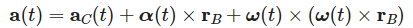
  
  其中，a_C(t)是质心的线加速度，α(t) 是角加速度。

## 四、刚体运动的描述方法
刚体运动的描述方法主要涉及如何精确地表示刚体在空间中的位置和姿态。常见的描述方法包括位置向量、旋转矩阵、欧拉角和四元数。这些方法各有优缺点，适用于不同的应用场景。位置向量适用于描述平移运动，旋转矩阵和四元数适用于描述旋转运动，欧拉角则在某些特定应用中因其直观性而被广泛使用。选择合适的描述方法可以提高计算效率和准确性，特别是在机器人学、航空航天和机械工程等领域。
### 1. 位置向量
位置向量用于描述刚体在空间中的位置。通常，我们选择刚体上的一个特定点（如质心）作为参考点，并用一个三维向量 fr 来表示该点的位置。
##### 表示方法

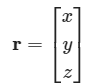
  
  其中，x、y和z分别是该点在坐标系中的坐标。
##### 优点
直观易懂，适用于描述平移运动。
##### 缺点
仅描述位置，不包含姿态信息。
### 2. 旋转矩阵
旋转矩阵用于描述刚体在空间中的姿态。旋转矩阵是一个 3x3 的正交矩阵，其行列式为 1。旋转矩阵可以表示刚体从一个坐标系到另一个坐标系的旋转。
##### 表示方法

  其中，mathbfR的每一列代表旋转后坐标系的一个单位基向量在原始坐标系中的表示。
##### 优点
1. 数学性质良好，易于进行矩阵运算。
2. 可以直接用于向量的旋转变换。
##### 缺点
1. 需要 9 个参数，数据冗余。
2. 存在万向锁问题，即在某些特定姿态下，旋转自由度减少。
### 3. 欧拉角
欧拉角是一种常用的描述刚体姿态的方法，通过三个角度（通常称为滚转角、俯仰角和偏航角）来表示刚体的旋转。欧拉角有多种表示顺序，如 ZYX、YZX 等。
##### 表示方法
(φ，θ，ψ)

  其中，φ是滚转角（绕 x 轴），θ 是俯仰角（绕 y 轴），ψ是偏航角（绕 z 轴）。
##### 优点
1. 直观易懂，物理意义明确。
2. 仅需要 3 个参数，数据量小。
##### 缺点
1. 存在万向锁问题，即在某些特定姿态下，旋转自由度减少。插值和组合旋转时容易出现奇异点。
### 4. 四元数
四元数是一种用于描述三维旋转的数学工具，通过 4 个参数来表示一个旋转。四元数在计算机图形学和机器人学中广泛应用，因为它们避免了万向锁问题，并且在插值和组合旋转时表现良好。
##### 表示方法

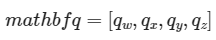

  
  其中，\(q_w\) 是实部，\(q_x\)、\(q_y\) 和 \(q_z\) 是虚部。四元数满足归一化条件：
  
  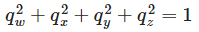

##### 优点
1. 避免了万向锁问题。
2. 插值和组合旋转时表现良好，计算效率高。
3. 仅需要 4 个参数，数据量小。
##### 缺点
1. 数学概念较为抽象，物理意义不直观。
2. 需要进行归一化处理，以确保其表示有效的旋转。

## 五、矢量法
在矢量法中，位移、速度和加速度都是以矢量的形式来描述，它们分别表示物体在空间中的位置变化、位置变化率和位置变化率的变化率。

位移矢量、速度矢量和加速度矢量是描述物体运动状态的基本物理量。位移矢量表示物体在空间中的位置变化，速度矢量表示物体位置变化的快慢和方向，加速度矢量表示物体速度变化的快慢和方向。这些矢量可以通过对位移矢量进行时间导数来计算得到。在实际应用中，这些矢量的计算对于分析和设计机械系统、机器人运动等具有重要意义。
### 1. 位移矢量
位移矢量是从物体的初始位置指向物体的最终位置的有向线段，表示物体在空间中的位置变化。
##### 表示方法
通常用 r表示位移矢量，其在直角坐标系中的表示为：

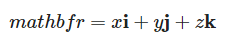

  其中，x，y和z分别是位移矢量在x 轴、y轴和z轴上的分量，i，j和k是相应的单位矢量。
### 2. 速度矢量
速度矢量是物体位置矢量对时间的导数，表示物体位置变化的快慢和方向。
##### 计算方法
速度矢量v是位移矢量r对时间t的一阶导数：

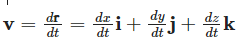
  
  其中，i，j，k前面的系数分别是速度矢量在 x轴、y轴和y轴上的分量。
### 3. 加速度矢量
加速度矢量是物体速度矢量对时间的导数，表示物体速度变化的快慢和方向。
##### 计算方法
加速度矢量a是速度矢量 v 对时间t的一阶导数，也是位移矢量r对时间 t的二阶导数：

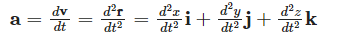

  其中，i，j，k前面的系数分别是加速度矢量在x轴、y轴和z轴上的分量。

## 六、矩阵法
矩阵法通过使用旋转矩阵和平移向量来描述刚体的位移、速度和加速度。齐次变换矩阵 \( T \) 可以表示刚体的平动和转动，速度矢量 \( V \) 和加速度矢量 \( A \) 可以分别表示刚体的速度和加速度。这些矩阵和矢量的计算方法在机器人学、航空航天和机械工程等领域有广泛应用。
### 矩阵法描述刚体运动
矩阵法是描述刚体运动的一种有效方法，通过使用旋转矩阵和平移向量来表示刚体的位置和姿态。以下是如何使用矩阵法来描述刚体的位移、速度和加速度。
#### 1. 位移矩阵
刚体的位移可以通过一个4x4的齐次变换矩阵来表示，该矩阵包括旋转矩阵和平移向量。齐次变换矩阵 \( T \) 的形式如下：

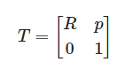

其中，R是3x3的旋转矩阵，表示刚体的姿态；p是3x1的平移向量，表示刚体的位置。
#### 2. 速度矩阵
刚体的速度可以通过速度矢量来表示，速度矢量包括线速度和角速度。速度矢量 \( V \) 的形式如下：

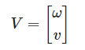

其中，ω是3x1的角速度矢量，表示刚体的旋转速度；v是3x1的线速度矢量，表示刚体的平移速度。
#### 3. 加速度矩阵
刚体的加速度可以通过加速度矢量来表示，加速度矢量包括线加速度和角加速度。加速度矢量 \( A \) 的形式如下：

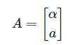

其中，α是3x1的角加速度矢量，表示刚体的旋转加速度；a是3x1的线加速度矢量，表示刚体的平移加速度。
### 矩阵法的应用
#### 1. 刚体平动
刚体平动时，姿态矩阵 \( R \) 保持不变，位移只取决于首末位置。刚体平动的齐次变换矩阵 \( T \) 可以表示为：

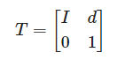

其中，I是3x3的单位矩阵，d是3x1的平移向量。
#### 2. 刚体转动
刚体转动可以分为绕坐标轴旋转、绕通过坐标原点的一般轴线旋转，以及绕空间任意轴的旋转。
##### 绕坐标轴旋转
绕 x轴旋转 θ角度的旋转矩阵 Rx 为：

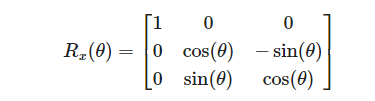

 
 绕y轴旋转 α 角度的旋转矩阵 Ry为：
 
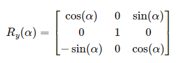

绕 z轴旋转 γ角度的旋转矩阵Rz为：

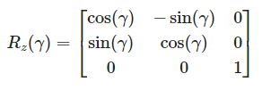

##### 绕过坐标系原点的一般轴线旋转
绕单位向量 k旋转 θ角度的旋转矩阵Rk 为：

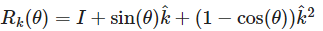

其中，k^是单位向量k的反对称矩阵。
##### 绕空间一般轴线旋转
绕过点 Q的单位向量 k旋转 θ 角度的齐次变换矩阵T 为：

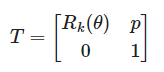

其中，p = (I - Rk(θ)) Q。

## 七、刚体运动的合成与分解原理
刚体运动的合成与分解原理是研究刚体运动学的基础，它通过将刚体的复杂运动分解为基本的平移和旋转运动，以及将这些基本运动合成复杂的刚体运动，为分析和设计刚体运动提供了有效的方法。齐次变换矩阵是描述刚体运动的常用工具，它能够表示刚体的平移和旋转运动。
### 飞机的飞行运动分析
飞机的飞行运动是一个典型的刚体运动，涉及平动和转动的合成。平动主要指飞机沿飞行轨迹的直线运动，而转动包括俯仰、偏航和滚转运动。这些运动的合成使得飞机能够在三维空间中进行复杂的飞行操作。这种合成方法在飞行器设计、飞行控制和航空工程中具有重要的应用价值。以下是对飞机平动和转动运动的详细分析及其合成方法。
### 1. 飞机的平动运动
平动运动是指飞机沿飞行轨迹的直线运动。在飞行过程中，飞机的质心沿着一条预定的轨迹移动。平动运动可以用位置向量 \(\mathbf{r}(t)\) 来描述，表示飞机质心在空间中的位置。
##### 位置向量
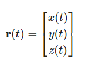

  其中，x(t)、y(t)和z(t)分别是飞机质心在x轴、y轴和z轴上的坐标。
##### 速度向量
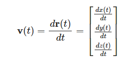

  速度向量表示飞机质心的移动速度。
##### 加速度向量
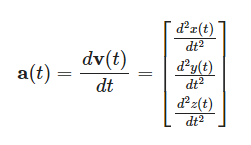
  
  加速度向量表示飞机质心的加速度。

### 2. 飞机的转动运动
转动运动包括俯仰（pitch）、偏航（yaw）和滚转（roll）运动。这些运动可以用欧拉角来描述，欧拉角包括滚转角φ、俯仰角 θ 和偏航角 ψ。
##### 滚转角 (φ)
绕 \(x\) 轴的旋转角，表示飞机的侧倾。
##### 俯仰角 (θ)
绕 \(y\) 轴的旋转角，表示飞机的抬头或低头。
##### 偏航角 (ψ)
绕 \(z\) 轴的旋转角，表示飞机的转向。
##### 旋转矩阵
旋转矩阵 R可以通过欧拉角的组合来表示飞机的姿态。假设先绕 z轴旋转 ψ，再绕 y轴旋转θ，最后绕 x轴旋转φ，则旋转矩阵R 为：
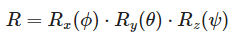

  其中：
  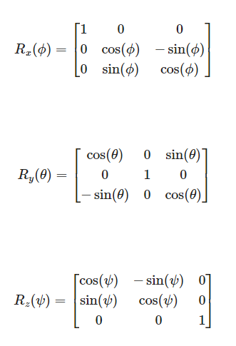
  
##### 角速度向量
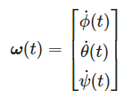

  其中，变量分别是滚转角、俯仰角和偏航角的时间导数。
##### 角加速度向量
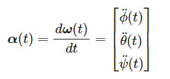

### 3. 飞机的复杂空间运动合成
飞机的复杂空间运动可以通过将平动和转动运动合成来描述。具体来说，飞机的位移、速度和加速度可以通过以下方式合成：
##### 位移合成
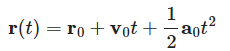

  其中，r0是初始位置，v0是初始速度，a0是初始加速度。
##### 速度合成
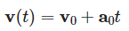

  速度向量包括平动速度和转动速度的合成：
  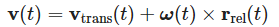

  其中，V_trans(t)是平动速度，ω(t) x r_rel(t)是转动速度， r_rel(t)是飞机上某点相对于质心的位置向量。
##### 加速度合成
 a(t) = a
 
加速度向量包括平动加速度和转动加速度的合成：
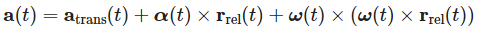

  其中，a_trans(t) 是平动加速度，α(t) x r_rel(t)是转动加速度，ω(t) x (ω(t) x r_rel(t))是科里奥利加速度。
### 运用矢量合成与分解的方法求解飞机在不同飞行姿态下的速度和加速度分量
在飞机的飞行过程中，其速度和加速度矢量会随着飞行姿态的变化而变化。通过运用矢量合成与分解的方法，我们可以求解飞机在不同飞行姿态下的速度和加速度分量。
#### 1. 速度矢量的合成与分解
飞机的速度矢量v可以分解为沿飞机机体坐标系的三个分量：沿飞机的纵轴（x轴）的分量 v_x，沿飞机的横轴（y轴）的分量v_y，以及沿飞机的立轴（z轴）的分量 \(v_z\)。
##### 速度矢量的分解
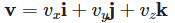

其中，i，j 和k分别是飞机机体坐标系的单位矢量。
##### 速度分量的计算
速度分量可以通过速度矢量与机体坐标系单位矢量的点积来计算：
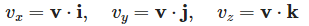

#### 2. 加速度矢量的合成与分解
飞机的加速度矢量 a 可以分解为沿飞机机体坐标系的三个分量：沿飞机的纵轴（x轴）的分量 a_x，沿飞机的横轴（y轴）的分量 a_y，以及沿飞机的立轴（z轴）的分量a_z。
##### 加速度矢量的分解
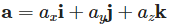

其中，i、j和 k分别是飞机机体坐标系的单位矢量。
##### 加速度分量的计算
加速度分量可以通过加速度矢量与机体坐标系单位矢量的点积来计算：
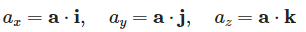

#### 3. 飞机飞行姿态对速度和加速度分量的影响
飞机的飞行姿态，包括俯仰角 θ、偏航角 ψ和滚转角 φ，会影响速度和加速度矢量在机体坐标系中的分量。
##### 速度分量
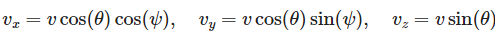

其中，v是飞机的速度大小。
##### 加速度分量
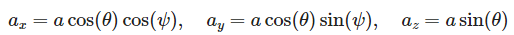

其中，a是飞机的加速度大小。

## 八、刚体运动的合成与分解原理
刚体运动的合成与分解原理是研究刚体运动学的重要内容，它涉及到如何将刚体的复杂运动分解为基本的平移和旋转运动，以及如何将这些基本运动合成复杂的刚体运动。
### 1. 刚体运动的分解
刚体的任意运动都可以分解为平移运动和旋转运动的组合。具体来说，刚体的运动可以分解为以下两种基本运动：

1. **平移运动**：刚体上所有点沿相同方向移动相同距离的运动。
2. **旋转运动**：刚体绕某一点或某轴的转动，所有点的运动轨迹为圆或圆弧。
### 2. 刚体运动的合成
刚体的复杂运动可以通过将平移运动和旋转运动按照一定的顺序和方式组合起来来实现。以下是一些常见的合成方式：

1. **先平移后旋转**：先将刚体平移到某个位置，然后绕该位置的某一点或某轴旋转。
2. **先旋转后平移**：先将刚体绕某一点或某轴旋转，然后平移到某个位置。
3. **连续旋转**：刚体绕多个轴连续旋转，每个旋转都相对于前一个旋转的轴进行。
### 3. 刚体运动的描述
刚体运动的描述通常使用齐次变换矩阵来表示。齐次变换矩阵是一个4x4的矩阵，它包含了旋转矩阵和平移向量，可以表示刚体的平移和旋转运动。齐次变换矩阵 \( T \) 的形式如下：
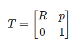

其中，R是3x3的旋转矩阵，表示刚体的旋转；p是3x1的平移向量，表示刚体的平移。
### 4. 刚体运动的合成与分解示例
假设刚体先绕z轴旋转 θ角度，然后沿x轴平移d距离。这个运动可以用两个齐次变换矩阵的乘积来表示：

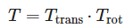

其中，T_trans是平移矩阵，T_rot是旋转矩阵。具体地：

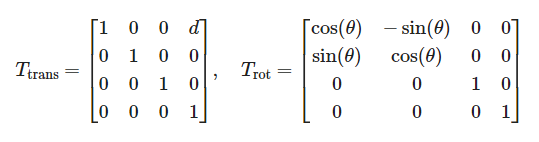

因此，合成的齐次变换矩阵T为：

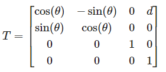

## 视频讲解
**BiliBili：** [视睿网络-哔哩哔哩视频 (bilibili.com)](https://space.bilibili.com/1985904092/lists/1497284)

<iframe
  width=auto
  height=auto
  src="//player.bilibili.com/player.html?isOutside=true&aid=230442258&bvid=BV19h411w7rf&cid=1183170164&p=1" 
  scrolling="no" 
  border="0" 
  frameborder="no" 
  framespacing="0" 
  allowfullscreen="true"></iframe>