# 机构运动分析方法（Kinematic Analysis）
机构运动分析是研究机械系统中各构件的运动规律，包括位移、速度和加速度等运动参数。每种方法都有其优缺点，适用于不同的应用场景。通过这些方法，工程师可以在设计阶段对机构进行全面的运动分析，优化设计方案，提高机构的性能和可靠性。以下是几种常见的机构运动分析方法及其应用领域：
### 1. 解析法
解析法基于机构运动学理论，通过建立机构的运动方程，求解出机构各构件的位移、速度和加速度等运动参数。解析法能够得到精确的解析解，但其适用范围有限，仅适用于结构简单、运动方程易于建立的机构。对于复杂的机构，其运动方程可能非常复杂，甚至无法获得解析解。
### 2. 数值法
数值法通过对运动方程进行数值积分，逐步逼近机构的真实运动轨迹。常见的数值方法包括欧拉法、龙格-库塔法等。数值法具有较强的适用性，可以处理各种复杂的机构，但其精度受步长等参数的影响，需要仔细选择参数以保证精度。
### 3. 仿真软件
一些商业仿真软件，如ADAMS、MATLAB/Simulink等，提供了强大的机构仿真功能，可以方便地建立机构模型，进行运动仿真和分析。这些软件通常集成了多种数值算法，并具有强大的后处理功能，能够直观地展现机构的运动过程和相关参数变化。
### 4. 瞬心法
瞬心法基于瞬时速度的概念，利用机构在任意时刻都存在瞬时速度为零的点，即瞬心。通过确定机构中的瞬心位置，可以推导出机构的速度分布、加速度分布，甚至是力和力矩的分布情况。瞬心法不仅能够应用于简单的平面机构分析，而且对于复杂的空间机构，如RSSR机构，也有很好的适用性。

## 一、速度瞬心法详解
速度瞬心法是研究刚体平面运动的一个重要方法，通过确定刚体上各点的速度方向和大小，来分析刚体的运动状态。瞬心法在机械设计、运动分析和动力学问题中具有广泛的应用。以下是速度瞬心法的详细定义、求解方法和应用实例。
### 1. 定义
1. **瞬心**：两构件上相对速度为零的重合点或瞬时绝对速度相同的重合点。
2. **绝对瞬心**：两构件之一是静止的，瞬心的速度为零。
3. **相对瞬心**：两构件都是运动的，瞬心的速度不为零。
4. **符号表示**：构件 \(i\) 和构件 \(j\) 的相对速度瞬心一般用符号 \(P_{ij}\) 或 \(P_{ji}\) 表示。
### 2. 求解速度瞬心
求解速度瞬心的方法包括根据定义求解和根据三心定理求解。
#### 2.1 根据定义求解
1. **两构件转动副相连**：相对瞬心在转动副中心。
2. **两构件组成移动副**：相对瞬心在导路的垂直方向无穷远处。
3. **两构件组成纯滚动高副**：相对瞬心在接触点。
4. **两构件组成滑动兼滚动高副**：相对瞬心在过接触点的公法线上，具体位置根据滚动、滑动数值而定。
#### 2.2 根据三心定理求解
1. **三心定理**：做平面运动的三个构件共有三个瞬心，这三个瞬心位于同一条直线上。
2. **应用范围**：不直接接触的两构件之间的求瞬心问题。
### 3. 通过确定机构中各构件的速度瞬心来求解构件的速度和加速度
速度瞬心法是一种有效的工具，用于分析平面运动机构中各构件的速度和加速度。这种方法基于刚体平面运动的瞬时速度特性，通过确定机构中各构件的速度瞬心，可以方便地求解出各构件的速度和加速度。以下是详细的步骤和方法：
#### 3.1 确定速度瞬心
速度瞬心是机构中两个构件上相对速度为零的点。确定速度瞬心的方法有多种，常见的方法包括：

1. **直接观察法**：对于简单的机构，如转动副、移动副等，可以直接观察和确定瞬心的位置。
2. **三心定理**：对于三个构件组成的机构，任意三个构件的三个瞬心必定共线。利用这一原理，可以确定不直接接触的两个构件之间的瞬心。
#### 3.2 求解速度
一旦确定了速度瞬心，可以利用以下公式求解构件上任意点的速度：v = ω x r 。其中：v是点的速度矢量。ω是构件的角速度矢量。r是从瞬心到该点的位置矢量。
#### 3.3 求解加速度
求解加速度稍微复杂，需要考虑角加速度和科里奥利加速度。构件上任意点的加速度可以表示为：a = α x r +ω x (ω x r)。其中：
a是点的加速度矢量。α是构件的角加速度矢量。ω是构件的角速度矢量。r是从瞬心到该点的位置矢量。
### 4. 应用实例
#### 4.1 凸轮机构
假设有一个凸轮机构，凸轮以角速度ω_1 旋转，从动件与凸轮接触点为 P。

**确定瞬心**：

- 瞬心P_12在凸轮与从动件的接触点。
- 瞬心P_13在凸轮的旋转中心。

**求解从动件的速度**：
从动件的速度V_2可以通过以下公式计算：v_2 = ω_1 x l_p12P13。其中，l_p12p13是从瞬心p_12到瞬心p_13的距离。

**求解从动件的加速度**：
从动件的加速度a_2可以通过以下公式计算：

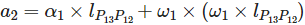

其中，α 是凸轮的角加速度。
#### 4.2 铰链四杆机构
假设有一个铰链四杆机构，已知构件1的角速度ω_1。
##### 1. 确定瞬心

- 瞬心P_12在构件1和构件2的连接点。

- 瞬心P_24在构件2和构件4的连接点。

- 瞬心P_14在构件1和构件4的连接点。
##### 2. 求解构件2的角速度

构件2的角速度ω_2可以通过以下公式计算：
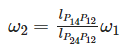
##### 3. 求解构件3的角速度
构件3的角速度 ω_3可以通过以下公式计算：
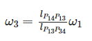
##### 4. 求解构件2和构件3的加速度
构件2的加速度a_2可以通过以下公式计算：
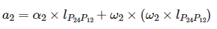

构件3的加速度a_3可以通过以下公式计算：
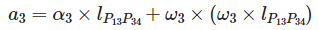
### 利用三心定理确定四杆机构的速度瞬心位置并求解各构件的角速度和线速度
通过利用三心定理确定四杆机构的速度瞬心位置，可以方便地求解出各构件的角速度和线速度。速度瞬心法不仅适用于简单的平面机构，还可以扩展到复杂的空间机构，是一种非常实用的分析工具。
#### 1. 四杆机构的组成
四杆机构由四个构件组成，通常包括一个固定构件（机架）、两个转动副和一个移动副或转动副。假设四杆机构的四个构件分别为1、2、3和4，其中构件1为固定构件，构件2和构件3为转动副，构件4为移动副或转动副。
#### 2. 确定速度瞬心位置
根据三心定理，三个彼此作平面平行运动的构件共有三个瞬心，且位于一条直线上。对于四杆机构，我们可以选择三个构件（例如构件1、2和3）来确定瞬心位置。

- **瞬心P_12**：位于构件1和构件2的转动副中心。

- **瞬心 P_13**：位于构件1和构件3的转动副中心。

- **瞬心 P_23**：位于构件2和构件3的连接点。

由于 P_12、P_13 和 P_23 位于一条直线上，我们可以通过这条直线来确定P_23的位置。
#### 3. 求解各构件的角速度和线速度
假设已知构件1的角速度为ω_1，我们可以通过以下步骤求解其他构件的角速度和线速度。
##### 1. 求解构件2的角速度ω_2
根据瞬心P_12和P_23的位置，可以计算出构件2的角速度ω_2：
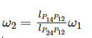

其中，l_p14p12是从瞬心P_14到瞬心P_12的距离，l_p24p12是从瞬心P_24到瞬心P_12的距离。
##### 2. 求解构件3的角速度ω_3
根据瞬心P_13和P_23的位置，可以计算出构件3的角速度ω_3：
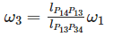

其中，l_p13p14 是从瞬心P_14 到瞬心P_13的距离，l_p13p34是从瞬心P_13到瞬心P_34的距离。
##### 3. **求解构件4的线速度 \(v_4\)**：
- 根据瞬心P_24和P_34的位置，可以计算出构件4的线速度v_4：
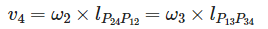

其中，l_p24p12是从瞬心P_24到瞬心P_12的距离，l_p13p34是从瞬心P_13到瞬心P_34的距离。

## 二、相对运动图解法
通过相对运动图解法，可以直观地分析凸轮机构中从动件相对于凸轮的运动关系。绘制从动件的位移、速度和加速度曲线图，在机械设计、运动分析和动力学问题中具有广泛的应用。
### 相对运动图解法
相对运动图解法是一种通过图形方法来分析和求解机构中各构件相对运动的方法。这种方法特别适用于分析凸轮机构中从动件相对于凸轮的运动关系。通过绘制从动件的位移、速度和加速度曲线图，可以直观地了解从动件的运动特性。
#### 1. 基本原理
相对运动图解法基于以下基本原理：
##### 位移
从动件相对于凸轮的位移。
##### 速度
从动件相对于凸轮的速度。
##### 加速度
从动件相对于凸轮的加速度。
#### 2. 凸轮机构的运动分析
凸轮机构通常由凸轮、从动件和机架组成。凸轮的运动通常已知，从动件的运动可以通过凸轮的运动来推导。
##### 2.1 位移分析
##### 位移曲线
从动件的位移s 随凸轮转角θ 的变化关系。
##### 绘制方法
  1. 确定凸轮的转角θ范围，通常为0 到2Π。
  2. 对于每个转角θ，计算从动件的位移s。
  3. 绘制位移曲线图，横轴为凸轮转角 θ，纵轴为从动件位移s。
##### 2.2 速度分析
##### 速度曲线
从动件的速度v 随凸轮转角 θ 的变化关系。
##### 计算方法
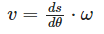
  其中，ω是凸轮的角速度。
##### 绘制方法
  1. 对位移曲线求导，得到速度曲线。
  2. 绘制速度曲线图，横轴为凸轮转角θ，纵轴为从动件速度v。
##### 2.3 加速度分析
##### 加速度曲线
从动件的加速度 a随凸轮转角θ的变化关系。
##### 计算方法
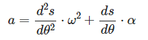

  其中，α是凸轮的角加速度。
##### 绘制方法

  1. 对速度曲线求导，得到加速度曲线。
  2. 绘制加速度曲线图，横轴为凸轮转角θ，纵轴为从动件加速度 a。
#### 3. 应用实例
假设有一个凸轮机构，凸轮的运动规律为简谐运动，从动件的位移s 随凸轮转角θ 的变化关系为：
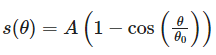

其中，A是从动件的最大位移，θ 是凸轮的总转角。

##### 1. 位移曲线
绘制位移曲线图，横轴为凸轮转角θ，纵轴为从动件位移 s。
位移曲线图如下：

```plaintext
θ (度)    0    90   180  270  360
s (mm)    0    A/2  A    A/2  0
```

##### 2. 速度曲线
计算速度：
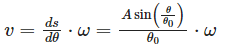

绘制速度曲线图，横轴为凸轮转角 θ，纵轴为从动件速度v。
 速度曲线图如下：
 
```plaintext
θ (度)    0    90   180  270  360
v (mm/s)  0    Aω/2 0   -Aω/2 0
```

##### 3. 加速度曲线
 计算加速度：
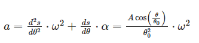

绘制加速度曲线图，横轴为凸轮转角 θ，纵轴为从动件加速度 a。
加速度曲线图如下：

```plaintext
θ (度)    0    90   180  270  360
a (mm/s²) Aω²/θ₀² 0  -Aω²/θ₀² 0  Aω²/θ₀²
```

## 三、矢量方程解析法
### （一）、明确机构的几何关系
#### 绘制机构简图
首先要准确绘制出连杆机构的简图。例如对于一个常见的四杆机构，需要标出各个构件（如机架、连架杆、连杆和摇杆）的长度、连接点等几何信息。假设一个四杆机构，机架长度为a，连架杆长度为b，连杆长度为c，摇杆长度为d。
在简图中，明确各个构件之间的连接关系，如铰链连接等。比如连架杆和机架通过铰链连接，连杆分别与连架杆和摇杆通过铰链连接。
#### 确定构件的矢量表示
选择合适的坐标系。一般可以选择以机架为基准，建立一个直角坐标系。例如，以机架的一个固定点为原点，水平方向为x轴，竖直方向为y轴。
用矢量表示各个构件的位置。对于连架杆，其位置矢量可以表示为rAB​，其中A是与机架连接的铰链点，B是与连杆连接的铰链点。同样，连杆的位置矢量为rBC​，摇杆的位置矢量为rCD​。
### （二）、建立矢量方程
#### 位置矢量方程
根据机构的几何关系，建立位置矢量方程。对于四杆机构，可以得到闭合矢量方程：rAB​+rBC​=rAC​

其中，rAC​是机架上A点到摇杆上C点的矢量。由于机架是固定的，rAC​可以看作是一个已知的矢量，其大小和方向由机构的初始位置和几何参数决定。

将矢量方程分解为x和y方向的分量方程。例如：

rABx​+rBCx​=rACx​rABy​+rBCy​=rACy​

其中，rABx​、rBCx​、rACx​分别是rAB​、rBC​、rAC​在x方向上的分量，rABy​、rBCy​、rACy​分别是它们在y方向上的分量。
#### 速度矢量方程
对位置矢量方程求导得到速度矢量方程。以四杆机构为例，对闭合矢量方程求导：

dtdrAB​​+dtdrBC​​=dtdrAC​​

由于rAC​是机架上的固定矢量，其导数为零。所以速度矢量方程简化为：

dtdrAB​​+dtdrBC​​=0

速度矢量可以表示为：

dtdrAB​​=ωAB​×rAB​dtdrBC​​=ωBC​×rBC​

其中，ωAB​和ωBC​分别是连架杆和连杆的角速度。将这些代入速度矢量方程，可以进一步分析各个构件的速度关系。
#### 加速度矢量方程
对速度矢量方程求导得到加速度矢量方程。继续以四杆机构为例：dt2d2rAB​​+dt2d2rBC​​=0

加速度矢量可以表示为：

dt2d2rAB​​=αAB​×rAB​+ωAB2​rAB​dt2d2rBC​​=αBC​×rBC​+ωBC2​rBC​

其中，αAB​和αBC​分别是连架杆和连杆的角加速度。将这些代入加速度矢量方程，可以分析各个构件的加速度关系。
### （三）、坐标变换和矢量运算求解
#### 坐标变换
在求解过程中，可能需要进行坐标变换。例如，如果连架杆的初始位置不是沿着坐标轴方向，需要将连架杆的矢量从其自身坐标系（以铰链点为原点，沿连架杆方向为一个坐标轴）变换到全局坐标系（机架坐标系）。
坐标变换可以通过旋转矩阵实现。假设连架杆与x轴的夹角为θ，旋转矩阵为：R=cosθsinθ​−sinθcosθ​

将连架杆在自身坐标系下的矢量rAB′​变换到全局坐标系下的矢量rAB​：rAB​=R⋅rAB′​
#### 矢量运算求解位置、速度和加速度
##### 位置求解
通过解位置矢量方程的分量方程，可以求出各个构件的位置关系。例如，对于四杆机构，利用三角函数关系和已知的几何参数，可以求出连杆和摇杆的位置。假设连架杆的转角为θAB​，可以根据几何关系求出连杆的转角θBC​和摇杆的位置。
##### 速度求解
利用速度矢量方程，结合角速度和位置矢量的信息，可以求出各个构件的速度。例如，通过求解速度矢量方程，可以得到连杆和摇杆的线速度以及角速度。对于连杆，其线速度可以表示为：

vBC​=ωBC​×rBC​

其中，rBC​是连杆的长度，ωBC​是通过速度矢量方程求解得到的角速度。
##### 加速度求解
利用加速度矢量方程，结合角加速度、角速度和位置矢量的信息，可以求出各个构件的加速度。例如，对于连杆，其加速度可以表示为：

aBC​=αBC​×rBC​+ωBC2​rBC​

其中，αBC​是通过加速度矢量方程求解得到的角加速度，ωBC​是已知的角速度，rBC​是连杆的长度。
### （四）、四杆机构位置矢量方程解析示例
#### 建立位置矢量方程
假设四杆机构中，机架长度a = 100mm，连架杆长度b = 150mm，连杆长度c = 200mm，摇杆长度d = 120mm。以机架上一个固定点A为原点建立坐标系。

连架杆与机架的夹角为θAB​，连杆与连架杆的夹角为θBC​，摇杆与机架的夹角为θCD​。位置矢量方程为：

rAB​+rBC​=rAC​

将矢量方程分解为x和y方向的分量方程：

bcosθAB​+ccos(θAB​+θBC​)=a+dcosθCD​bsinθAB​+csin(θAB​+θBC​)=dsinθCD​
#### 求解位置方程
假设已知θAB​和θCD​，需要求解θBC​。
将已知的θAB​和θCD​代入分量方程，得到两个关于θBC​的方程。
解这两个方程，可以得到θBC​的值。这通常需要数值方法，如牛顿迭代法等。
#### 建立速度矢量方程
对位置矢量方程求导得到速度矢量方程：

dtdrAB​​+dtdrBC​​=dtdrAC​​。

由于rAC​是机架上的固定矢量，其导数为零。所以速度矢量方程简化为：

dtdrAB​​+dtdrBC​​=0。

速度矢量可以表示为：

dtdrAB​​=ωAB​×rAB​dtdrBC​​=ωBC​×rBC​

其中，ωAB​和ωBC​分别是连架杆和连杆的角速度。
#### 求解速度方程
假设已知ωAB​，需要求解ωBC​。
将已知的ωAB​代入速度矢量方程，得到关于ωBC​的方程。
解这个方程，可以得到ωBC​的值。
#### 建立加速度矢量方程
对速度矢量方程求导得到加速度矢量方程：

dt2d2rAB​​+dt2d2rBC​​=0。

加速度矢量可以表示为：

dt2d2rAB​​=αAB​×rAB​+ωAB2​rAB​dt2d2rBC​​=αBC​×rBC​+ωBC2​rBC​

其中，αAB​和αBC​分别是连架杆和连杆的角加速度。
#### 求解加速度方程
假设已知αAB​和ωAB​，需要求解αBC​和ωBC​。
将已知的αAB​和ωAB​代入加速度矢量方程，得到关于αBC​和ωBC​的方程。解这个方程，可以得到αBC​和ωBC​的值。

## 四、拉格朗日方程
### （一）、拉格朗日方程的基本形式
拉格朗日方程是经典力学中的一个重要工具，用于描述物理系统在力学作用下的运动。对于一个具有完整约束的系统，拉格朗日方程的形式为：

dtd​(∂q˙​i​∂L​)−∂qi​∂L​=Qi​fori=1,2,…,n

其中：
L 是拉格朗日量，定义为系统的动能 T 减去势能 V，即 L=T−V。
qi​ 是广义坐标。
q˙​i​ 是广义速度。
Qi​ 是广义力。
### （二）、建立拉格朗日方程的步骤
#### 1. 确定系统的自由度和广义坐标
首先，确定系统的自由度 n 和 n 个独立的广义坐标 q1​,q2​,…,qn​。广义坐标可以是位置、角度等，具体取决于系统的结构和运动方式。
#### 2. 计算系统的动能 T 和势能 V
动能 T：动能是系统中所有质点的动能之和。对于多自由度系统，动能可以表示为：

T=21​i=1∑n​mi​q˙​i2​

其中，mi​ 是第 i 个质点的质量，q˙​i​ 是第 i 个广义速度。
势能 V：势能是系统中所有保守力（如重力、弹力等）的势能之和。对于多自由度系统，势能可以表示为：

V=21​i=1∑n​j=1∑n​kij​qi​qj​

其中，kij​ 是刚度矩阵的元素，qi​ 和 qj​ 是广义坐标。
#### 3. 构建拉格朗日量 L
拉格朗日量 L 定义为动能减去势能：L=T−V
#### 4. 应用拉格朗日方程
对于每个广义坐标 qi​，应用拉格朗日方程：

dtd​(∂q˙​i​∂L​)−∂qi​∂L​=Qi​

其中，Qi​ 是广义力，可以是外力、摩擦力等。
### （三）、多自由度机构的动力学方程求解
我们可以建立多自由度机构的动力学方程。这些方程可以进一步用于分析系统的动态行为，如振动特性、稳定性等。拉格朗日方程的优势在于它避免了直接处理复杂的约束反力，使得动力学分析更加简洁和高效。
#### 1. 选择广义坐标
假设有一个多自由度的机构，例如一个三自由度的振动系统，广义坐标为 x1​,x2​,x3​。
#### 2. 计算动能和势能
动能 T：T=21​m1​x˙12​+21​m2​x˙22​+21​m3​x˙32​

势能 V：V=21​k1​(x1​−x2​)2+21​k2​(x3​−x2​)2
#### 3. 构建拉格朗日量
L=T−V=21​m1​x˙12​+21​m2​x˙22​+21​m3​x˙32​−21​k1​(x1​−x2​)2−21​k2​(x3​−x2​)2
#### 4. 应用拉格朗日方程
对每个广义坐标 x1​,x2​,x3​ 应用拉格朗日方程：

dtd​(∂x˙1​∂L​)−∂x1​∂L​=0dtd​(∂x˙2​∂L​)−∂x2​∂L​=0dtd​(∂x˙3​∂L​)−∂x3​∂L​=0

具体计算如下：

∂x˙1​∂L​
=m1​x˙1​dtd​(∂x˙1​∂L​)
=m1​x¨1​∂x1​∂L​
=−k1​(x1​−x2​)m1​x¨1​+k1​(x1​−x2​)
=0∂x˙2​∂L​
=m2​x˙2​dtd​(∂x˙2​∂L​)
=m2​x¨2​∂x2​∂L​
=k1​(x1​−x2​)+k2​(x3​−x2​)m2​x¨2​−k1​(x1​−x2​)−k2​(x3​−x2​)
=0∂x˙3​∂L​
=m3​x˙3​dtd​(∂x˙3​∂L​)
=m3​x¨3​∂x3​∂L
​=−k2​(x3​−x2​)m3​x¨3​+k2​(x3​−x2​)
=0


## 视频讲解
**BiliBili：** [视睿网络-哔哩哔哩视频 (bilibili.com)](https://space.bilibili.com/1985904092/lists/1497284)

<iframe
  width=auto
  height=auto
  src="//player.bilibili.com/player.html?isOutside=true&aid=230442258&bvid=BV19h411w7rf&cid=1183170164&p=1" 
  scrolling="no" 
  border="0" 
  frameborder="no" 
  framespacing="0" 
  allowfullscreen="true"></iframe>