# 图解机械结构（Mechanical Structure Explain）

## 1. 曲柄摇杆机构 Crank rocker mechanism

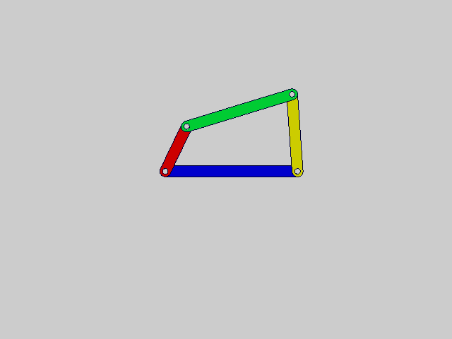

曲柄摇杆机构是一种常见的机械传动机构，它由曲柄、连杆和摇杆组成。
### 原理
通过曲柄的旋转，使连杆和摇杆发生相应的运动，从而实现机械传动。这种机构具有结构简单、传动效率高、运动平稳等优点，因此被广泛应用于各种机械设备中。
### 主要特点
简单可靠、可控性强、负载能力强以及可实现多种运动方式。它能够将旋转运动转换为往复摆动或直线运动，或者将直线运动转化为旋转运动。这种多样性使得曲柄摇杆机构可以应用在多种领域，满足不同的工作需求。
### 应用
1. **汽车发动机**：曲轴就是一种曲柄摇杆机构，它通过连杆和摇杆的运动，将活塞的往复运动转化为旋转运动，从而驱动汽车的轮胎。
2. **雷达天线调整**：曲柄摇杆机构可以推动摇杆上安装的天线实现角度调整。
3. **搅拌机**：曲柄连续转动，连杆做平面运动，伸出部分的搅拌臂做图示的曲线运动，把需要拌匀的物料搅拌均匀。

## 2. 双曲柄机构 Hyperbolic handle mechanism

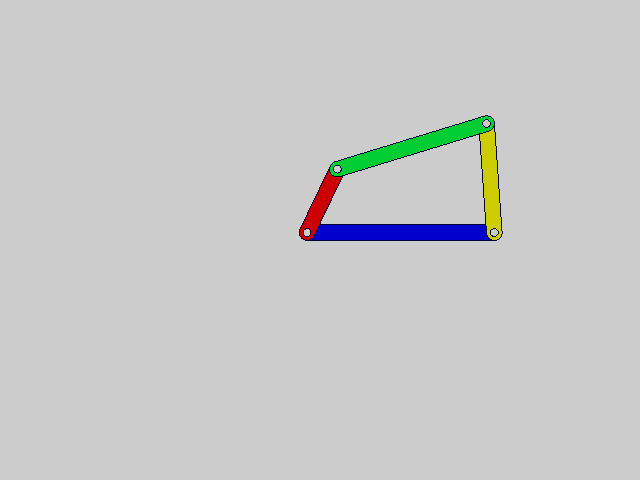

双曲柄机构是一种由两个曲柄和连接它们的连杆组成的机械机构。
### 原理
当一个曲柄旋转时，通过连杆推动另一个曲柄，从而将圆周运动转变为直线运动或直线运动转变为圆周运动。双曲柄机构具有结构简单、可靠性高、转动平稳等优点，因此被广泛应用于工程中。

- 双曲柄机构的类型包括不等长双曲柄机构、平行双曲柄机构和反向双曲柄机构。

- 不等长双曲柄机构具有无死点位置和有急回特性应用实例为惯性筛。

- 平行双曲柄机构具有两个死点位置，无急回特性，应用实例为天平。

- 反向双曲柄机构具有无死点位置和无急回特性，以长边为机架时，双曲柄的回转方向相反；以短边为机架时，双曲柄回转方向相同，两种情况下曲柄角速度均不等，应用实例为汽车门启闭系统。
### 应用
双曲柄机构的应用非常广泛，包括但不限于以下领域：

1. **内燃机**：在内燃机中，双曲柄机构通过曲柄轮和连杆的组合，将活塞的往复运动转化为旋转运动，驱动机械系统的其他部件。
2. **自动化生产线**：在自动化生产线中，双曲柄机构常用于机器人的臂部运动控制，实现机器人臂部在特定路径上的往复运动，从而完成特定的加工或搬运任务。
3. **工程机械**：例如，推土机中的刮刀机构、挖掘机中的铲斗机构等都采用了双曲柄机构，通过双曲柄机构将转动运动转换为直线运动。
4. **机车车轮机构**：在机车车轮机构中，双曲柄机构用于实现车轮的联动。
5. **车门开启机构**：在车门开启机构中，反平行四边形机构被用来实现两扇车门的同步开启和关闭。
6. **自适应力矩传感器**：在自适应力矩传感器中，双曲柄机构可以将力矩的大小和方向转化为连接杆的运动规律，从而实现对力矩的测量和控制。

## 3. 平行四杆机构 Parallel four-bar mechanism

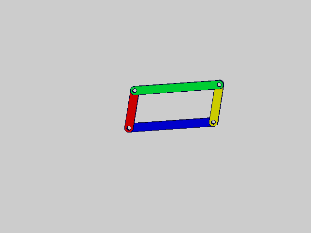

平行四杆机构是一种特殊的四杆机构，其特点是当主动曲柄连续等速转动时，从动曲柄一般做不等速转动。
### 原理
在双曲柄机构中，如果两对边构件长度相等且平行，则成为平行四边形机构。这种机构的传动特点是主动曲柄和从动曲柄均以相同的角速度转动，而连杆做平动。在运动不确定特性中，当主动曲柄转动到与从动曲柄、连杆及机架共线位置时，将出现运动不确定的状态。
### 应用
1. 车轮联动：机车车轮联动机构中，被联动的各车轮具有与主动轮完全相同的运动。
2. 水平机构：平行四边形机构在天平机构中能保证天平始终处于水平位置。

## 4. 连杆上A点的轨迹 Trajectory of point A on the connecting rod

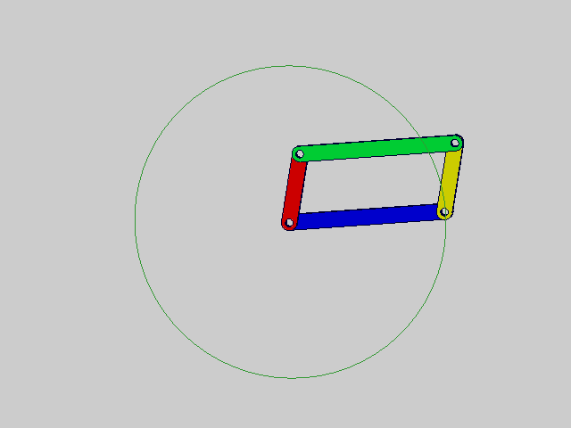

连杆上A点的轨迹是指在机械运动中，连杆上的某一点随着机构的运动而描绘出的路径。
### 原理
通过选定原动件的铰链中心、曲柄和连杆的长度，可以设计出使连杆上某一点实现给定轨迹的机构。连杆上不同点的轨迹不同，让连杆画不同的曲线。可以利用连杆上A点的轨迹来实现特定的运动需求。
### 应用
1. 搅拌
2. 搬运物料
3. 插秧
4. 自动化设备
5. 机器人

## 5. 从动曲柄逆转 Reverse rotation of driven crank

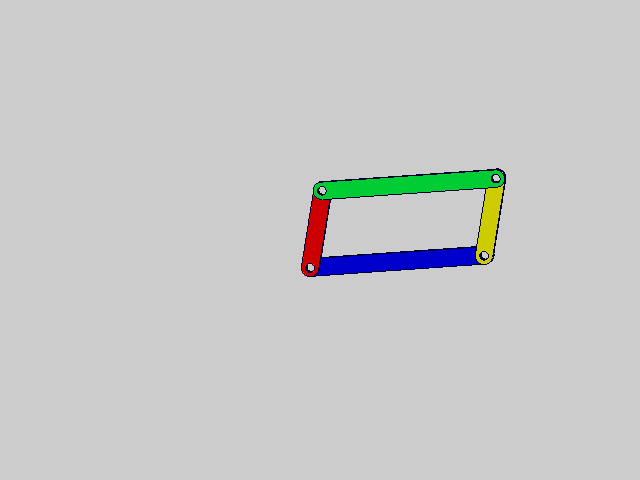

从动曲柄逆转是指在四杆机构中，从动曲柄在运动过程中发生运动方向的改变。
### 原理
当主动曲柄以匀速转动时，从动曲柄会作非匀速转动，且在某些位置下会发生运动方向的改变。从动曲柄逆转可能会影响机构的正常工作，因此在设计时需要特别注意。在反平行四边形机构中，当主动曲柄转至与机架重合时，从动曲柄也与机架重合，这时形成机构运动的不确定状态，即曲柄继续向前转动时，从动曲柄有可能与主动曲柄同向转动，故必须用特殊装置（如死点引出器）或杆件惯性来渡过机构的不稳定状态。
#### 机构的死点位置
在某些机构中，当连杆与从动曲柄共线时，机构的压力角为90°，此时有效驱动力矩为零，机构处于停顿状态。如果此时受到外力干扰，从动曲柄可能会反向转动。
#### 运动特性
在反向双曲柄机构中，两曲柄的回转方向相反，且角速度不等，这种特性可能导致从动曲柄在特定条件下出现逆转。
#### 解决方法
##### 增加虚约束：
通过在机构中增加虚约束（如平行四边形机构中的虚约束杆），可以防止从动曲柄逆转。
##### 利用惯性：
在从动件上安装飞轮，利用其惯性维持从动曲柄的转向不变。
##### 双偏心盘设计：
通过双偏心盘的设计，可以避免从动曲柄逆转。
### 应用
1. 机械手
2. 抓手

## 6. 双偏心驱动导杆机构 Double eccentric drive guide rod mechanism

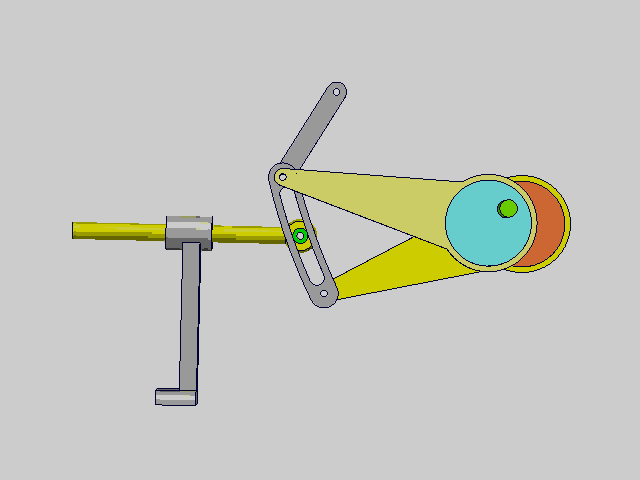

### 原理
通过同轴同步转动的两个偏心盘分别带动两个连杆，这两个连杆又带动一个带有圆弧槽的导杆，从而实现导杆的往复摆动，进而使从动杆做往复直线运动。该机构结构简单、性能优越，适用于需要高频往复直线运动的场合。该机构由于在结构上保持对称，因此理论上导杆和导轨之间不存在压力，能够有效减少摩擦损失，实现高频往复直线运动。
### 应用
1. 机械加工设备：刨床、磨床
2. 自动化生产线：输送带
3. 安全执行机构：机械延时功能

## 7. 三联平行四边形机构 Triple parallelogram mechanism

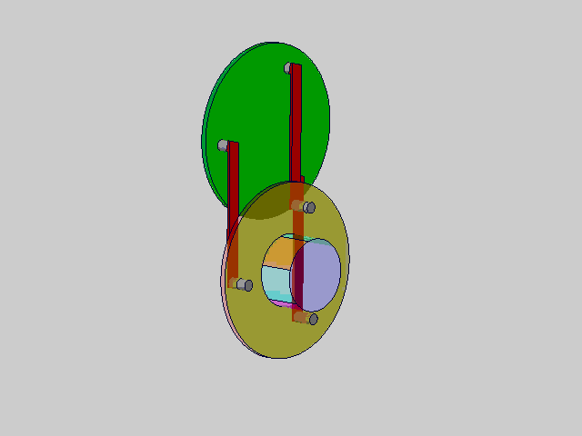

三联平行四边形机构是一种高效的机械传动系统，它由三个平行四边形机构组合而成。
### 原理
每个平行四边形机构本身是一个铰链四杆机构，它们首尾相连，形成一个复杂的传动系统。该机构通常包括多个连杆和铰接点，其中每组平行四边形的边由连杆构成，这些连杆通过铰接点连接，使得整个系统在运动时能保持连杆间的平行状态。 
### 特点
它能实现复杂而精确的运动控制，特别是在需要末端执行器进行精确直线运动或复杂轨迹运动的场合。
### 应用
1. 机器人技术
2. 自动化生产线
3. 精密定位：精确组装、搬运重物

## 8. 双摇杆机构 Dual joystick mechanism

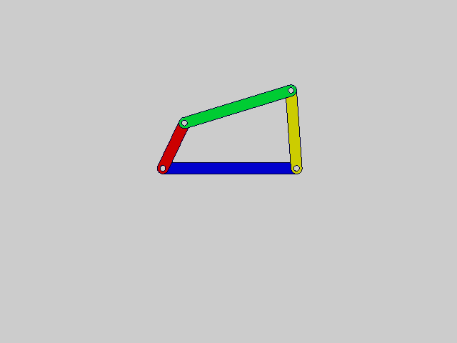

双摇杆机构是一种铰链四杆机构，其中两连架杆均为摇杆，称为双摇杆机构。双摇杆机构主要应用于把摆动变为转动或把转动变为摆动的场景。
### 原理
两摇杆可以分别为主动件。当连杆与摇杆共线时，为机构的两个极限位置。双摇杆机构连杆上的转动副都是周转副，故连杆能相对于两连架杆作整周回转。双摇杆机构的两连架杆都不能作整周转动。三个活动构件均做变速运动，只是用于速度很低的传动机构中。双摇杆机构有1到2个死点位置，无急回特性。
### 应用
1. 手动冲孔机
2. 电风扇摇头
3. 起重机
4. 车辆前轮转向

## 9. 用一对齿轮副驱动双摇杆机构 Drive a dual rocker mechanism with a pair of gear pairs

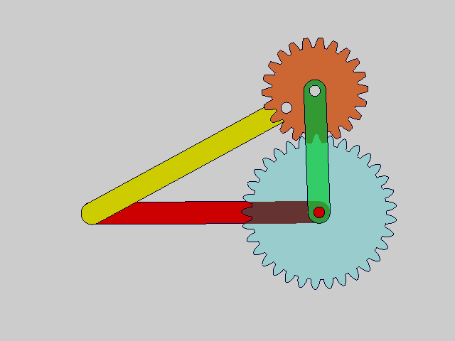

用一对齿轮副驱动双摇杆机构是一种巧妙的机械设计，通过齿轮传动实现双摇杆机构的连续摆动，避免机构卡住现象。在双摇杆机构中，有时可用一个齿轮副解决双摇杆机构不能连续摆动而且卡住的现象，但要求两齿轮的中心距等于其中一个摇杆的长度，即摇杆1的两端安装一对啮合的齿轮。这种设计通过连杆实现齿轮的啮合运动。
### 原理
齿轮副驱动双摇杆机构通过一对啮合齿轮实现运动的传递。其中一个齿轮与摇杆相连，齿轮的旋转带动摇杆摆动，从而实现双摇杆机构的运动。
### 应用
1. 工业机械：用于自动化生产线中的物料搬运
2. 机器人：实现关节的往复运动
3. 汽车传动系统：用于间隙运动的部件

## 10. 曲柄滑块机构 Crank slider mechanism

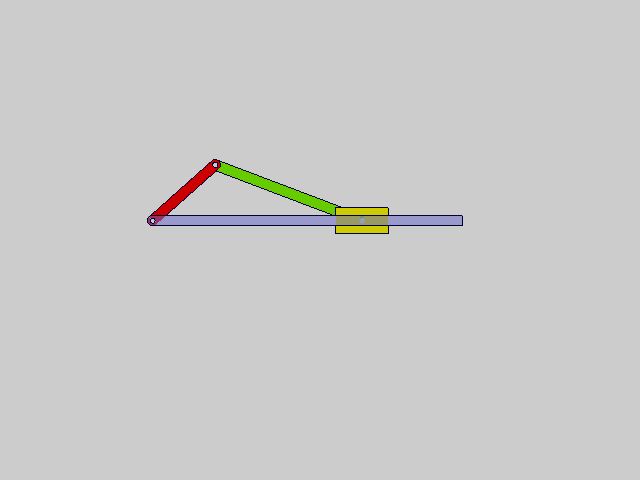

曲柄滑块机构是一种典型的机械传动装置，它主要由曲柄、连杆和滑块三部分组成。曲柄是旋转体，连杆是运动体，滑块则是定位体。
### 原理
当曲柄旋转时，通过连杆的运动将滑块带动进行往复直线运动。具有结构简单、运动平稳等优点
### 应用
1. 工程机械领域：液压缸
2. 纺织机械领域：织布机、缝纫机等

## 11. 转动导杆机构 Rotating guide rod mechanism

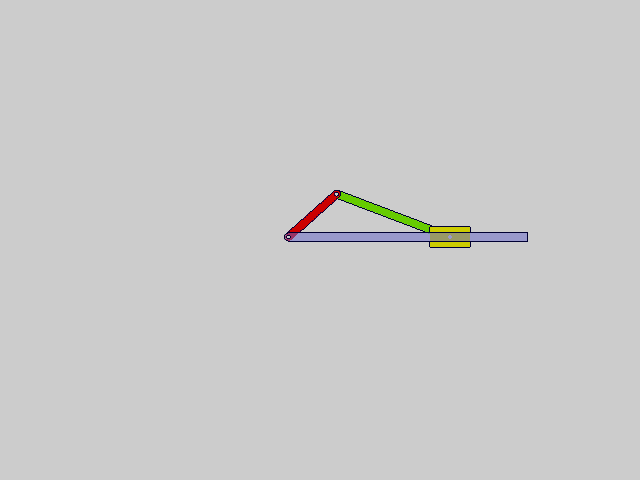

转动导杆机构是一种机械传动装置，它可以通过导杆的转动来实现特定的运动转换。这种机构的应用实例包括转动导杆与摆动导杆串接机构、转动导杆切纸机构、双偏心双平行四边形机构等。转动导杆调速机构可以用于调节速度，实现精确控制。主要用来实现往复运动或转换运动形式。
### 原理
转动导杆机构由曲柄、滑块和导杆组成。曲柄通过转动带动滑块在导杆上作往复直线运动，从而实现运动方向的转换。当曲柄的长度大于机架的长度时，导杆可以作整周运动，这种机构称为转动导杆机构。
### 应用
1. 转动导杆切纸机构

## 12. 导杆主动从动杆变速 Active shift of guide rod and driven rod

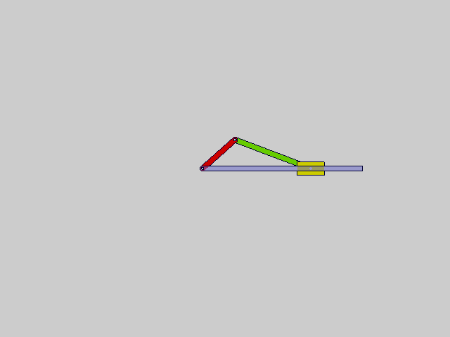

导杆主动从动杆变速机构是一种特殊的机械传动机构。
### 原理
转动导杆为一个从动件，其转动中心与主动齿轮的转动中心通过齿轮副连接，从而实现速度的调节。无论转动导杆是主动还是从动，都可以实现调速功能。这种机构可以应用于需要精确控制速度的场合，通过调整导杆的位置或速度，可以改变从动杆的转速，实现变速效果。
### 应用
1. 机床
2. 自动化设备

## 13. 曲柄摇块机构 Crank rocker mechanism

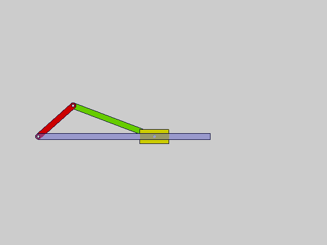

曲柄摇块机构是一种常用的平面连杆机构，由曲柄、摇块和连杆组成。
### 原理
曲柄是主动件，通常为等速转动，摇块为从动件，在曲柄的转动下作往复摆动。该机构可以将曲柄的旋转运动转化为摇块的往复运动，也可以将摇块的摆动转化为曲柄的转动。
### 应用
1. 挖掘机
2. 内燃机

## 14. 移动导杆机构 Mobile guide rod mechanism

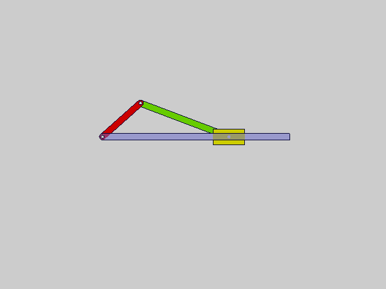

移动导杆机构是平面四杆机构中的一种演化形式，原动件（曲柄）、随从动件（导杆）一起往复移动，具有自驱动运动特性。
### 原理
曲柄移动导杆机构是具有一个曲柄和一个移动导杆的导杆机构。当输入曲柄等速旋转时，输出导杆的位移呈简谐运动规律。其工作原理是通过曲柄的旋转运动转化为导杆的往复摆动，从而实现特定的机械运动和力的传递。
### 应用
1. 刀具往复运动
2. 刨床

## 15. 摆动导杆机构 oscillating guide-bar mechanism

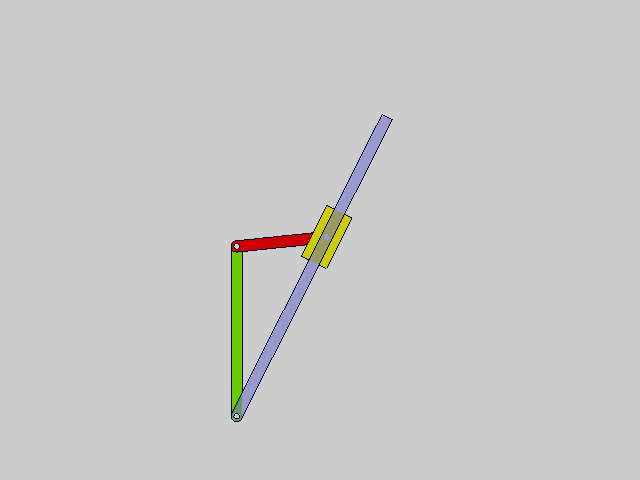

摆动导杆机构是一种常见的机械传动机构，它主要由导杆、曲柄、滑块等部件组成。
### 原理
通过曲柄的旋转运动转化为导杆的往复摆动，从而实现特定的机械运动和力的传递。摆动导杆机构的应用实例包括插床上的应用，其中AB构件绕销轴A作定轴转动，带动滑块B转动并摆动，滑块B在导杆CD上滑动并带动导杆CD绕销轴C作定轴摆动，摆杆CD带动连杆DE做平面运动，连杆DE带动滑块E和刀架及插刀做往复运动，从而实现插削加工。
### 应用
1. 车门开合设计
2. 轮椅运动控制

## 16. 双滑块机构 double-slider mechanism

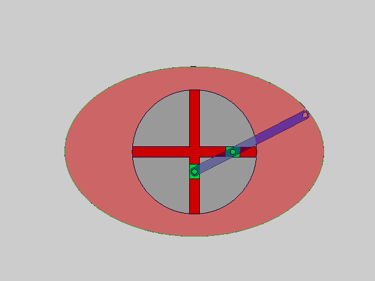

双滑块机构是一种具有两个滑块的平面四杆机构，它在机械工程领域中应用广泛。双滑块机构可以演化为具有两个移动副的四杆机构，称为双滑块机构。
### 原理
通过曲柄的旋转运动转化为滑块的往复直线运动，从而实现特定的机械运动和力的传递。双滑块机构的特点是结构简单、易于制造和维护，运动平稳，抗震性能好，传动轴的距离短，能节省空间并增加机器的稳定性，可靠性强，使用寿命较长，运动轨迹可调，能满足不同的生产要求。这种机构在应用中可以连接中心线不重合的两根轴。
### 应用
1. 滑块联轴器
2. 椭圆仪

## 17. 转动导杆与摆动导杆串接机构 Rotating guide rod and swinging guide rod series connection mechanism

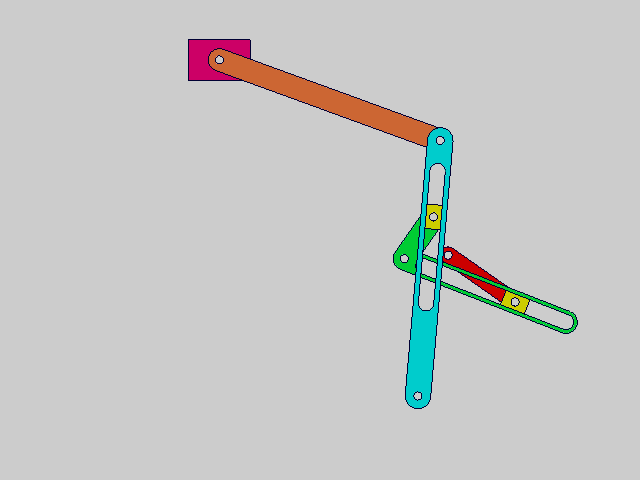

转动导杆与摆动导杆串接机构是一种机械传动机构，它通过将转动导杆的旋转运动与摆动导杆的往复摆动运动相结合，实现复杂的运动转换。
### 原理
转动导杆部分通过曲柄实现导杆的旋转运动，摆动导杆部分通过滑块或连杆与转动导杆相连，实现导杆的往复摆动，转动导杆的输出端与摆动导杆的输入端相连，通过中间的连杆或滑块传递运动。转动导杆将旋转运动传递给摆动导杆，摆动导杆则实现往复摆动运动，最终输出所需的复杂运动形式。
### 应用
1. 刨床
2. 间歇输送

## 18. 双导杆间歇机构 Dual guide intermittent mechanism

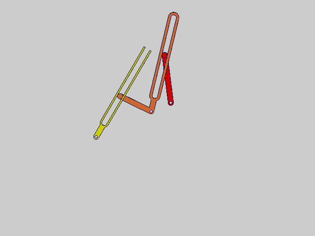

导杆上设置一段圆弧槽，当主动件的滚子在圆弧槽内运动时，导杆保持静止；当滚子离开圆弧槽后，导杆开始运动，从而实现间歇运动。
### 原理
由两个导杆组成，其中一个导杆作为主动件，通过特定的传动方式驱动另一个导杆实现间歇运动。其核心在于利用导杆上的特定轨迹或外部约束来控制运动和停歇。双导杆间歇机构是一种特殊的间歇运动机构，它通过两个导杆的串接来实现间歇运动。这种机构的特点是可以实现较长时间停歇，适用于需要周期性停止的场合。
### 应用
1. 物料的推送
2. 印染烘干机

## 19. 曲柄摇杆导杆-正弦机构 Crank rocker guide rod - sine mechanism

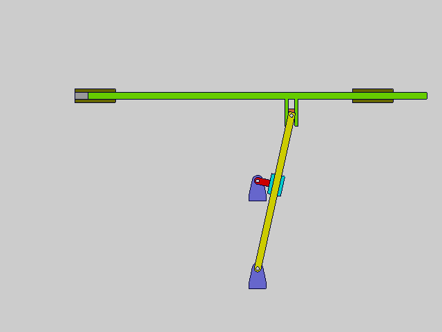

曲柄摇杆导杆-正弦机构是一种特殊的机械机构，它将曲柄的旋转运动通过摇杆和导杆传递，最终实现导杆的正弦运动。
### 原理
曲柄作为主动件，通常以匀速旋转。连杆连接曲柄和导杆，传递运动。导杆作为从动件，实现往复运动，其速度按正弦规律变化。当曲柄以匀速转动时，通过连杆的传递，导杆的往复运动速度会呈现出正弦规律变化。
### 应用
1. 水泵
2. 缝纫机

## 20. 曲柄摇块滑块三级机构 Crank rocker block slider three-level mechanism

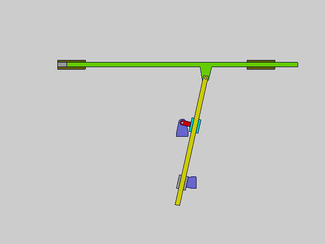

曲柄摇块滑块三级机构是一种复杂的平面四杆机构，它结合了曲柄、摇块和滑块机构的特点，以实现特定的运动转换。
### 原理
1. **曲柄的旋转**：机构中的曲柄通常固定在一个机架上，并绕着一个固定轴旋转。这个旋转运动是主动运动，用于驱动整个机构。
2. **摇块的摆动**：曲柄的一端连接到一个摇块上。当曲柄旋转时，它推动摇块绕着其自身的固定轴摆动。这个摆动运动是中间运动，它将曲柄的旋转运动转换为摇块的往复摆动。
3. **滑块的直线运动**：摇块的另一端连接到一个滑块上，滑块在一个固定的导轨上滑动。当摇块摆动时，它推动滑块沿着导轨做直线往复运动。这个直线运动是最终输出运动，可以用于执行特定的机械任务。
4. **三级机构的组合**：在三级机构中，可能存在多个这样的曲柄-摇块-滑块组合，或者这些基本单元与其他类型的机构（如齿轮、凸轮等）组合，以实现更复杂的运动控制和转换。

在实际应用中，曲柄摇块滑块三级机构的设计和分析需要考虑多个因素，包括各个构件的长度、质量、运动速度和加速度等，以确保机构能够平稳、准确地运行，并满足特定的工程要求。
### 应用
1. **压力机**：在压力机中，曲柄摇块机构可以将电动机的旋转运动转换为滑块的直线运动，用于冲压工件。
2. **内燃机**：在内燃机中，曲柄滑块机构将活塞的往复运动转换为曲轴的旋转运动，从而驱动车辆。
3. **机械臂**：在某些类型的机械臂中，曲柄摇块机构可以用于控制机械臂的某些关节，实现精确的位置控制。

## 21. 曲柄摇杆滑块三级机构 Crank rocker slider three-level mechanism

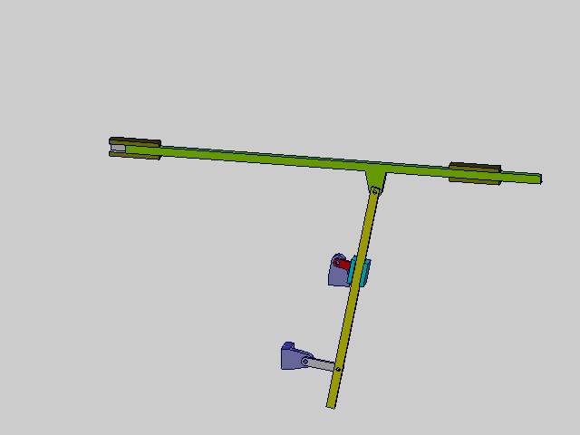

曲柄摇杆滑块三级机构是一种较为复杂的机械传动机构，它结合了曲柄、摇杆和滑块三种基本构件，通过这些构件的相互运动来实现特定的运动转换。这种机构通常由三个基本的四杆机构串联组成，每个四杆机构都包含一个曲柄、一个摇杆和一个滑块。
### 原理
1. **输入运动**：通常一个曲柄（主动件）绕着固定轴旋转，这个曲柄与第一个四杆机构的摇杆相连。
2. **运动传递**：曲柄的旋转运动通过第一个四杆机构传递给第一个滑块，使滑块产生直线运动。这个滑块又与第二个四杆机构的摇杆相连。
3. **中间运动**：第一个滑块的直线运动转换为第二个四杆机构的摇杆摆动，这个摇杆再驱动第二个滑块进行直线运动。
4. **输出运动**：第二个滑块的直线运动通过第三个四杆机构传递给第三个摇杆，最终实现所需的输出运动。
5. **三级串联**：通过三个四杆机构的串联，可以实现复杂的运动转换，如将旋转运动转换为特定的直线运动，或者将直线运动转换为旋转运动。
### 应用
1. 自动化生产线上的物料搬运
2. 精密机械加工
3. 机器人技术

## 22. 摆动导杆与双滑块机构 Swing guide rod and double slider mechanism

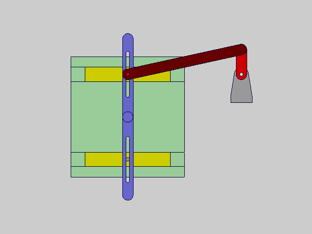

摆动导杆机构是一种常见的机械传动机构，它主要由导杆、曲柄、双滑块等部件组成。
### 原理
通过曲柄的旋转运动转化为导杆的往复摆动，从而实现双滑块的往复直线运动。而转动导杆与摆动导杆串接机构的特点在于通过转动导杆的旋转运动实现对摆动导杆的驱动。
### 应用
1. 泵
2. 自动生产线

## 23. 曲柄滑块与转动导杆串接机构 Crank slider and rotating guide rod series connection mechanism

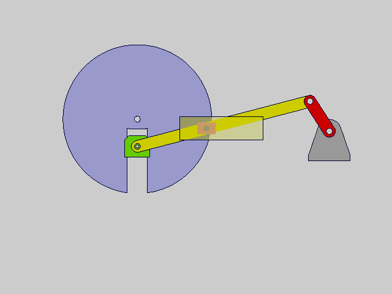

通过曲柄的旋转运动实现对摆动导杆的驱动。可以实现较长时间停歇，适用于需要周期性停止的场合。
### 原理
曲柄作为主动件，通过连杆带动滑块沿直线导轨作往复运动。滑块与转动导杆相连，将滑块的直线运动转换为导杆的旋转运动。曲柄绕固定轴旋转，通过连杆带动滑块沿导轨作往复直线运动。滑块通过连接件传递到转动导杆，使导杆绕固定轴旋转。该机构可以将旋转运动转换为直线运动，再将直线运动转换为旋转运动，实现复杂的运动形式。
### 应用
1. 内燃机
2. 压缩机
3. 泵

## 24. 输出摆杆有停歇的铰链连杆机构 The output swing rod has a resting hinge linkage mechanism

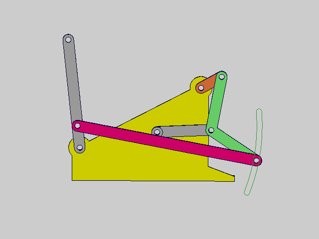

### 原理
基于四杆机构，其中包括曲柄、连杆、摇杆等组件。当曲柄绕机架上某一点转动时，带动连杆做平面运动，连杆与摇杆在某点铰接。通过精确设计这些组件，可以实现特定的运动规律和运动轨迹。这种机构的特点是可以实现较长时间停歇，适用于需要周期性停止的场合。
### 应用
1. 铡刀

## 25. 双曲柄与转动导杆串接机构 Double crank and rotating guide rod series connection mechanism

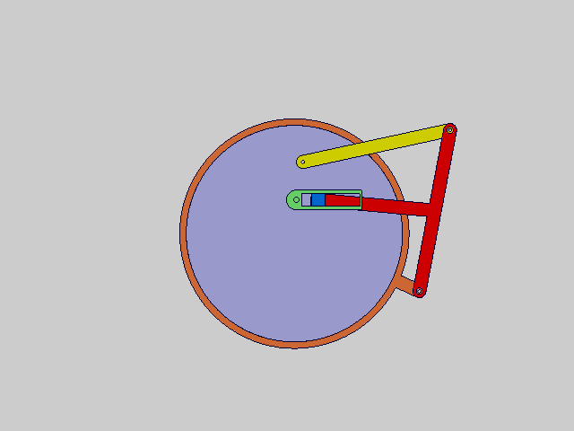

这种机构通过巧妙地组合双曲柄和转动导杆，为机械传动领域带来了新的可能性，被广泛应用于模具加工设备中。它能够将转动运动转化为模具的直线运动，实现精确的切削、冲压等操作，提高模具加工的精度和效率。
### 原理
双曲柄机构包含两个曲柄，通过连杆连接。根据曲柄的长度和运动方向，双曲柄机构可以分为不等长双曲柄机构、平行双曲柄机构和反向双曲柄机构。转动导杆通过连杆与双曲柄机构相连，将曲柄的旋转运动转换为导杆的旋转运动。当主动曲柄以匀速转动时，通过连杆带动从动曲柄运动。根据曲柄的长度和运动方向，从动曲柄的运动特性会有不同。从动曲柄通过连杆带动转动导杆绕固定轴旋转。
当双曲柄进行旋转运动时，转动导杆沿着双曲柄的曲线轨迹做往复直线运动。这是因为双曲柄的曲线轨迹能够将旋转运动转换为直线运动，从而实现复杂运动的精准控制。
### 应用
1. 机械手关节
2. 物料输送

## 26. 摆杆极限位置可调节的铰链六杆机构 Adjustable hinge six bar mechanism with swing rod limit position

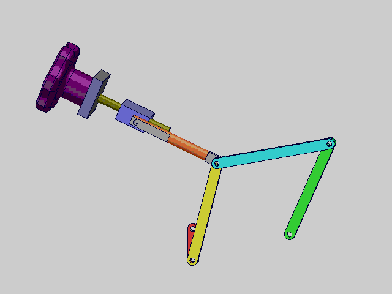

摆杆极限位置可调节的铰链六杆机构的显著特点是其可调节性。通过调整铰链的位置或更换不同长度的杆件，可以改变摆杆的运动范围和极限位置。这种机构的可调节性使其在多种应用中具有灵活性和适应性，能够满足不同的工程需求。
### 原理
摆杆极限位置可调节的铰链六杆机构是一种在机械设计中应用广泛的机构，它通过调节构件之间的相对位置来改变摆杆的极限位置，从而实现不同的运动要求。这种机构的可调节性使其在多种应用中具有灵活性和适应性，能够满足不同的工程需求。六杆机构在机械工业中广泛应用于各种类型的传动装置和运动装置。例如，它可以用于实现复杂的导向和定位运动，在简单的单节双履带移动式机器人基础上，提出一种基于铰链六杆机构具有自适应变形能力的履带式移动机器人。自适应变形机构通过改变机器人前导轮的角度和高度来提高机器人的越障能力。
### 应用
1. 机器人

## 27. 输入输出均为转动导杆机构 Both input and output are rotating guide rod mechanisms

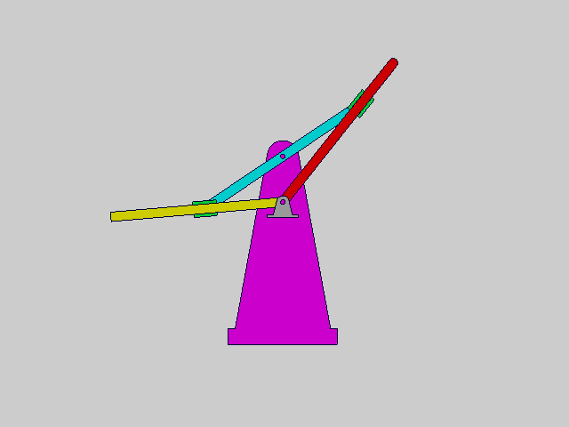

### 原理
曲柄输入转动，导杆做平面运动，致使摇块摆动；而导杆上的齿条又使齿轮实现往复摆动的输出。该机构可以实现较大的摆动角。但齿条与导杆之间。这种机构通过曲柄的旋转运动实现对摆动导杆的驱动，适用于需要周期性停止的场合。
### 应用
1. 风扇摇头
2. 切纸

## 28. 直线运动机构 Linear motion mechanism

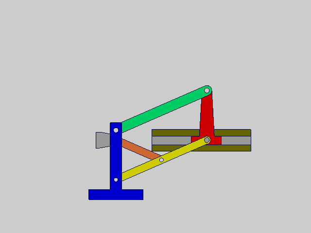

直线运动机构是将输入的动力或运动转换为直线（往复）运动的机械装置。这类机构在工业自动化、机器人技术、运输系统以及各种机械设备中非常常见。
### 原理
1. **杠杆原理**：通过杠杆臂的旋转来放大或缩小力，实现直线运动。
2. **螺旋原理**（螺纹驱动）：螺纹和螺杆的相互作用可以将旋转运动转换为直线运动，或者反过来，将直线运动转换为旋转运动。
3. **连杆机构**：通过连接不同长度的杆件，将一个杆件的旋转运动转换为另一个杆件的直线往复运
### 应用
1. 气缸或液压缸
2. 水泵

直线运动机构的设计和应用需要考虑运动的精度、速度、力量、行程长度、负载能力以及环境因素等。在实际应用中，这些机构可以单独使用，也可以组合使用，以满足特定的工程需求。

## 29. 可实现单侧停歇的摆动导杆机构 Swing guide rod mechanism that can achieve unilateral stopping

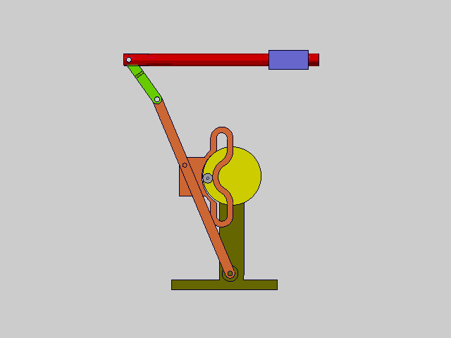

### 原理
通过设计导杆上的导槽，当主动曲柄在一定范围内运动时，滚子位于特定段圆弧槽内，导杆停歇，从而实现从动杆具有单侧停歇的间歇运动特性。结构紧凑、制造简单、运动性能较好。如果导槽曲线由两段相对的圆弧构成，则可获得双侧停歇的间歇运动。
### 应用
1. 食品加工机械中作为物料的推送机构

## 30. 从动件在极限位置有较长时间停歇 The driven component stops for a long time at the extreme position

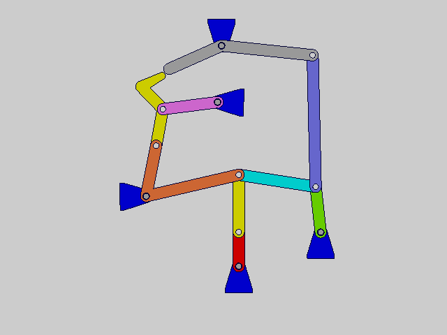

从动件在极限位置有较长时间停歇的机构。
### 原理
通过曲柄摇杆机构，使连杆上的某一点的运动轨迹包含圆弧段。当该点运动到圆弧段时，从动件可以实现短暂停歇。在主动的曲柄摇杆机构基础上，增加辅助连杆，使从动件在特定位置实现停歇。
### 应用
1. 输送线上的物件准确地推送到指定位置
2. 折叠机
3. 夹手

## 31. 输出构件作间歇运动 Intermittent motion of output components

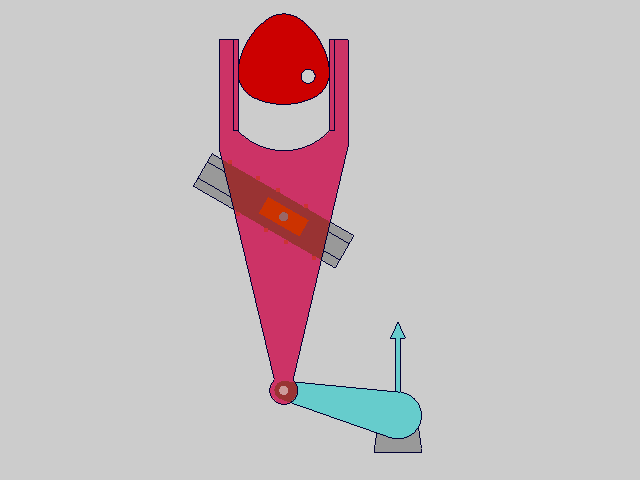

### 原理
通过单一基本四杆机构难以实现从动件的停歇，需要通过特定的机构设计来达到这一目的。一个转动的等宽凸轮可以实现从动摆杆的停歇摆动。从动件与凸轮轮廓接触，并传递动力和实现预定的运动规律，一般进行往复直线运动或摆动。
### 应用
1. 纺织机

## 32. 齿轮正弦机构 Gear sine mechanism

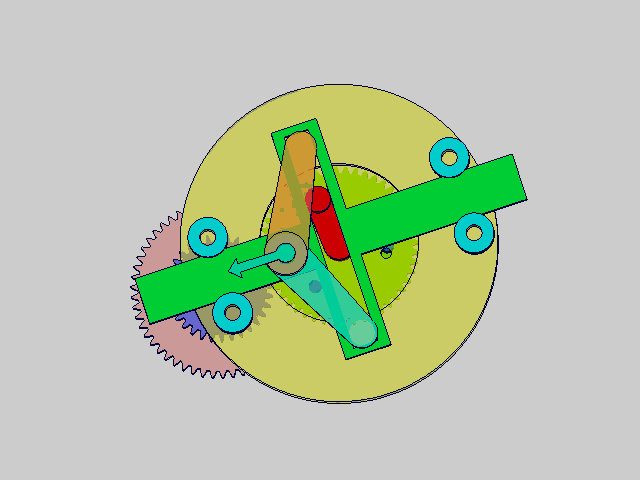

### 原理
利用正弦曲线的特性，将旋转运动转化为直线运动或者将直线运动转化为旋转运动。正弦曲线是一种周期性的曲线，它的特点是在一个周期内，曲线的起点和终点处的斜率相等，且曲线在周期的中点处达到最大值。这种特性使得正弦曲线在机械传动中具有很好的应用价值。具体来说，以齿轮式正弦机构为例，当输入轴旋转时，驱动齿轮的齿数和被驱动齿轮的齿数不同，因此被驱动齿轮的转速会与输入轴的转速不同。被驱动齿轮的轴心上装有一个滑块，滑块的运动轨迹是一条正弦曲线。
### 应用
1. 汽车
2. 飞机
3. 机床

## 33. 正反转销驱动摆杆机构 Positive and negative rotation driven swing rod mechanism

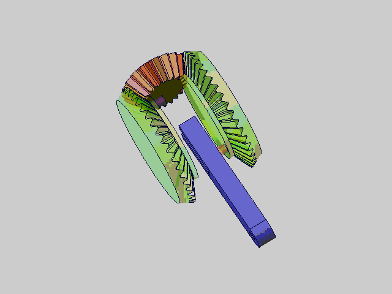

### 原理
一种通过正反旋转的销轴来驱动摆杆进行往复摆动的机械装置，常用于需要周期性或间歇性运动的机械设备中。正反转销驱动摆杆机构的工作原理主要基于曲柄摆杆机构的设计。在这种机构中，红色齿轮自由旋转带动绿色齿轮分别正反向旋转，绿色齿轮驱动摆杆左右摆动。
### 应用
1. 摆动式油泵

## 34. 翻转机构 Flip mechanism

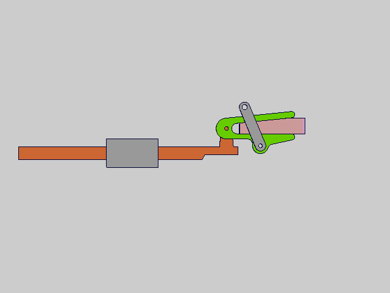

翻转机构的工作原理是通过传动系统驱动运动机构，改变物体的位置或方向，并通过控制系统控制和监控机构的运动。通过这种方式，翻转机构可以实现物体在一个方向上的旋转或倾斜到另一个方向。
### 原理
通过传动系统驱动运动机构，改变物体的位置或方向，并通过控制系统控制和监控机构的运动。具体来说，翻转机构通常由传动系统驱动，传动系统通过控制电机等能源，将能量转化为物体位置或方向的改变。翻转机构通常包括一个或多个运动机构，如齿轮、连杆、曲柄、链条等。这些运动机构将传动的力转变为物体的旋转或倾斜运动。此外，翻转机构通常需要一个稳固的支撑结构来支撑物体的重量，并提供稳定的运动平台。这通常由强度高、刚度好的金属或合金构成。翻转机构通常需要一个控制系统来控制运动的速度、方向和停止。控制系统可以通过传感器、编码器等设备来检测和监控机构的位置和运动状态，并根据需要进行调整和控制。
### 应用
1. 零件装配
2. 焊接
3. 包装

## 35. 凸轮与转动导杆组合机构 Combination mechanism of cam and rotating guide rod

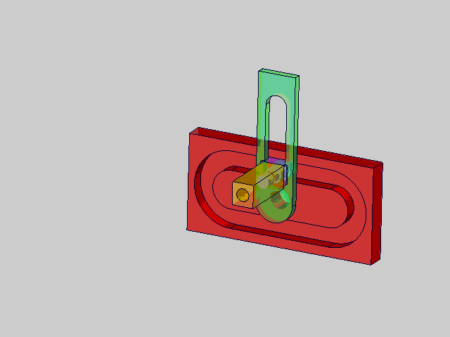

### 原理
利用凸轮的旋转来驱动转动导杆，实现特定的运动规律或运动轨迹。这种机构的设计和应用可以满足不同的工程需求，如实现向左转动旋转或直线移动等。
### 应用
1. 机械手
2. 印刷机

## 视频讲解
**BiliBili：** [视睿网络-哔哩哔哩视频 (bilibili.com)](https://space.bilibili.com/1985904092/lists/1497284)

<iframe
  width=auto
  height=auto
  src="//player.bilibili.com/player.html?isOutside=true&aid=230442258&bvid=BV19h411w7rf&cid=1183170164&p=1" 
  scrolling="no" 
  border="0" 
  frameborder="no" 
  framespacing="0" 
  allowfullscreen="true"></iframe>